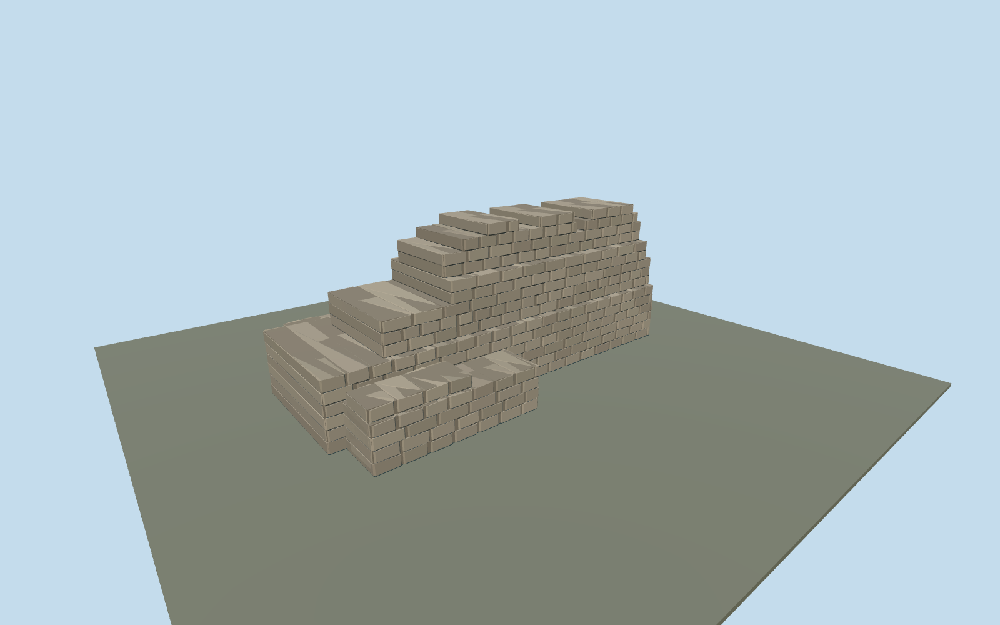

# Temple of Jupiter Optimus Maximus

Exposed eastern tufa foundation and stepped podium masonry of the Temple of Jupiter Optimus Maximus in the Capitoline Museums.

## Evidence and reconstruction

Published dimensions and reconstructed details are separated in spec.json. Primary references:

- [Reference](https://commons.wikimedia.org/wiki/File:Temple_Jupiter_Optimus_Maximus.JPG)
- [Reference](https://commons.wikimedia.org/wiki/File:Temple_of_Jupiter_Optimus_Maximus.jpg)
- [Reference](https://commons.wikimedia.org/wiki/File:Ruins_of_the_Temple_of_Jupiter_(Capitoline_Hill)_-_2024-10-27_(2).jpg)

Two registered recipes rebuild the exposed tufa masonry with a shared raw stone graph, metric UVs and linear stone tones.

## Model and axes

9,824 triangles; 29,472 vertices; 1 material groups; 1,180,432 bytes. Native bounds: -10.214, 0.000, -7.450 to 10.220, 7.936, 5.200. Source hash: `sha256:87f694b83abcd1eb441e2debe3173847920b18ab41e02b9cff1420098289e168`.

{"x":"northwest along the exposed eastern foundation","y":"up","z":"east-northeast into the visitor gallery"}

The visitor plan registers the exposed foundation in rooms 17 and 18 adjoining the Esedra. The separate Palazzo dei Conservatori model supplies the modern gallery and uses the same vertical terrain reference. Floor elevations remain approximate. Map data © OpenStreetMap contributors, ODbL-1.0.

## Reproduce

Run `node packages/worldgen/scripts/generate-additional-landmarks.mjs --ids=temple_of_jupiter_optimus_maximus` (or add `--check`). The generator preserves manually edited masters by checking their baseline hashes. Import through the standard authored-model workflow with optimization disabled; then capture all QA cameras, including shared-surface views.

## Pending work

- Exposed eastern tufa foundation and stepped podium masonry of the Temple of Jupiter Optimus Maximus in the Capitoline Museums.
- The museum first-floor visitor drawing places rooms 17 and 18 beside the curved Esedra. Four mapped courtyard corners align the drawing, and the curved hall independently checks the registration. The visible eastern foundation trace determines the length and axis. The geotagged 2024 photograph falls on the modeled face side.
- The approximately 20 m exposed run derives from the registered public plan. Block dimensions, the stepped crest and the upper preserved courses are interpreted from the museum photographs.
- The retained museum datum establishes a common vertical reference for the authored visitor room and tufa foundation. The display floor is reconstructed from public views and the standard terrain. Relative grades share the present-day museum heightfield.
- The visitor plan constrains the orientation. The display floor, wall heights and the visible ancient masonry are approximate reconstructions.

This bundle follows the medium-fi standard. Medium-fi appearance and geographic fit are reviewed separately. Hash-bound visual acceptance is recorded separately after capture inspection.

## Additional geographic data

©OpenStreetMap contributors; Protomaps; Mapzen/USGS terrain.
