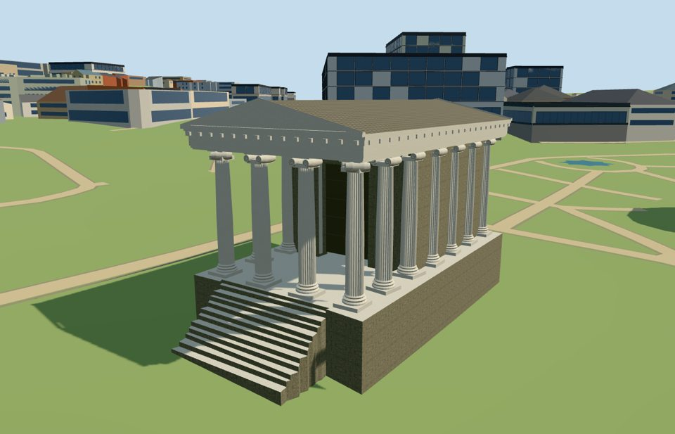

# temple_of_portunus — Temple of Portunus

Reviewed2026-10-19. Accepted for the specific medium-fi complete exterior and approximate PMTiles/DEM fit.

## Exterior and shared materials

Inspected all11 portable views. The complete Temple of Portunus exterior includes the high podium and mapped stairs, six free-standing Ionic portico columns, twelve engaged side/rear columns, roofed pronaos, recessed closed door, layered entablature, both triangular pediments and shallow tiled gable roof. Near geometry adds shaft fluting, tiered bases, paired volutes and original spiral relief strips. Initial renders prompted removing stair-side clipping scraps, lowering the conservative stair datum about0.546m, projecting the scroll faces beyond the neck block and moving the detail view below the cornice. Fine carving and exact wall repairs remain medium-fi estimates.

Inspected all11 shared-material views. Four reused256-square graphs provide continuous raw limestone for modeled stones/columns, weathered limestone for walls, ceramic roof tile and cast bronze for the closed entrance. Metric UVs and linear tints; four near draws and one skyline draw. Each graph is read once and eviction releases geometry. No embedded images, unique atlas or copied photograph. Spiral contrast reuses the wall stone graph as a coarse carved-groove approximation. Weathered stone, roof and door colors are approximate. Flat-stage material views expose some buried retaining depth; actual contact was inspected on the original standard DEM separately.

## Browser levels

| Level | Triangles | Bytes | Draws |
| --- | ---: | ---: | ---: |
| skyline | 796 | 83932 | 1 |
| district | 2848 | 275904 | 4 |
| street | 15076 | 1554056 | 4 |
| closeup | 26740 | 2717184 | 4 |

Inspected all27 medium-fi views: street/block/skyline at noon and late afternoon in Economy/High, an untextured silhouette, six detail/site views, every whole-temple detail level and transitions. Levels796/2848/15076/26740 triangles retain all18 column positions, roofed portico, complete cella, closed entrance, front stairs and both pediments. Skyline keeps coarse column/capital masses; district adds profiles and Ionic lobes; street adds fluting, visible volutes/spiral relief and selected dentils; closeup uses finer flutes and scroll profiles. Initial skyline plus district geometry totals359836 bytes, plus four shared graphs. Separate attribute streams avoid duplicate GPU uploads. Physical-device and dense-city measurements remain pending.

## Geographic fit

Reviewed approximate full-site fit on the unchanged161-square/6m standard DEM. Twenty-two mapped temple components retain241 original control vertices, including18 shaft positions, cella wall, podium, eleven stair parts and roof/entablature bands. The mapped stair projection and two ordinary photographs establish the north-northwest front; geometry retains raw east/south coordinates at heading0, with a162.695-degree internal architectural rotation. Six columns are free-standing and twelve engaged. The lower datum is the least offset that keeps every mapped stair above its original terrain by0.2m; this lowers the initial conservative draft by about0.546m. For all12 occupied floors,76 intersecting original terrain triangles were clipped to the floor footprints and290 resulting corners evaluated; minimum clearance is0.200000017m. Retaining sides extend below coarse grade. Tiny upper-floor clipping scraps under0.1m² were removed to eliminate false stair-side spikes; all original controls remain unchanged. No ground/water cutout. Full loading replaces22 authored records and preserves1356 independent tile buildings exactly; all2491 independent buildings in the retained extract stay outside the replacement envelope. Source retains63 nearby records, including the22 controls. Twelve native water records retain203489.55596715916 square metres. Failed loads preserve all1378 native tile buildings; eviction frees all model geometry. Synthetic10m residency clips the portico/stairs, rear cella and pediments, exposing floor/roof edges while keeping original ground under and around the partial architecture. Full completeness requires surrounding tiles; exposed partial floors are not approved as a complete temple. Independent neighboring monuments retain native procedural shells in this single-landmark fixture; their historical appearance is not approved. Ionic carving, fluting, door, exact stucco loss, roof pitch and thresholds remain medium-fi estimates.

## Scope and limitations

Accepted for the specific medium-fi Temple of Portunus exterior and approximate standard-map/DEM fit. Twenty-two mapped parts preserve241 original source-control vertices, including all18 shaft positions, eleven stair parts, podium, cella and roof/entablature bands. Six columns are free-standing and twelve engaged; circular shafts and moldings are reconstructed around the mapped centers rather than presented as surveyed stonework. The mapped stair projection and front/rear pictures establish the north-northwest front. Geometry uses raw east/south coordinates at heading0 with a162.695-degree internal rotation. Approximate map heights supply the3m podium,3.2–10m shaft interval,10m cella and11.5–12.9m roof envelope above the declared lower datum. Ionic volutes, spiral contrast, flute counts, dentils, door, roof pitch and current stucco loss are stylized estimates. The rear picture dates from2004 and does not prove exact current repair patterns. No navigable interior, fresco reconstruction or neighboring monument is claimed. The lower datum seats the stairs against terrain directly beneath them:76 intersecting rendered triangles are clipped to the12 occupied floors, with290 corner-height checks and at least0.200000017m clearance. Original terrain/water stay intact. Synthetic10m residency clips the portico/stairs, rear cella and roof, exposing floor edges and unsupported-looking partial slices; complete appearance requires surrounding tiles. Independent monuments use native procedural shells in this single-landmark fixture, and their historical appearance is not approved. Only ordinary pictures and the standard PMTiles/DEM were used.

## Source and checks

Two registered recipes and retained source inputs rebuild the master and four browser levels. Master:26,740 triangles /3,211,780 bytes. Six Khronos checks have zero errors or warnings. All198 geometry probes,241 source-control vertices,868 floor samples and290 clipped terrain-corner checks pass. Inspected49 official and24 site/failure/partial views. Bulk captures stay local.

The960m integration tile has1,378 map buildings. Loading replaces22 authored parts and preserves1,356 independent records exactly. All2,491 independent buildings in the full retained extract remain outside the replacement envelope; source retains63 nearby records, including the22 controls. Twelve native water records retain203,489.55596715916 square metres. The original161-square/6m DEM is unchanged. Failed loads preserve all1,378 buildings; eviction frees geometry. A10m partial tile preserves ground while exposing clipped architecture.

Selected source/import/LOD/placement checks, strict medium-fi, verified hashes, scene validation and sim30 pass. Both model recipes were registered before final review binding. The next full source rebuild and asset-lock refresh belong to a meaningful batch milestone. No dependency audit, Git mutation or upload was performed.

Rebuild: node packages/worldgen/scripts/generate-additional-landmarks.mjs --ids=temple_of_portunus; node packages/worldgen/scripts/import-structure-models.mjs --ids=temple_of_portunus; node packages/tooling/scripts/generate-landmark-lods.mjs --ids=temple_of_portunus.

Source: sha256:7a35c69efa2b8b17483fed4c9bbdc5a2bf13b732500ad54f9111c06250dcabb3

Runtime: sha256:a961c6b86407567623c4d1735391b94be470eb3193e3e23023c23f29e0e0e13f

Input: sha256:20210934eda726b84371ddf89a4d0d8bb24bc34342b8f4b490b92afaf6edbeb4

## Ordinary pictures

https://commons.wikimedia.org/wiki/File:L06_709e_Tempel_des_Portunus.jpg — Falk2; CC BY-SA4.0; viewed only. 2025-10-20 No pixels shipped.

https://commons.wikimedia.org/wiki/File:Rome.Temple_of_Portunus.backside.JPG — Rickard Lamré; imported by Longbow4u; Public domain; viewed only. 2004-06-11 No pixels shipped.
