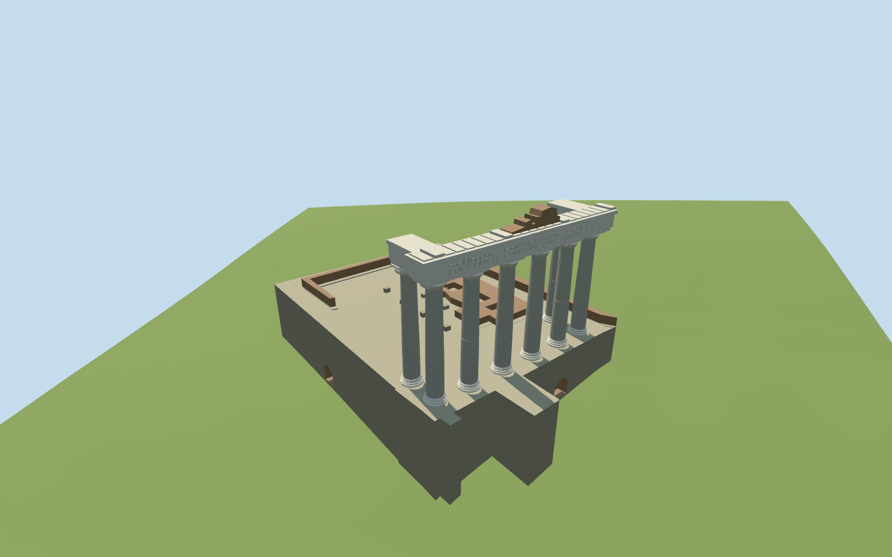

# Temple of Saturn

Present-day Temple of Saturn ruin in the Roman Forum: eight mapped smooth granite columns, six across the northeast front and two short returns, Ionic capitals, surviving U-shaped entablature with inscribed front frieze, broken upper pediment core, occupied stone/concrete podium and specifically mapped low masonry. The missing roof, cella and remainder of the original temple are not reconstructed; independent Forum monuments remain native.

## Evidence and reconstruction

Published dimensions and reconstructed details are separated in spec.json. Primary references:

- [Reference](https://commons.wikimedia.org/wiki/File:Foro_romano_tempio_Saturno_09feb08_01.jpg)
- [Reference](https://commons.wikimedia.org/wiki/File:Foro_romano_tempio_Saturno_09feb08_03.jpg)
- [Reference](https://commons.wikimedia.org/wiki/File:Front_Saturntempel.jpg)

Two registered recipes rebuild the present-day ruin and four budgeted levels. Five shared256-square material graphs supply granite, marble, weathered limestone, long-format brick and gravel with metric UVs and linear tints. No embedded images or unique atlas.

## Model and axes

10,869 triangles; 32,607 vertices; 5 material groups; 1,307,716 bytes. Native bounds: -22.205, -6.367, -19.067 to 19.307, 20.763, 23.590. Source hash: `sha256:5af767fdd7608389fb59fd913656e1a4c791f1b65c12103f7c56f3a040d91aaf`.

{"x":"east","y":"up","z":"south"}

The geographic proposal uses exact-QID OpenStreetMap evidence. Map-derived orientation and estimated architectural details require real-site visual review; preview eligibility is distinct from geographic/fidelity approval. Map attribution: © OpenStreetMap contributors, ODbL-1.0.

## Reproduce

Run `node packages/worldgen/scripts/generate-additional-landmarks.mjs --ids=temple_of_saturn` (or add `--check`). The generator preserves manually edited masters by checking their baseline hashes. Import through the standard authored-model workflow with optimization disabled; then capture all QA cameras, including shared-surface views.

## Pending work

- Present-day Temple of Saturn ruin in the Roman Forum: eight mapped smooth granite columns, six across the northeast front and two short returns, Ionic capitals, surviving U-shaped entablature with inscribed front frieze, broken upper pediment core, occupied stone/concrete podium and specifically mapped low masonry. The missing roof, cella and remainder of the original temple are not reconstructed; independent Forum monuments remain native.
- Q746721/relation1849835 identifies this ruin. The current standard map provides eight individual column centres and five podium/fragment footprints inside the temple outline. Six columns form the northeast front; one return stands behind each end. Ordinary front and reverse photographs establish the inscription faces northeast, resolving the unsigned old rectangle axis. Raw east/south control vertices remain unchanged.
- Map footprints control the approximately27×39m surviving podium envelope and nineteen-metre front column span. Ordinary photographs guide a4.1m podium mass, smooth tapered granite shafts,14.7m shaft top,15.45m Ionic capital top and17.5m entablature top above the lower base datum. The irregular pediment core rises to19m. These visualization dimensions, chamber niches and damage are estimates, not a survey or a historical reconstruction.
- The original161-square/6m standard Mapzen/USGS DEM is retained at the new anchor. The occupied opaque top is seated0.2m above the highest nearby grid vertex across the footprint bounds, with continuous retaining faces reaching below the minimum grade. Recessed podium niches begin above their local coarse ground. No ground or water cutout is proposed; original terrain remains under and around the ruin. Exact archaeological thresholds and street levels are not surveyed.
- This represents the surviving Roman Forum ruin, with eight smooth granite columns and Ionic capitals. The vanished roof and cella remain absent; recessed block lettering and chamber niches are approximate. Fine carvings, exact damage patterns, buried chambers and adjoining Forum ruins are outside scope. Current review status is recorded in qa.json.

This bundle follows the medium-fi standard. Medium-fi appearance and geographic fit are reviewed separately. Hash-bound visual acceptance is recorded separately after capture inspection.

## Additional geographic data

©OpenStreetMap contributors; Protomaps; Mapzen/USGS terrain.
