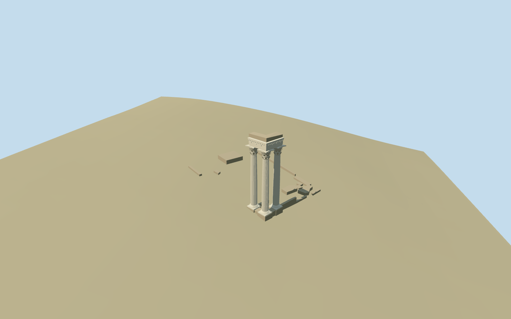

# temple_of_vespasian_and_titus — Temple of Vespasian and Titus

Reviewed2026-10-19 in one continuous author/build/inspect/fix round.

## Appearance

Inspected all 48 final current source/shared/medium-fi/native-site/fallback views. Exactly three pale fluted columns stand at the mapped southeast corner, with layered bases, two chunky leafy capital rows, corner volutes, concave abaci and both surviving L-shaped entablature returns. Layered fascia/cornice, dentils, coarse relief rhythm and a taller rough broken core distinguish the top. Low mapped remnants leave the destroyed temple interior open. Three ordinary pictures guide proportions; exact damaged carved motifs/inscription letters, individual rubble and repair fittings are simplified or omitted. Same-round corrections trimmed the numeric replacement mask away from the Tabularium and widened the column camera. Source/native whole and entablature views carry complete framing; some synthetic close views intentionally emphasize shafts or low remnants.

## Shared materials and browser levels

Two reused 256² graphs: stone_marble for dressed columns/entablature and stone_limestone_weathered for exposed rough cores/remnants. Metric UVs and linear warm-neutral tints; both graphs read once through the production resolver. Zero embedded images or unique atlas. At most two draws, four LOD caps pass, separate GPU streams and matching CPU/GPU byte accounting. Initial skyline-plus-district geometry is 338,796 bytes. Unloading releases all loaded geometry.

| Level | Triangles | Bytes | Draws |
| --- | ---: | ---: | ---: |
| skyline | 652 | 68780 | 1 |
| district | 2652 | 270016 | 2 |
| street | 5898 | 598452 | 2 |
| closeup | 7578 | 764556 | 2 |

Inspected current noon/late, economy/high, silhouette, three architectural details, four authored levels and transitions. The three-column corner and L-shaped surviving top remain readable across levels; close levels add flutes, leaves, volutes and dentils. Pale warm stone stays coherent with shared materials. Synthetic terrain/neighbors are style checks, not location proof; the separate native Rome fixture verifies fit.

## Approximate map fit

Exact-QID relation1767603 provides the archaeological extent/axis, not an intact building footprint. PMTiles corner remnant52776559974420 fixes the surviving group; twelve mapped remnant controls provide low ruins. Native east/south at heading0, internal angle+0.580061860533rad. Approximate column centers and local level corner footing preserve an open site; other low remnants follow coarse native grade. A 2cm replacement margin is trimmed against the independent Tabularium footprint. All 1,915 independent native building inputs remain byte-equivalent, and native ground/water are unchanged. Three tiny boundary strips totaling 0.01513m² remain within 2.8cm of/inside the host footprint; measured renderer residuals match independent polygon subtraction. They are retained against the host rather than cutting its facade. Four loaded levels retain 1,918 native records (1,915 independent plus these strips); failure preserves all 1,927 originals. Disposal releases geometry and restores ground/water.

## Limits

Accepted medium-fi surviving-ruin scope from three ordinary pictures and the reused standard Rome PMTiles/Mapzen extract; no bespoke survey or archive campaign. About15.2m columns and17.8m surviving top, column spacing, remnant heights, footing level, chipped profiles and coarse grade contact remain picture-led approximations. Exact inscriptions, sacrificial relief inventory, repair pins and fine leaf carving are omitted. No intact cella, roof, full pediment or complete peristyle is reconstructed. Neighboring Tabularium/Portico remain native host context with their existing procedural appearance. Physical-device and dense-city timings remain pending.

## Selected checks

Six Khronos files: zero errors/warnings.144 actual geometry/contact probes; 48 current inspected views. Scene validation/sim30 and strict selected medium-fi audit pass. Source and runtime hashes/material bindings/LOD caps verified.

Rebuild: node packages/worldgen/scripts/generate-additional-landmarks.mjs --ids=temple_of_vespasian_and_titus; node packages/worldgen/scripts/import-structure-models.mjs --ids=temple_of_vespasian_and_titus; node packages/tooling/scripts/generate-landmark-lods.mjs --ids=temple_of_vespasian_and_titus --force.

Source: sha256:4f3ca8c11ad27847c6166114e3b4fb8e87799988f63d17ee8a66e1da3eb62d6e

Runtime: sha256:ef8a0878cc05b28f5bce870ae5d899c6066e2c9a2c90948373395a25c1f7038f

Input: sha256:24081ba579dcd736387f5433293877ee8b1b1c1d243080720f5425e7ea7fcb1c

## Viewed ordinary pictures

https://commons.wikimedia.org/wiki/File:Temple_of_Vesp._and_Titus.jpg — Modussiccandi; CC BY-SA4.0; viewed only. Viewed only; no pixels copied.

https://commons.wikimedia.org/wiki/File:Entablature_-_Temple_of_Vespasian_and_Titus_(seen_from_Tabularium)_-_Roman_Forum_-_Rome_2016.jpg — José Luiz Bernardes Ribeiro; CC BY-SA4.0; viewed only. Viewed only; no pixels copied.

https://commons.wikimedia.org/wiki/File:Tabularium-and-temple.jpg — Ifly6; CC BY-SA4.0; viewed only. Viewed only; no pixels copied.
