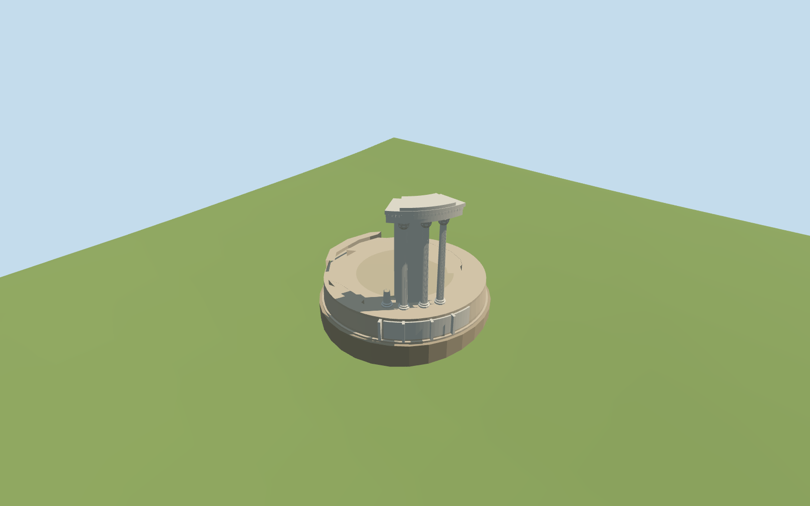

# Temple of Vesta

Present-day roofless Temple of Vesta in the Roman Forum: circular exposed-brick podium, three tall fluted Corinthian columns and one mapped stump, northwest curved marble cella/entablature sector, and individually mapped low ruin fragments. The missing roof and remaining historic colonnade are not reconstructed. Independent Forum ruins remain native.

## Evidence and reconstruction

Published dimensions and reconstructed details are separated in spec.json. Primary references:

- [Reference](https://commons.wikimedia.org/wiki/File:Temple_of_Vesta_(Rome).jpg)
- [Reference](https://commons.wikimedia.org/wiki/File:Temple_of_Vesta_Forum_Romanum_Rome.jpg)
- [Reference](https://commons.wikimedia.org/wiki/File:Temple_Vesta_Forum_Romanum_Rome_Italy.jpg)

Two registered recipes rebuild the present-day ruin and four budgeted levels. Four common256-square graphs supply marble, long-format brick, weathered limestone and gravel with metric UVs and linear tints. No embedded images or unique atlas.

## Model and axes

5,486 triangles; 16,458 vertices; 4 material groups; 661,284 bytes. Native bounds: -7.361, -1.519, -7.358 to 7.539, 11.447, 7.542. Source hash: `sha256:f60dec979709bc2a381ac7fc2bc164dcb8d87eecadf19ae897ad23b8a1dd6f89`.

{"x":"east","y":"up","z":"south"}

The unmodified161-square/6m standard Mapzen-USGS grid is retained with21.663m raw datum. The opaque occupied foundation clears the original rendered terrain by at least0.1476m across2826 grid/boundary probes. Its retaining faces continue below the lowest perimeter sample, enclosing the original ground. No terrain or water opening is needed. Eight authored map components are replaced inside the bounded foundation; surrounding Forum ruins remain native. Heights and grade are approximate viewer-scale fits, not surveyed thresholds. The source preview remains a separate visualization; production uses the unchanged full grid.

## Reproduce

Run `node packages/worldgen/scripts/generate-additional-landmarks.mjs --ids=temple_of_vesta_rome` (or add `--check`). The generator preserves manually edited masters by checking their baseline hashes. Import through the standard authored-model workflow with optimization disabled; then capture all QA cameras, including shared-surface views.

## Pending work

- Present-day roofless Temple of Vesta in the Roman Forum: circular exposed-brick podium, three tall fluted Corinthian columns and one mapped stump, northwest curved marble cella/entablature sector, and individually mapped low ruin fragments. The missing roof and remaining historic colonnade are not reconstructed. Independent Forum ruins remain native.
- Q753791/relation1842062 identifies the Roman Forum ruin. Eight current PMTiles component footprints include three full column positions, one stump, the northwest surviving sector and three low masonry fragments. Their raw east/south coordinates control placement. Ordinary northwest and reverse photographs confirm the surviving marble sector faces northwest; the old minimum-area rectangle axis is not a facade direction. In the northwest ordinary photographs the low stump appears left of the three tall columns. The northeastern end of the mapped four-column group,35184503447738, therefore remains the short stump;35184503447720/35184503447713/35184503447731 retain full height. The cella wall stops inside the western bay so the westernmost tall column stands open beneath the broken entablature. PMTiles provides positions, not these surviving heights; the signed survival assignment is picture-guided.
- Ordinary photographs guide approximate podium2.05m, shaft/capital and10.35m entablature top above the occupied foundation. The ordinary article describes an approximately15m historic podium,20 original columns,6.19m architrave radius and8.6m inner cella diameter. These are plan context, not a full reconstruction or surveyed current dimensions. The outer occupied foundation is14.9m across; mapped column positions remain unchanged. Fragments, profiles, flutes and capitals are medium-fi approximations.
- The unmodified161-square/6m standard Mapzen-USGS grid is retained with21.663m raw datum. The opaque occupied foundation clears the original rendered terrain by at least0.1476m across2826 grid/boundary probes. Its retaining faces continue below the lowest perimeter sample, enclosing the original ground. No terrain or water opening is needed. Eight authored map components are replaced inside the bounded foundation; surrounding Forum ruins remain native. Heights and grade are approximate viewer-scale fits, not surveyed thresholds. The source preview remains a separate visualization; production uses the unchanged full grid.
- This represents the surviving Roman Forum ruin, including its partial twentieth-century reconstruction. Missing roof and colonnade remain absent. Fine carvings, exact damage patterns, buried chambers and adjoining Forum ruins are outside scope. Current review status is recorded in qa.json.

This bundle follows the medium-fi standard. Medium-fi appearance and geographic fit are reviewed separately. Hash-bound visual acceptance is recorded separately after capture inspection.

## Additional geographic data

©OpenStreetMap contributors; Protomaps; Mapzen/USGS terrain.
