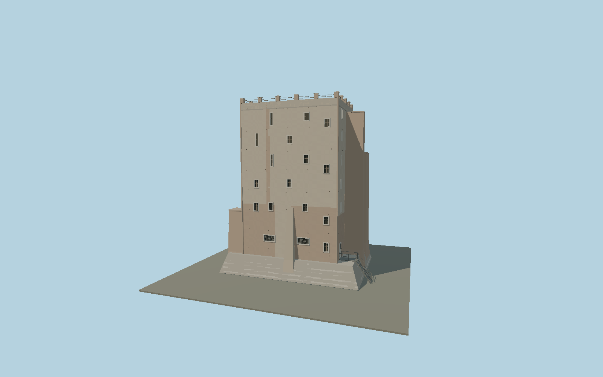

# Torre dei Conti

Dated pre-collapse exterior: restored irregular west windows, exposed Roman brick patches, three buttressed elevations, bichrome stone scarpa, putlog sockets, roof merlons and access bridge.

## Identity and geometry

Catalog torre_dei_conti, [Q605721](https://www.wikidata.org/wiki/Q605721). The exact-identity mapped envelope supplies the base footprint; the heritage study reproduces measured plans and identifies the asymmetric restored western face and three buttressed sides. Their relative wall/rib positions are registered to that envelope. Elevations and individual window positions are photographic reconstructions within the documented 29 m surviving height, not a reconstruction of the lost 60 m medieval tower.

Mapped overall base envelope center; Y=0 at the exposed lower foundation contact. +Z is the restored southwest/west facade toward Via dei Fori Imperiali; +Y is up. The geographic proposal identifies its anchor and orientation evidence separately from remaining terrain and azimuth uncertainty.

Source facts and measured references are recorded in spec.json. References: [1](https://muripertutti.com/wp-content/uploads/2026/01/rsa108_porretta_torre_dei_conti_low.pdf), [2](https://sovraintendenzaroma.it/content/torre-dei-conti), [3](https://commons.wikimedia.org/wiki/File:Tor_dei_Conti_2013-2.jpg), [4](https://commons.wikimedia.org/wiki/File:Roma_-_Torre_dei_Conti_-_2024-09-18_15-32-43_001.JPG), [5](https://www.comune.roma.it/web/it/notizia/crollo-parte-torre-dei-conti.page), [6](https://www.vigilfuoco.it/media/notizie/torre-dei-conti-concluso-lintervento-dei-vigili-del-fuoco-il-monumento-torna-sicurezza), [7](https://www.openstreetmap.org/relation/1899644). Reference pages and images are not redistributed.

## Original source and shared materials

Geometry is authored in `packages/worldgen/scripts/torre-dei-conti-model.mjs`. Shared material graphs with metric repeat UV0 and original vertex tints; GLB PBR fallback remains self-contained. No per-model texture duplication. No third-party mesh or photograph is embedded.

22,696 triangles; 45,392 vertices; 8 material groups; 1,911,104 source bytes. Source hash: `sha256:58ddac7792c1a1b9b884f31edd0c280f335468b8b5218d360101df60cb991172`. Geometry validation checks finite Float32 coordinates, indices, triangle area and winding before export.

Regenerate with `node packages/worldgen/scripts/generate-heritage-towers.mjs torre_dei_conti`; add `--check` for reproducibility. The generator refuses to overwrite a master whose hash differs from source.json. Import uses `--no-optimize` to preserve facade recesses.

## Remaining detail and review

- Complete static medium-fi exterior of the intact Torre dei Conti documented on18September2024, before the3November2025 collapse. The four browser levels preserve the29m surviving tower, asymmetrical three-sided buttresses, lower northwest annex, southwest plastered face, bichrome scarpa, irregular window indications, parapet merlons and southeast access bridge/stair. The preserved original detailed recipe remains byte-reproducible. Published floor plans establish the wall and rib arrangement; the attributed mapped envelope constrains approximate overall dimensions, while vertical offsets, aperture sizes, plaster loss, putlog positions and access ironwork are proportional photographic reconstructions. Putlog sockets are closed dark geometric indications, not physical openings. No lost60m medieval upper stories, restoration proposals, interior, adjacent houses or excavated archaeological terrain are included. Ground0 is the bottom of the exposed foundation, not street level; the approximately3.2m difference requires host terrain appropriate to the excavation. Default current-world placement remains excluded: the documented southern buttress/base/stair and roof damage, and2026 stabilization, are not reconstructed. Dated placement is conservatively supported only for the observed2024-09-18 photograph date, with exclusive end2024-09-19. No downloaded geometry or photograph is embedded. Canonical shared graphs are stylized common materials rather than site-specific photographic textures. Physical laptop/phone timings and real host excavation contact remain unmeasured.

Named near/far cameras are included for lit visual review. A valid export is not maximum-fidelity certification.
