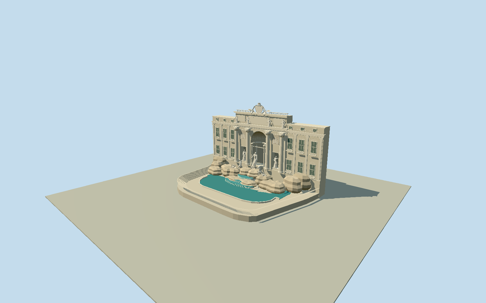

# Trevi Fountain

Pale Palazzo Poli fountain facade with four giant Corinthian columns, actual deep conch niche and four small inner columns, flanking allegory niches, three pedimented shutter-window bays per wing, attic/balustrade and sculptural papal crest. Recognizable posed Oceanus/shell chariot, distinct sea horses/tritons and side/attic figures, rough stepped travertine rock and curved spill bowls; mapped turquoise basin with separate dry amphitheatre/stairs. Full rear palace and neighboring city excluded.

Authoring state: **review-in-qa.json**. Current completion evidence is in [qa.json](qa.json) and the [local 100 ledger](../../../../qualla-structures/batches/PROGRESS.md).

- [Trevi Fountain](https://qualla.com/trevi-fountain/)

Native map geometry is quantized and low-zoom; precise sculpted rock placement and facade heights are photographic interpretations, not a construction survey.

Native whole-fountain envelope differs from actual water edge. Preserve both; do not fill the whole envelope with water.

Mapped Palazzo Poli has rear courts and wings; asset scope covers fountain facade and immediate backing thickness, not complete palace or its interior.

Statues, arms, horses, shell chariot and papal crest must retain interpreted recognizable silhouettes; no exact facial/inscription/art-conservation reproduction.

Native map preparation establishes location and signed axes; geometry, independent terrain and actual visual/placement acceptance must be separately verified before any completion annotation.

Facade width49.69m follows mapped line;26.3m reported overall height is a non-survey visual control. Individual cornices, column dimensions, water/step levels, rock positions and statue poses are photographic estimates. Sculptures retain restrained silhouettes, not exact faces, muscle/finger/fabric detail or copied reliefs/inscriptions.

Immediate4.2m backing facade is a bounded wall volume, not the complete Palazzo Poli. No interior, water simulation, fountain plumbing or navigable collision claim. Waterfall strips are static pale geometric surfaces.

Original Terrarium pixels may oversample much coarser composite source data;1m sampling does not imply survey accuracy. Provider-relative vertical reference only; default coarse host terrain compatibility not certified.

Build: `node packages/worldgen/scripts/generate-authored-places.mjs --ids=trevi_fountain`. Add `--check` to verify exact regeneration. 39181 triangles; 5 materials; no embedded photographs.
