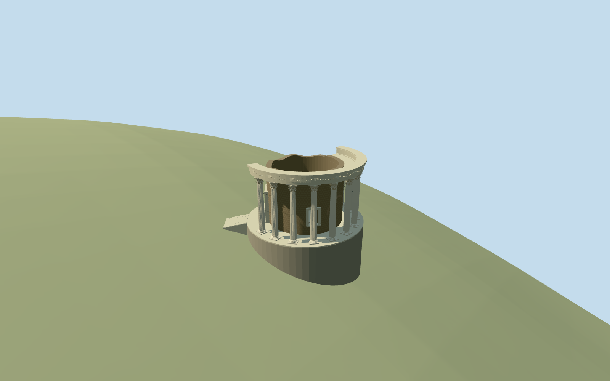

# Temple of Vesta

Standing Temple of Vesta at Tivoli: roofless hollow dark-rubble cella with original simplified reticulate masonry patches with real southwest doorway and southeast window, blocked eastern relieving arch, ten surviving pale fluted Corinthian columns on the eastern/southern arc, partial curved entablature/annular coffered soffit and circular occupied podium with short southwest approach. Original simplified Tivoli-style floral capitals and horned skull/swag/rosette frieze; small restraint rods. Neighboring Temple of the Sibyl, restaurant furniture, cliff-retaining structures and landscaping remain separate host context. No restored absent columns, complete conical roof, copied inscription/sculpture or photo atlas.

## Evidence and reconstruction

Published dimensions and reconstructed details are separated in spec.json. Primary references:

- [Reference](https://commons.wikimedia.org/wiki/File:Temple_of_Vesta,_built_in_the_early_1st_century_BC_on_the_acropolis_of_Tibur,_Tivoli_(14940758021).jpg)
- [Reference](https://commons.wikimedia.org/wiki/File:Temple_of_Vesta_(Tivoli)_2017.1.jpg)
- [Reference](https://commons.wikimedia.org/wiki/File:Temple_of_Vesta,_built_in_the_early_1st_century_BC_on_the_acropolis_of_Tibur,_Tivoli_(14920855626).jpg)

Standing Temple of Vesta at Tivoli: roofless hollow dark-rubble cella with original simplified reticulate masonry patches with real southwest doorway and southeast window, blocked eastern relieving arch, ten surviving pale fluted Corinthian columns on the eastern/southern arc, partial curved entablature/annular coffered soffit and circular occupied podium with short southwest approach. Original simplified Tivoli-style floral capitals and horned skull/swag/rosette frieze; small restraint rods. Neighboring Temple of the Sibyl, restaurant furniture, cliff-retaining structures and landscaping remain separate host context. No restored absent columns, complete conical roof, copied inscription/sculpture or photo atlas.

## Model and axes

35,234 triangles; 105,702 vertices; 5 material groups; 4,231,512 bytes. Native bounds: -8.003, -3.406, -7.261 to 7.264, 12.054, 8.006. Source hash: `sha256:cb537c0ee602da672b567313615b60572a615078ad01d467876b227abbb65edf`.

{"x":"east","y":"up","z":"south"}

The geographic proposal uses exact-QID OpenStreetMap evidence. Map-derived orientation and estimated architectural details require real-site visual review; preview eligibility is distinct from geographic/fidelity approval. Map attribution: © OpenStreetMap contributors, ODbL-1.0.

## Reproduce

Run `node packages/worldgen/scripts/generate-additional-landmarks.mjs --ids=temple_of_vesta_tivoli` (or add `--check`). The generator preserves manually edited masters by checking their baseline hashes. Import through the standard authored-model workflow with optimization disabled; then capture all QA cameras, including shared-surface views.

## Pending work

- Standing Temple of Vesta at Tivoli: roofless hollow dark-rubble cella with original simplified reticulate masonry patches with real southwest doorway and southeast window, blocked eastern relieving arch, ten surviving pale fluted Corinthian columns on the eastern/southern arc, partial curved entablature/annular coffered soffit and circular occupied podium with short southwest approach. Original simplified Tivoli-style floral capitals and horned skull/swag/rosette frieze; small restraint rods. Neighboring Temple of the Sibyl, restaurant furniture, cliff-retaining structures and landscaping remain separate host context. No restored absent columns, complete conical roof, copied inscription/sculpture or photo atlas.
- Exact OSM way/432883964 carriesQ1219688 and agrees with named PMTiles cella building/POI35184804972796. Its approximately9.1m circular footprint identifies the cella, not the whole peristyle. Native anchor12.800822243,41.966639022, heading0/east-south axes; mapped cella center[0.013574854432735428,-0.01091013677570185]. Separate Temple of the Sibyl35184580229500 lies about15m north and remains untouched. Picture-led column ring radius6.25m/podium7.25m, ten surviving columns at approximately-80 through100degrees, doorway southwest and window southeast. Restaurant west/Sibyl north and ordinary pictures support approximate facing, with about30degree uncertainty; doorway/window/arc locations are not separately surveyed map controls.
- Ordinary-picture/map estimates: cella radius4.6m/wall0.65m, column ring6.25m, podium radius7.25m, columns6.8m above level occupied floor, partial entablature to7.9m and irregular roofless cella top about7.1m. Door2.2x3.8m, southeast window1.1x1.9m with raised sill, blocked relieving arch3.5m wide. Ten columns, incomplete eastern/southern arc and original simplified relief/coffers; fine inventory, sculptural form, heights and absolute threshold levels remain estimates.
- Retain pinned standard6m Mapzen cliff terrain, paths/water and all independent buildings. Level occupied podium floor is at least0.2m above its sampled7.25m envelope and0.6m above the coarse southwest approach; narrow perimeter footing bottoms follow retained ground and southwest steps descend to sampled approach. No surrounding acropolis slab, native ground/water cutout or terrain flattening. Coarse DEM blurs the cliff edge and cannot resolve archaeological paving/thresholds; exposed podium depths are visualization fit, not a measured ancient foundation section. Only matching cella shell is replaced; neighboring Sibyl/restaurant remain independent.
- Three retained ordinary pictures establish the standing shell/columns/capital-frieze vocabulary; later changes, hidden stonework and exact inventory/facing remain approximate. Neighboring Sibyl temple, restaurant furniture and cliff-retaining structures remain independent context. No restored complete roof, absent column ring, copied inscription/sculpture or photographic atlas.

This bundle follows the medium-fi standard. Medium-fi appearance and geographic fit are reviewed separately. Hash-bound visual acceptance is recorded separately after capture inspection.

## Additional geographic data

©OpenStreetMap contributors; Protomaps; Mapzen/USGS terrain.
