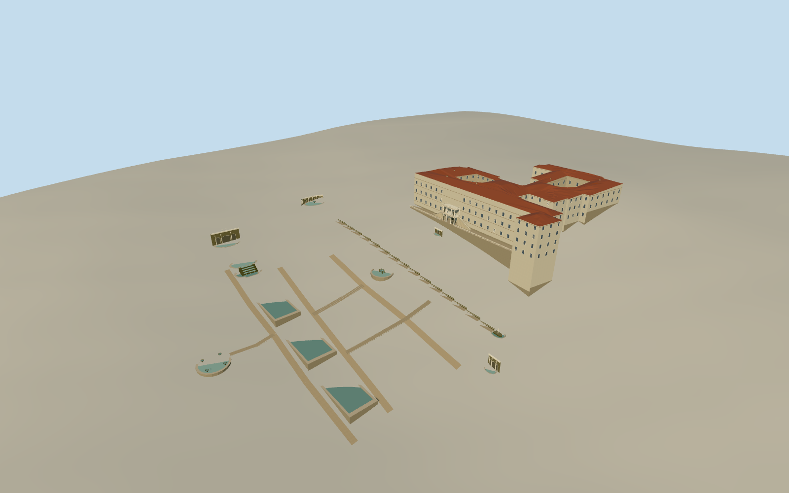

# Villa d’Este

Tivoli’s Villa d’Este palace, with its two courts, pale three-storey garden front, double Renaissance loggia, stepped garden, and stone fountains.

Authoring state: **review-in-qa.json**. Current completion evidence is in [qa.json](qa.json) and the [completion ledger](../../../../qualla-structures/batches/qualla-003.PROGRESS.md).

- [Villa d'Este](https://qualla.com/villa-d-este/)

The model covers the standing palace, two open courtyards, entry, garden loggia, retaining terraces and principal exterior fountain structures. The neighbouring church, interior rooms and plantings are outside the architectural scope.

The original terrain is unchanged. Individual fountain floor levels, wing roof heights, parapets, staircase widths and unmeasured features are estimates based on the standing mapped outline, site descriptions and five verified Qualla originals.

The garden structures capture major architectural forms. Small carving, detailed statuary, planted beds, and active fountain hydraulics are simplified.

Build: `node content/worldgen/source/places/sr/sr3/villa_d_este/models/generate-villa-d-este.mjs`. Add `--check` to verify exact regeneration. 22655 triangles; 6 materials; no embedded photographs.
