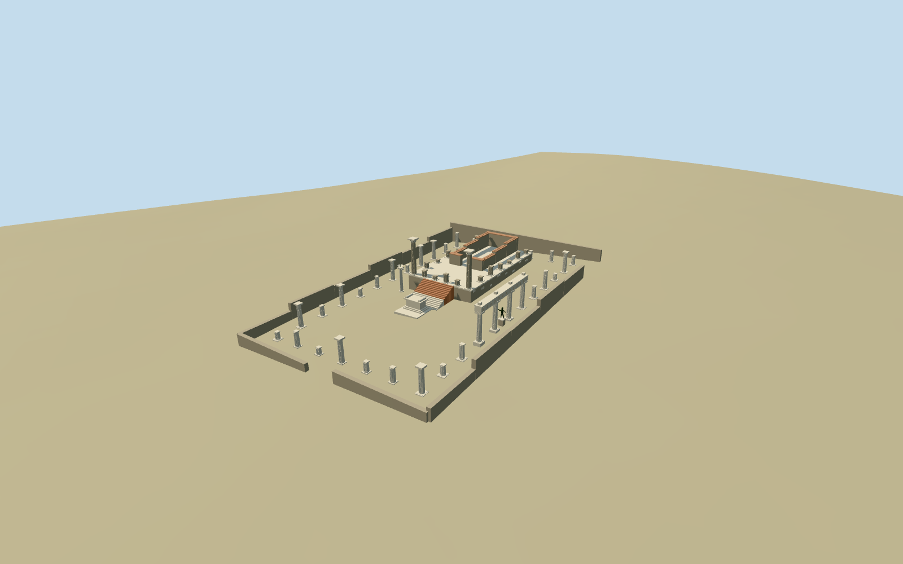

# temple_of_apollo — Temple of Apollo, Pompeii

Reviewed 2026-10-19 in one continuous author/build/inspect/fix round.

## Appearance

Inspected48 current source/shared/medium-fi/native/fallback views during construction. Specific standing Apollo sanctuary: raised rough stone podium, two tall fluted front columns with original simplified leafy capitals, varied broken peripteral stumps, roofless cella with a real south entry and tile-capped walls, pale lower/brick upper frontal stair. Separate molded pale altar/rolled ends and slender pale sundial column; open precinct, broken/fluted court shafts and short surviving east four-column entablature. Original simplified volumetric bronze replica figure on its pedestal. Same-round renders exposed coplanar podium floor surfaces; removed the hidden duplicate top, confirmed a clear floor and deduplicated detail cameras. No restored roof or pediment.

## Shared materials and browser levels

Five existing256-square graphs: stone_limestone_weathered for darker surviving masonry, stone_limestone_raw for pale shafts/trim/altar, brick for stair, tile_ceramic for protective wall caps and metal_bronze_cast for replica/gnomon. Each graph read once, five draws maximum, metric UVs and linear tints; zero embedded images. Separate GPU streams and matching CPU/GPU accounting. LODs972/3286/9738/23850triangles, initial428440bytes; optional close-up2265692bytes. Model geometry disposed on eviction.

| Level | Triangles | Bytes | Draws |
| --- | ---: | ---: | ---: |
| skyline | 972 | 104324 | 1 |
| district | 3286 | 324116 | 5 |
| street | 9738 | 901852 | 5 |
| closeup | 23850 | 2265692 | 5 |

Current noon/late/economy/high, street/block/skyline context, silhouette, all four levels/transitions and three combined detail views inspected. Skyline retains roofless podium/cella, two tall front columns, open court/entries, altar, sundial and sparse column rhythm. District restores denser perimeter/end rows, bases, rolled altar ends and simplified replica. Street adds actual longitudinal fluting, tile caps and entablature panel rhythm; close-up adds more flutes/entasis, drum bands and capital facets. Flat shared ground differs from terrain-relative footing heights; source/medium/native views establish ground contact. Some sundial/temple columns overlap in frontal projection; rotating whole views cover separation. Green native ground, modern procedural facades standing in for neighboring ruins, paths and other map records are host context.

## Approximate map fit

Exact-QID ruins-area way240573968/Q2699249 supplies the55.1x34.4m precinct boundary, not the podium/cella footprint. Named standard PMTiles point35184612662800 and central occupied altar-like control35185565970074 correlate the sanctuary. Anchor14.484426935,40.749212932; heading0, internal cross-axis-.444299136394rad, front toward south/southeast local+z. Internal geometry is picture-led within that boundary. Only the central control is replaced with2cm numeric tolerance; zero residual. All349 independent resident building inputs, including northeast corner35185565970071, original6m terrain, paths and native water state unchanged. Loaded levels349 records; failed load350 originals; unload frees geometry. Only occupied podium/stair/altar and narrow wall/column footings authored, with buried bases/grade-following peripheral contact. Open court remains native ground. No broad slab, flattening or ground/water cutout.

## Limits

Accepted medium-fi using four inspected ordinary front, flute close-up, east portico/altar/replica and southwest podium/cella pictures plus standard PMTiles/Mapzen. Side/overview pictures filled specific flute/entablature/roofless side coverage gaps; no bespoke research. Original simplified leaf, rolled altar, sundial and volumetric figure vocabulary; no copied sculpture, readable inscription, painting or photo atlas. Exact survival inventory, capital anatomy, repairs, internal allocation/heights, replica pose and archaeological floor/threshold levels are approximate. No conjectural temple roof/pediment or complete archaeological reconstruction. Coarse DEM does not resolve level excavated paving or steps. Independent neighboring ruins retain the host procedural treatment. Physical-device/dense-city timings remain pending.

## Selected checks

Six Khronos files: zero errors/warnings.238 actual mesh/contact probes; 48 current inspected views. Scene validation/sim30 and strict selected medium-fi audit pass. Source and runtime hashes/material bindings/LOD caps verified.

Rebuild: node packages/worldgen/scripts/generate-additional-landmarks.mjs --ids=temple_of_apollo; node packages/worldgen/scripts/import-structure-models.mjs --ids=temple_of_apollo; node packages/tooling/scripts/generate-landmark-lods.mjs --ids=temple_of_apollo --force.

Source: sha256:9119ad58beaa16d1dce09ae566b984b886b7cd47d0e8b4d7b1beee0f354bc7c5

Runtime: sha256:0ddfb31db570b60bdcb3e7f9e547786b8e5236f652f9d628cb4a8e0ae67d54da

Input: sha256:84022d1e23ab2453a1c87e9aac74e9bca02b585c40c58747d899facb47c77b29

## Viewed ordinary pictures

https://commons.wikimedia.org/wiki/File:Temple_of_Apollo,_Pompeii,_with_Mount_Vesuvius_in_background.png — Cosmosanchez; CC-BY-4.0. Viewed only; no pixels copied.

https://commons.wikimedia.org/wiki/File:Pompeii_excavations,_Napoli,_Italy_28_-_columns.JPG — MAKY.OREL; CC-BY-3.0. Viewed only; no pixels copied.

https://commons.wikimedia.org/wiki/File:Temple_of_Apollo,_altar_and_east_colonnade_with_replica_statue_of_Apollo,_Pompeii_(15015555291).jpg — Carole Raddato; CC-BY-SA-2.0. Viewed only; no pixels copied.

https://commons.wikimedia.org/wiki/File:Temple_of_Apollo,_looking_north-east_towards_the_podium_and_cella,_Pompeii_(14831708520).jpg — Carole Raddato; CC-BY-SA-2.0. Viewed only; no pixels copied.
