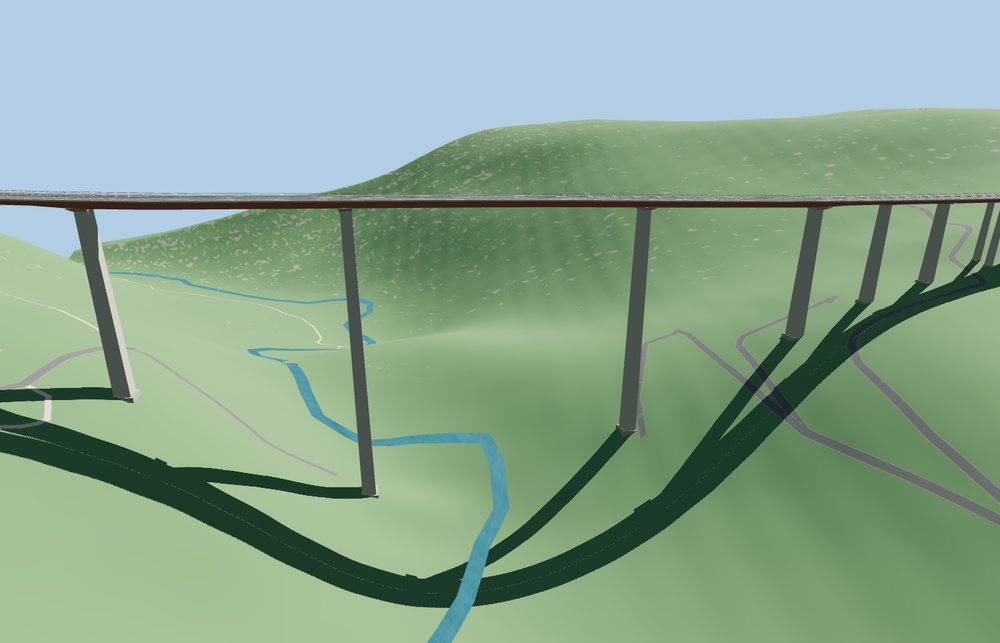

# Italia Viaduct

The two current A2 carriageways follow the curved red-brown steel girder across the Lao gorge. Tall pale piers carry the three main spans. At the north bank the decks spread toward the twin tunnel mouths, while the southern decks curve into the mapped approaches.

The 48,232-triangle source rebuilds byte for byte. Skyline, district, street and close-up use 932, 3,812, 11,960, 30,360 triangles. Skyline and district total 454,440 bytes. Six GLBs validated and 36 current views were inspected.

Twenty-five support probes, 40 deck probes and four carriageway centerline joins pass at each level. The largest centerline height difference is 0.051 m. Both native tunnel mouths and all 32 independent road records remain. The standard viewer relief gives 185.1 and 188.0 m of clearance under the two lanes at the mapped river crossing. The original crossing returns if model loading fails.

Two current A2 carriageway traces fix the deck alignment, the separated north landings and the curved south approach. Adjacent tunnel mouths and downstream bridges remain host features. The steel girder, support rhythm and pier profiles follow exterior photos. Pier stations, road grades and the exact clearance are visualization estimates on the standard terrain samples. The rendered gorge relief comes from standard elevation tiles. The sampled visual clearance varies with the terrain resolution and host data.

Rebuild with `node packages/worldgen/scripts/generate-italia-viaduct.mjs`. Append `--check` to compare exact bytes. Use `--ids=italia_viaduct` for targeted import, LOD, placement and readiness.
