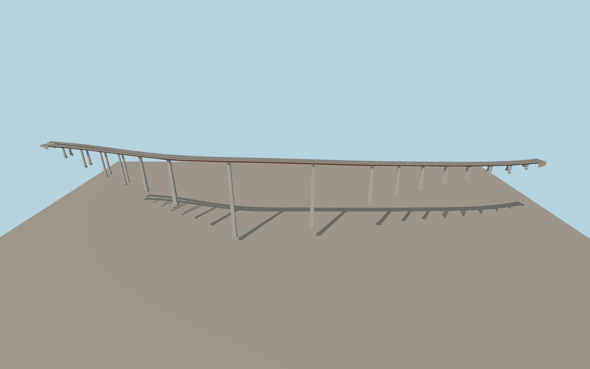

# Italia Viaduct

The two current A2 carriageways follow the curved red-brown steel girder across the Lao gorge. Tall pale piers carry the three main spans. At the north bank the decks spread toward the twin tunnel mouths, while the southern decks curve into the mapped approaches.

Run `node packages/worldgen/scripts/generate-italia-viaduct.mjs` to rebuild the source master. Append `--check` to compare the exact bytes. Use `--ids=italia_viaduct` for targeted import, LOD generation and placement.

Two current A2 carriageway traces fix the deck alignment, the separated north landings and the curved south approach. Adjacent tunnel mouths and downstream bridges remain host features.

The steel girder, support rhythm and pier profiles follow exterior photos. Pier stations, road grades and the exact clearance are visualization estimates on the standard terrain samples.

The rendered gorge relief comes from standard elevation tiles. The sampled visual clearance varies with the terrain resolution and host data.

Original geometry follows the repository license. Map data is © OpenStreetMap contributors under ODbL-1.0 via Protomaps. Terrain samples are described in terrain-grid.json. Ordinary pictures stay local and are not redistributed or used as textures. Current acceptance is recorded in qa.json.
