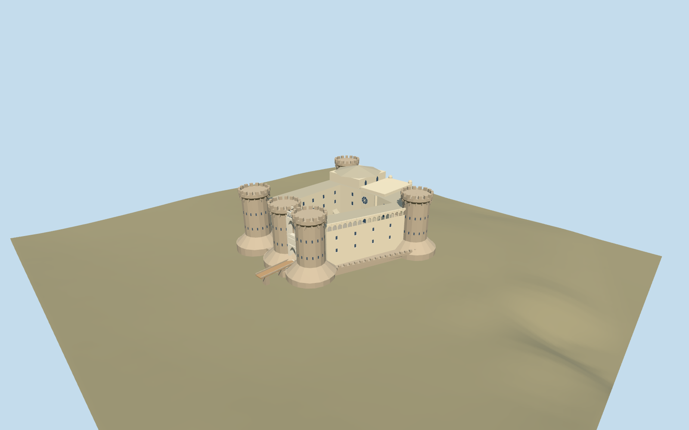

# Castel Nuovo

Five flat crenellated piperno towers on battered footings,tufo curtain wings,stacked pale marble entrance arch,open trapezoid courtyard,rose-window chapel,raised Barons Hall and nine court arcades.

## Evidence and reconstruction

Published dimensions and reconstructed details are separated in spec.json. Primary references:

- [Reference](https://www.comune.napoli.it/vivere-il-comune/luoghi/castel-nuovo-maschio-angioino/)
- [Reference](https://cultura.regione.campania.it/en/web/itinerari/poi?id=766084)
- [Reference](https://cultura.gov.it/luogo/museo-civico-castelnuovo)
- [Reference](https://www.castcampania.it/castelli-di-napoli---castel-nuovo.html)
- [Reference](https://static-www.comune.napoli.it/wp-content/uploads/2024/09/Castel-Nuovo-Maschio-Angioino.jpg)
- [Reference](https://static-www.comune.napoli.it/wp-content/uploads/2024/09/Castel_Nuovo_o_Maschio_Angioino.jpg)
- [Reference](https://media.cultura.gov.it/mibac/files/boards/bec8803f226b6c1f1d4be3ed98d36b8e/Campania%201/Museo%20civico%20Castelnuovo.jpg)
- [Reference](https://commons.wikimedia.org/wiki/File:NapoliMaschioAngioinoDaSanMartino.jpg)
- [Reference](https://commons.wikimedia.org/wiki/File:NapoliMaschioAngioinoIngresso.jpg)
- [Reference](https://commons.wikimedia.org/wiki/File:Napoli-castelnuovo01.jpg)
- [Reference](https://commons.wikimedia.org/wiki/File:Napoli_Castel_Nuovo_cortile_1060655-6.JPG)
- [Reference](https://www.openstreetmap.org/relation/15009683)

Mapped footings and court reproduce separately attributed OpenStreetMap data under ODbL-1.0. All other geometry is original approximate authoring. No downloaded mesh,research photograph or unique texture is embedded;four shared material graphs supply reusable surfaces.

## Model and axes

7,590 triangles; 22,770 vertices; 6 material groups; 914,540 bytes. Native bounds: -73.500, -6.145, -56.326 to 60.400, 41.000, 56.326. Source hash: `sha256:ddc907beb6d25929c6d0b664f65919ce33ef6a5e9ae28ba3633385e634281cce`.

{"up":"+Y","lateral":"+X approximately east along cached map axis; signed registration pending","longitudinal":"+Z approximately south; entrance faces native -X","origin":"Site anchor; Y0 standard PMTiles working datum."}

Inspected picture confirms flat crenellated dark towers, corbelled crowns, warm curtain walls and pale stacked entrance arch. Retained mapped tower-footing/court geometry and standard viewer PMTiles set approximate location, scale and western-entry orientation. A reconstructed1m working rise keeps court and entry above coarse sampled ground; bounded tower-footing bottoms extend beneath terrain. Anchor 14.253249701,40.838300344; heading -0.308685078188; standard PMTiles datum 15.497152127096433m. Floors are reconstructed and foundations extend below the coarse sampled ground.

## Reproduce

Run `node packages/worldgen/scripts/generate-signature-towers.mjs --ids=castel_nuovo` (or add `--check`). The generator preserves manually edited masters by checking their baseline hashes. Import through the standard authored-model workflow with optimization disabled; then capture all QA cameras, including shared-surface views.

## Pending work

- Approximate current exterior from one inspected picture and standard viewer PMTiles; no bespoke survey or exact thresholds.
- Original detailed master/hash/recipe preserved. Tower, chapel, hall, gate and court-floor dimensions remain reconstructed; pale gate reliefs are simplified geometric masses.
- Five common graphs plus explicit dark recess slot, zero embedded images. No interiors, terrain cutouts, surrounding plaza/city or exact ground levels.
- Footprint replacement remains off; physical-device timing unmeasured.

This bundle follows the medium-fi standard. Medium-fi appearance and geographic fit are reviewed separately. Hash-bound visual acceptance is recorded separately after capture inspection.

## Additional geographic data

© OpenStreetMap contributors;Municipality of Naples;Italian Ministry of Culture;Campania region;Italian Institute of Castles,Campania;primary photographers MM,currybet,Lalupa.
