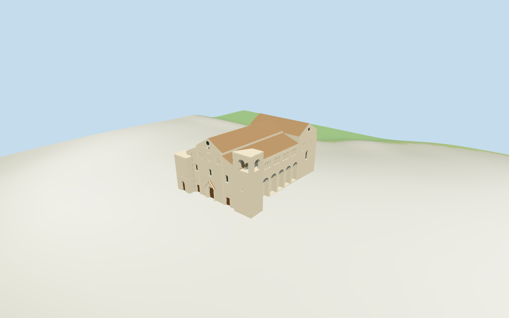

# Basilica of Saint Nicholas

Individual Basilica of Saint Nicholas in Bari: unequal flat-topped western towers, pale stone central gable and sloped shoulders, triple western portals with gabled central prothyron, small round/paired windows and oculus, deep lower round side arcades and grouped upper galleries, high eastern transept and flat rectangular eastern wall with large framed barred window. Four budgeted browser tiers; shared cream ashlar/limestone, muted terracotta tile and plain wood. Metric UVs/linear tints, no embedded images. Standard terrain foundations. Exact reliefs/statues/inscriptions, carved tracery, small liturgical fittings, interiors, adjacent old-town fabric, parking/railings, surveyed paving/steps and walking excluded.

## Evidence and reconstruction

Published dimensions and reconstructed details are separated in spec.json. Primary references:

- [Reference](https://commons.wikimedia.org/wiki/File:Bari,_San_Nicola,_west_facade.jpg)
- [Reference](https://commons.wikimedia.org/wiki/File:Bari,_San_Nicola,_south_facade.jpg)
- [Reference](https://commons.wikimedia.org/wiki/File:093_Basilica_di_San_Nicola_(Bari),_fa%C3%A7ana_est,_Corte_del_Catapano.jpg)

Four existing shared256-square ashlar/limestone/flat tile/plain wood graphs. Cream linear tints, metric UVs and flat normals; glazing/recesses use flat geometric PBR colors. No embedded images, bespoke textures or baked shadows.

## Model and axes

23,190 triangles; 69,570 vertices; 6 material groups; 2,786,436 bytes. Native bounds: -33.428, -1.625, -20.579 to 32.133, 30.200, 24.156. Source hash: `sha256:4b68775d5a98bf9e424f78b8a2e6423bbbcfd42d17e7e76810b9126c626b6da4`.

{"x":"east-northeast along basilica from west portals to flat east wall","y":"up","z":"south-southeast toward tall west tower and gallery"}

Standard viewer DEM datum 10.557088m; display offset 0.4m, mapped perimeter terrain -1.28..0.88m. Side-only foundations follow this coarse terrain. Doorways use estimated floor+0.2m and small connecting steps where possible; exact Basilica plaza paving, doorway levels and absolute altitude remain unverified. No global terrain flattening or road replacement.

## Reproduce

Run `node packages/worldgen/scripts/generate-additional-landmarks.mjs --ids=N0368` (or add `--check`). The generator preserves manually edited masters by checking their baseline hashes. Import through the standard authored-model workflow with optimization disabled; then capture all QA cameras, including shared-surface views.

## Pending work

- Exact-QID way417998763/Q550514 matches current PMTiles main35184790087595. Its13-vertex raw outline/tags retain absent height and min_height. No surveyed height/width/length is retained. All vertical dimensions are explicit picture estimates: nave eave25m/ridge29.8m, side gallery wall20.5m/roof join24m, east transept eave24m/ridge29m, north tower18.8m and south tower27.5m. Western central/side doors, canopy, arcade/galleries, paired windows and flat east wall follow three inspected pictures. Only subplans subdivide/approximate the raw main envelope; no map rescale. North facade rhythm is inferred from the south. Exact carving, thresholds and roof junctions are not surveyed.
- Standard viewer DEM datum 10.557088m; display offset 0.4m, mapped perimeter terrain -1.28..0.88m. Side-only foundations follow this coarse terrain. Doorways use estimated floor+0.2m and small connecting steps where possible; exact Basilica plaza paving, doorway levels and absolute altitude remain unverified. No global terrain flattening or road replacement.
- Medium-fi exterior from three inspected west/south/east pictures and standard viewer PMTiles/DEM only. North side rhythm inferred. Exact reliefs/statues/inscriptions, tiny carving, interiors, neighboring town fabric, parking/railings and surveyed paving/thresholds/walking excluded. Oculi are framed geometric dark disks. Physical device timing pending.
- Skyline retains stepped roof/tower silhouette and open south belfry. District adds shared surfaces and flat doors/windows/gallery fields. Street opens lower side recesses, upper gallery cavities and door/window recesses; closeup/master refine rounded arch bands, window bars and canopy moulds. Synthetic neighbors are review fixtures.

This bundle follows the medium-fi standard. Medium-fi appearance and geographic fit are reviewed separately. Hash-bound visual acceptance is recorded separately after capture inspection.

## Additional geographic data

©OpenStreetMap contributors; Protomaps; Mapzen/USGS terrain tiles.
