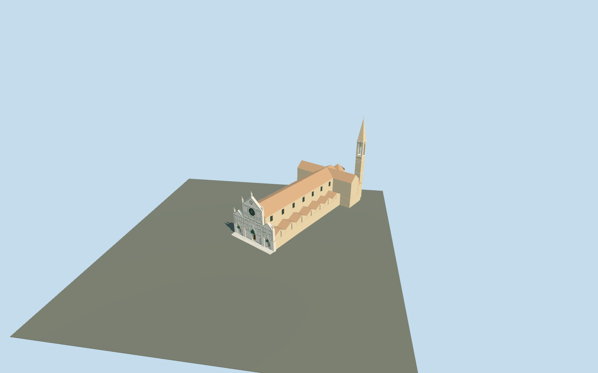

# Basilica of Santa Croce

Basilica of Santa Croce connected church exterior plus its separate integral campanile: long raised nave with tiled gable, repeated lower side-aisle gables, transept, rear chapels/polygonal apse, marble three-part western facade with rose and geometric green/pink inlay, three real recessed wooden portals and broad supported entrance treads, pinnacles and a tall pointed belfry/spire. Actual parent and32 integral mapped building parts control scale; the campanile has its own actual footprint. The separately mapped convent/cloisters, Pazzi Chapel, refectory and neighboring city buildings remain independent. No copied sculpture, frescoes, tombs, text or furnished interiors.

## Evidence and reconstruction

Published dimensions and reconstructed details are separated in spec.json. Primary references:

- [Reference](https://www.tickets-florence.it/basilica-of-santa-croce/)
- [Reference](https://commons.wikimedia.org/wiki/File:Basilica_of_Santa_Croce_-_0972.jpg)

Basilica of Santa Croce connected church exterior plus its separate integral campanile: long raised nave with tiled gable, repeated lower side-aisle gables, transept, rear chapels/polygonal apse, marble three-part western facade with rose and geometric green/pink inlay, three real recessed wooden portals and broad supported entrance treads, pinnacles and a tall pointed belfry/spire. Actual parent and32 integral mapped building parts control scale; the campanile has its own actual footprint. The separately mapped convent/cloisters, Pazzi Chapel, refectory and neighboring city buildings remain independent. No copied sculpture, frescoes, tombs, text or furnished interiors.

## Model and axes

2,556 triangles; 7,126 vertices; 6 material groups; 291,080 bytes. Native bounds: -15.725, -0.350, -21.373 to 115.572, 80.700, 83.324. Source hash: `sha256:101dd5cbbee13fe49593f57aea5c0ffeb404e5152c1ba67c4ca69a3d08ca32f4`.

{"x":"east","y":"up","z":"south"}

The geographic proposal uses exact-QID OpenStreetMap evidence. Map-derived orientation and estimated architectural details require real-site visual review; preview eligibility is distinct from geographic/fidelity approval. Map attribution: © OpenStreetMap contributors, ODbL-1.0.

## Reproduce

Run `node packages/worldgen/scripts/generate-additional-landmarks.mjs --ids=basilica_of_santa_croce` (or add `--check`). The generator preserves manually edited masters by checking their baseline hashes. Import through the standard authored-model workflow with optimization disabled; then capture all QA cameras, including shared-surface views.

## Pending work

- Basilica of Santa Croce connected church exterior plus its separate integral campanile: long raised nave with tiled gable, repeated lower side-aisle gables, transept, rear chapels/polygonal apse, marble three-part western facade with rose and geometric green/pink inlay, three real recessed wooden portals and broad supported entrance treads, pinnacles and a tall pointed belfry/spire. Actual parent and32 integral mapped building parts control scale; the campanile has its own actual footprint. The separately mapped convent/cloisters, Pazzi Chapel, refectory and neighboring city buildings remain independent. No copied sculpture, frescoes, tombs, text or furnished interiors.
- Q51177 and named Basilica di Santa Croce POI identify parent way777563049/native35185149651881. Own this parent, its32 integral intersecting building-part records and campanile way662908308/native35185034997140; all34 full footprints are included in the ownership union, including centimeter-level map-part overhangs. The parent36-vertex footprint and roof/facade subdivisions provide scale. Origin is the midpoint of the western facade edge21→2; internal X south-southwest across front and Z west-northwest toward Piazza Santa Croce. Baked native east/up/south axes, heading0. Separate cloister/convent/Pazzi/refectory records stay independent.
- Ordinary front/aerial pictures and current standard map parts guide medium-fi exterior. Map parts specify14m lower roofs,30m nave,38m central facade and42.5m pinnacle; working nave walls24m/ridge30m, aisle walls10.5m/ridge14m, transept24/30m, rear chapels17/21m and apse24/30m, all relative to raised0.9m floor. Campanile mapped78m, working shaft/belfry57m and spire78m above that floor. Marble geometry, rose tracery, generic niches/finials, side/rear windows, roof junctions, steps and exact heights are approximations. No copied facade sculpture/mosaics/frescoes/tombs/inscriptions, Dante monument, interiors or separately mapped cloisters.
- Qualified approximate native exterior fit on retained cached palazzo_vecchio Protomaps20261020/Mapzen201x201/6m ground. Open western piazza provider[0,10] supplies57.339917263194465m datum. Main boundary grades+.031..+4.453m, entrance floor+.9m and closed foundation-.35m give supported contact; rising coarse rear ground buries some lower plinth/walls by up to3.55m. Six reconstructed0.15m front risers meet original local approach ground with partial high-side tread burial. Only occupied church/campanile/treads are masked; original piazza, roads, water and all independently mapped cloister/convent/Pazzi/refectory/city buildings remain intact. Some retained adjacent procedural roofs partly obscure lower side-aisle wall bases. Exact historical floor levels, thresholds/accessibility and rear grade remain approximate. Full unchanged native terrain supplies fit; flat review planes cannot establish it. No bespoke terrain or flattening.

This bundle follows the medium-fi standard. Medium-fi appearance and geographic fit are reviewed separately. Hash-bound visual acceptance is recorded separately after capture inspection.
