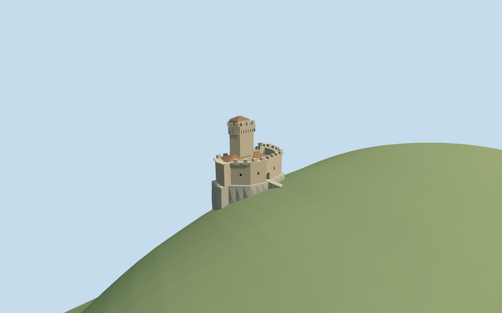

# De La Fratta

Standing Cesta/De La Fratta fortress: mapped irregular lower stone enclosure/occupied court, sparse recessed grilled windows and real recessed arched closed gate/short approach treads. Tall pentagonal keep, projected rounded machicolation mouths/corbel piers, crenellated upper crown and small tile-roofed top cabin. Two low map-associated roofed wings, restrained chimney/slits/roof edging, locally bounded faceted limestone outcrop contacting unchanged coarse DEM. Original shared-material geometry and four browser levels. No copied stone-crack/coat-of-arms atlas, museum collection/furnished rooms, temporary visitors/masts/ropes or other independent buildings/whole ridge.

## Evidence and reconstruction

Published dimensions and reconstructed details are separated in spec.json. Primary references:

- [Reference](https://commons.wikimedia.org/wiki/File:Torre_Cesta_-_San_Marino_-_GT_01_-_2024_04_30.jpg)
- [Reference](https://commons.wikimedia.org/wiki/File:Tower-Cesta-San-Marino-May-2009.jpg)

Standing Cesta/De La Fratta fortress: mapped irregular lower stone enclosure/occupied court, sparse recessed grilled windows and real recessed arched closed gate/short approach treads. Tall pentagonal keep, projected rounded machicolation mouths/corbel piers, crenellated upper crown and small tile-roofed top cabin. Two low map-associated roofed wings, restrained chimney/slits/roof edging, locally bounded faceted limestone outcrop contacting unchanged coarse DEM. Original shared-material geometry and four browser levels. No copied stone-crack/coat-of-arms atlas, museum collection/furnished rooms, temporary visitors/masts/ropes or other independent buildings/whole ridge.

## Model and axes

6,726 triangles; 20,178 vertices; 6 material groups; 811,008 bytes. Native bounds: -10.084, -6.474, -15.492 to 11.708, 28.227, 13.527. Source hash: `sha256:b6c027eebd1659a5f0d5745c3aac0d88075aa073f8db537371517eb84ff15bca`.

{"x":"east","y":"up","z":"south"}

The geographic proposal uses exact-QID OpenStreetMap evidence. Map-derived orientation and estimated architectural details require real-site visual review; preview eligibility is distinct from geographic/fidelity approval. Map attribution: © OpenStreetMap contributors, ODbL-1.0.

## Reproduce

Run `node packages/worldgen/scripts/generate-additional-landmarks.mjs --ids=de_la_fratta` (or add `--check`). The generator preserves manually edited masters by checking their baseline hashes. Import through the standard authored-model workflow with optimization disabled; then capture all QA cameras, including shared-surface views.

## Pending work

- Standing Cesta/De La Fratta fortress: mapped irregular lower stone enclosure/occupied court, sparse recessed grilled windows and real recessed arched closed gate/short approach treads. Tall pentagonal keep, projected rounded machicolation mouths/corbel piers, crenellated upper crown and small tile-roofed top cabin. Two low map-associated roofed wings, restrained chimney/slits/roof edging, locally bounded faceted limestone outcrop contacting unchanged coarse DEM. Original shared-material geometry and four browser levels. No copied stone-crack/coat-of-arms atlas, museum collection/furnished rooms, temporary visitors/masts/ropes or other independent buildings/whole ridge.
- Exact-QID OSMway59329686 is standard PMTiles primary35184431418518; two corresponding parts35185154011759/760 control the northern wing/polygonal end and central square room. Retain anchor12.451359066,43.932622165 and heading0/native east/south vertices. Mapped long-axis internal angle+1.23483791576rad places local+X towardSSE; this is opposite in sign to the engine heading convention. Photographs control the keep/corbel/crown and lower roofed-wing relationship; fine keep footprint across the northern/central mapped parts, side of the lower gate and room allocation remain picture/map approximations, about5m/30degrees. Main mapped enclosure remains26.6x12.6m. Other nearby map buildings are independent, including the unlabelled southern curved footprint; no attribution is invented for them.
- No qualified height is supplied by the retained catalog or vector controls. Picture-led nominal estimates: curtain parapet8.0m/merlons9.15m above occupied court; keep shaft to16.9m, machicolation band to18.3m, upper parapet to19.55m/merlons20.65m; small upper cabin/tile hip reaches22.4m. Roofed lower wings around7.4–9.7m, narrow stack about10.4m. Pentagonal keep allocation within the north map part, window/corbel inventory, roof profile and repair patches remain simplified estimates. The Monte Titano739m point is a separate nearby peak, not this model height/datum.
- Retain original6m standard Mapzen grid/native paths/water and every independent building. Only the three corresponding main castle/part shells are replaced with2cm pad. The court is level above sampled occupied-envelope maxima and nominally1.2m above the native approach endpoint; a narrowly bounded original faceted limestone outcrop extends down to sampled native grade around the castle, with buried contact skirts. It approximates the pictured cliff without changing terrain or claiming a surveyed rock face. Entrance treads follow the short mapped-side approach down to existing grade. No whole-ridge slab, terrain flattening or ground/water cutout. DEM greatly smooths the cliff: absolute court/foundation/rock levels and approach route are visualization fits.
- One2024 whole picture and one2009 close view carried through this construction round; exact-QID map envelope/two parts guide approximate layout. Keep allocation, heights, doorway side and fine inventory remain5m/30degree picture/map estimates. Bounded rock outcrop contacts unchanged coarse DEM without claiming a surveyed cliff. No furnished museum/whole ridge or copied stone/photo atlas.

This bundle follows the medium-fi standard. Medium-fi appearance and geographic fit are reviewed separately. Hash-bound visual acceptance is recorded separately after capture inspection.

## Additional geographic data

©OpenStreetMap contributors; Protomaps; Mapzen/USGS terrain.
