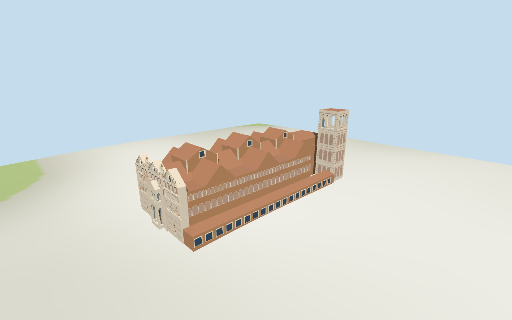

# ferrara_cathedral — Ferrara Cathedral review

Reviewed 2026-10-16 against current source/runtime bytes. Accepted for medium-fi exterior and approximate horizontal placement. Roof/stage interpretations and exact host-ground contact remain unverified.

## Built result

Inspected all 11 current portable/source-terrain frames. Three pale pink/cream marble gables, three rose windows, stacked blind arcades and a projecting two-stage protyrus establish the west front. The long brick body has three raised transverse roof monitors, a round eastern apse and continuous south shop range. A separate striped Renaissance campanile has four orders and a genuinely open triple-arched top stage. Corrected sideways front/porch gables, rose-window occlusion, monitor glazing hidden by roofs, duplicated body geometry blocking side portal air, brick-colored projecting marble piers and cornice height overshoot. Fine sculpture, lettering and shop details remain simplified.

Medium-fi exterior based on actually inspected 3impact 2009 west-front and Jean-Christophe BENOIST 2024 south-side photographs, plus standard viewer PMTiles/DEM. No bespoke plans or surveys and no redistributed reference images. The latter file description says Parme; its title, coordinates and visible Ferrara architecture support the recorded identity. Tower top is partly cropped; its flat completion is an approximation of the visible unfinished square stage. Fine saints/lions, relief program, inscriptions, exact tracery, shop branding, hidden roofs, complete interiors/bells and engineering details are approximate or excluded. Current finish, exact ground joins and physical-device performance are unverified.

## Shared surfaces and geographic fit

Inspected all 11 current shared/geographic frames. Five existing cached 256² brick, ashlar, continuous limestone, ceramic tile and plain wood graphs serve seven merged material groups; skyline uses one draw. Pink/cream stripes share the ashlar graph. Metric UV repeats, linear tints and flat architectural normals; visible stone courses, brick and tile repeats. Blue-grey glass is local PBR. No embedded images, reference-photo textures, unique facade maps or baked lighting. Each graph loads once; eviction leaves zero live model geometries.

Exact way/338822833, Q671933 and multilingual identity match current whole 35184710911665. All 124 current raw points in 16 controls are retained: 33 whole points, 71 points in 13 nested parts, 16 campanile points and four western-shop points. Earlier whole outline, all properties and height fields remain source inputs. Anchor [11.620399584,44.83556197], heading -0.427010147972 rad, unchanged; +X east-southeast apse, -X west-northwest facade, +Z south-southwest shops/campanile. No horizontal rescale. Whole 21 m plus roof rise 7 m, front parts 30 m, transverse/choir parts 29 m, raised monitor parts 34/35 m and campanile 45 m retain their documented stage interpretations. The 8 m western shop controls a picture-led extended south shop row. Part datums, roof/eave splits and facade/porch partitions are approximate. Replaced duplicated central body projection with the open porch; raw controls remain intact. Local UV-preserving triangle subdivision prevents conservative viewer stamps from hiding neighboring buildings or the south street. All 132 actual footprint checks cover the 16 controls and preserve four neighbors, west square and south street. DEM datum 17.206994 m, raw control perimeter -1.16 to +0.19 m, estimated floor 0.4 m. Footings cross Y=0 and extend below samples. No flattening, host DEM change or road replacement. Exact plaza/door joins, base clipping, absolute altitude and walking remain unverified.

## LOD and lighting review

Inspected all 27 current medium-fi frames: Economy/High, noon/late, three distances, texture-free silhouette, six details, four matched whole LODs and four transitions. Skyline 987 triangles retains the triple-peaked front, projecting porch, long shop/body, raised cross roofs, apse and tower air/flat cap. District 3,982 adds shared surfaces, simplified facade and tower-stage rhythms and grouped shop bays. Street 15,783 adds fuller recessed facade, rose spokes, shop frames and side arcades. Closeup/master 30,986 refine column and gallery rhythms, nested surrounds and low-frequency stone bands. Distant blind/gallery/window fields and grouped shops are intentional simplifications; full side arcade detail appears at street. Regional townhouses are fixtures. Physical laptop/phone timing remains pending.

## Browser budgets

| Level | Triangles | Bytes | Draws |
| --- | ---: | ---: | ---: |
| skyline | 987 | 75,784 | 1 |
| district | 3,982 | 302,284 | 7 |
| street | 15,783 | 1,169,304 | 7 |
| closeup | 30,986 | 2,298,972 | 7 |

Initial skyline plus district: **378,068 bytes** of geometry. Master: **3,722,540 bytes / 30,986 triangles**. Five shared 256² graphs; zero embedded images. Download bytes exclude graph definitions and runtime texture generation. Physical-device timing remains pending.

## Verification

Targeted byte reproduction, source/import/LOD/input/report hashes, source/recipe inventory/schema, scene validation and 30-tick simulation pass. Six Khronos validations have zero errors, warnings and images. **193 geometry probes**, **132 actual viewer-footprint checks** and **49 inspected current frames** pass. Actual shared graph read-once/unload, split vertex streams and equal CPU/GPU reservations pass. Simulation hash: sha256:7cf8b9d937951f1f7c634f2f3b890d73963eb215263cf4033dcf58fc20927f65.

Source hash: sha256:fb3f9caea02b2488fd1cf2cc0a4b8f9c273fbe77af93caa688278614f8503bb3. Runtime hash: sha256:eafd27089f082fbaa88e308b7d1d9480aab49a34246da5c0eeeca75d7ffa3846. Input hash: sha256:67939685adf5d7a97efdc75a03deca4715e3a42f38387c0b32f7abf4744d4639.

Commands: targeted generate/import/LOD/register-landmark-previews --ids=ferrara_cathedral; generate-additional-landmarks.mjs --ids=ferrara_cathedral --check; capture-structure-models --ids=ferrara_cathedral --reflections --antialias --fit-shadows; capture-landmark-library --ids=ferrara_cathedral --reflections --adaptive-clipping --bounded-placement; capture-medium-fi --ids=ferrara_cathedral --reflections; molen validate; molen sim run --ticks 30 --hash. Bulk captures remain ignored. Next routine source checkpoint: new_cathedral_linz–st_stephans_cathedral_passau.

## Limits

- Whole height21 m and roof:height7 m retained as lower body/eave21 m and ordinary tile ridge28 m. Current parts30 m control the three front gable peaks;29 m parts control three broad transverse roofs and long choir/apse roof;34/35 m inset parts control the raised central roof monitors. Their roof-wall split is estimated: transverse eaves21 m, monitor eaves29 m, apse eaves26 m. Separate mapped campanile45 m is its adopted total above the estimated0.4 m floor. Four tower-stage boundaries10/21/32/45 m, round/pointed aperture partitions and local facade/porch heights are picture estimates, with unverified part datums. Shop8 m height is retained for its mapped western control; extension of the shop row along the south side is picture-led. No independent dimension facts or horizontal rescale.
- Standard viewer DEM datum17.206994 m, raw control perimeter-1.16..0.19 m. Estimated floor0.4 m; footings crossY=0 and extend below samples. No flattening,host DEM change or road replacement. Exact pavement/door joins,base clipping,absolute altitude and walking remain unverified.
- Medium-fi exterior from two actually inspected western and southern2024/2009 photographs and standard viewer PMTiles/DEM only.Fine sculpture,saints/lions,relief panels,tracery lobes,inscriptions,shop branding,hidden roof partitions,full interiors/bells and engineering are approximate or excluded.Tower top partly cropped in side reference;flat completion follows the visible unfinished square stage.Temporary works omitted.Current finish and exact host-ground joins unverified.Physical laptop/phone timing pending.
- Skyline retains triple-gable front,projecting porch,tower air/flat cap,long shop/brick body,raised transverse roofs and round apse.District adds shared surfaces,selected galleries/doors and tower-stage rhythm.Street adds fuller arcades,recessed glazing/doors,actual open protyrus and triple belfry apertures.Closeup/master refine nested surrounds,slender columns and gable arcade rhythm.Regional neighbors are fixtures.

This accepts the recorded exterior and approximate horizontal scope. The 1,000-candidate project remains incomplete.
