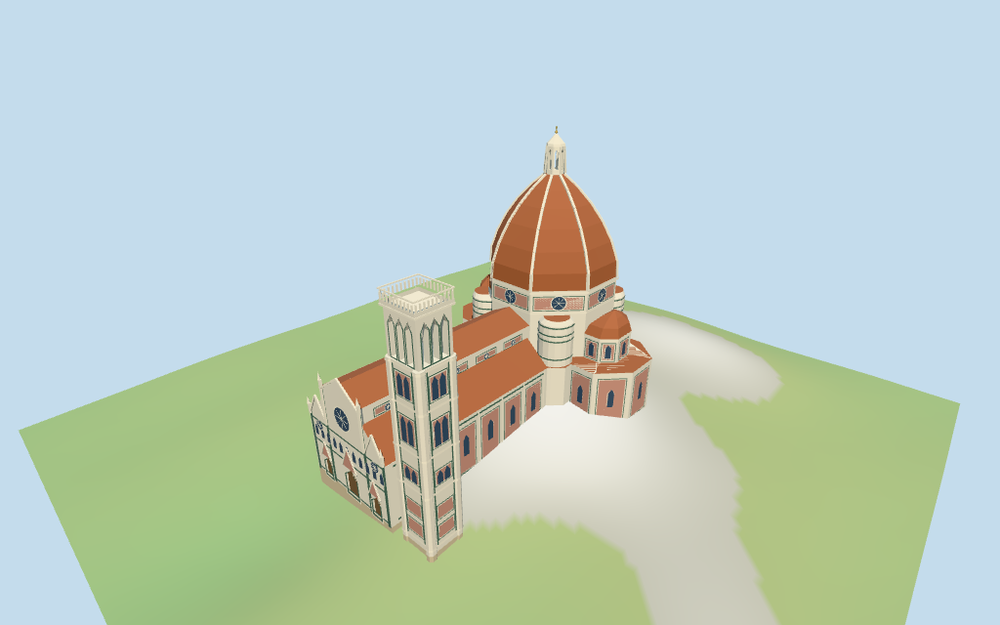

# Florence Cathedral

Individual Florence cathedral exterior with mapped nave/tribunes/buttress bodies, ribbed octagonal red dome and open lantern/gold crown, polychrome west facade with three closed pointed portals and rose windows, and adjacent square Giotto campanile with open triple belfry.

## Evidence and reconstruction

Published dimensions and reconstructed details are separated in spec.json. Primary references:

- [Reference](https://www.jnsm.com.ua/h/0705Q/)
- [Reference](https://www.florenceduomo.it/en/florence-brunelleschi/travel/giottos-campanile-combine-with-dome)

Three existing shared256-square graphs supply marble, terracotta tile and continuous foundation limestone. Cream/green/pink are linear vertex tints with metric UVs; glass/doors/gold use simple colors, no unique embedded image.

## Model and axes

9,500 triangles; 28,500 vertices; 7 material groups; 1,143,988 bytes. Native bounds: -78.980, -12.893, -48.705 to 77.818, 109.500, 48.604. Source hash: `sha256:8705a40fd90ac73b4137222010410f2be5ac72eb505bf8cffbf04936f3df1f14`.

{"x":"east along nave toward dome","y":"up","z":"south toward campanile"}

Two inspected aerial photographs and standard viewer PMTiles/DEM guide the cathedral/campanile exterior. Baptistery/museum/interiors excluded; detail/datum/ground joins approximate. ©OpenStreetMap contributors,ODbL-1.0.

## Reproduce

Run `node packages/worldgen/scripts/generate-additional-landmarks.mjs --ids=florence_cathedral` (or add `--check`). The generator preserves manually edited masters by checking their baseline hashes. Import through the standard authored-model workflow with optimization disabled; then capture all QA cameras, including shared-surface views.

## Pending work

- Mapped main/component outlines and nominal25/45/85/114.5m heights control exterior fit; drum/shell/lantern split, portal/rose proportions, campanile intermediate levels and all ornament are approximate picture-led geometry. Contradictory min_height114.5/height17 part is excluded from height inference.
- NativeY0 follows standardDEM73.4272m. Estimated−5m common floor follows typical perimeter samples rather than the raised anchor. Coarse DEM varies about−10.4m westfront,−6.65m tower and−5.18m eastapse; residual skirts/embedding and exact plaza/doorstep joins remain approximate. No surveyed datum or navigable interior/collision certification.
- Skyline retains red ribbed octagonal dome/lantern, stepped westfront, nave/three tribunes/four buttress bodies and separate square campanile. District adds polychrome panel rhythm/roses and open tower belfry; street/closeup add recessed closed portals, open lantern, cornices and sparse pinnacles. No exact statues, lettering, reliefs, structural shell thickness or full interiors.
- Separate baptistery, museum, surrounding city and vegetation remain outside this asset. Physical laptop/phone measurements remain pending.

This bundle follows the medium-fi standard. Medium-fi appearance and geographic fit are reviewed separately. Hash-bound visual acceptance is recorded separately after capture inspection.

## Additional geographic data

©OpenStreetMap contributors; Protomaps; Mapzen/USGS terrain tiles.
