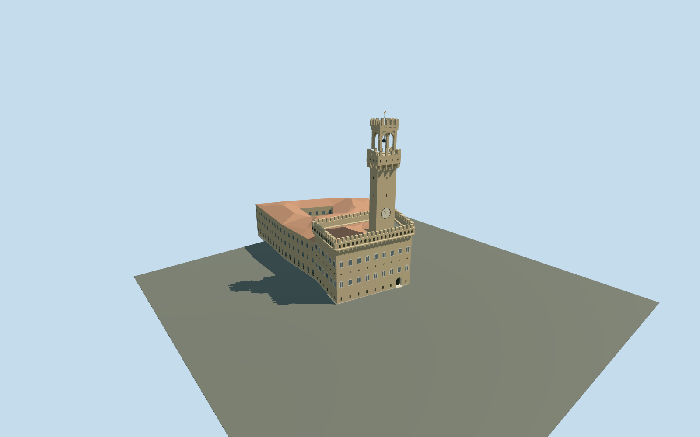

# Palazzo Vecchio, fortress palace and Torre di Arnolfo

Connected Palazzo Vecchio exterior: mapped palace ranges and four open courts, rusticated buff masonry, paired arched window rhythm, projecting machicolated gallery/crenellations, red ceramic roofs, actual recessed front portal/threshold/treads and the Torre di Arnolfo. Tower has a clock surface proxy with static hands, projecting corbelled terrace, actual open arched belfry, crown crenels and original schematic gold weather-vane. No copied heraldry/inscriptions/sculpture, furnished rooms, flags or adjacent Loggia/Uffizi models.

## Evidence and reconstruction

Published dimensions and reconstructed details are separated in spec.json. Primary references:

- [Reference](https://commons.wikimedia.org/wiki/File:Palazzo_vecchio_Florence.jpg)
- [Reference](https://www.firenzeyesplease.com/en/post/simone-olivari)

Connected Palazzo Vecchio exterior: mapped palace ranges and four open courts, rusticated buff masonry, paired arched window rhythm, projecting machicolated gallery/crenellations, red ceramic roofs, actual recessed front portal/threshold/treads and the Torre di Arnolfo. Tower has a clock surface proxy with static hands, projecting corbelled terrace, actual open arched belfry, crown crenels and original schematic gold weather-vane. No copied heraldry/inscriptions/sculpture, furnished rooms, flags or adjacent Loggia/Uffizi models.

## Model and axes

8,110 triangles; 21,084 vertices; 5 material groups; 859,796 bytes. Native bounds: -8.391, -1.837, -29.365 to 118.373, 94.200, 60.966. Source hash: `sha256:1c51423c5b1cf9806ac0dd514a03171c5d1c2eb9f6ef8b24e6762706c4fd70af`.

{"x":"east","y":"up","z":"south"}

The geographic proposal uses exact-QID OpenStreetMap evidence. Map-derived orientation and estimated architectural details require real-site visual review; preview eligibility is distinct from geographic/fidelity approval. Map attribution: © OpenStreetMap contributors, ODbL-1.0.

## Reproduce

Run `node packages/worldgen/scripts/generate-additional-landmarks.mjs --ids=N0764` (or add `--check`). The generator preserves manually edited masters by checking their baseline hashes. Import through the standard authored-model workflow with optimization disabled; then capture all QA cameras, including shared-surface views.

## Pending work

- Connected Palazzo Vecchio exterior: mapped palace ranges and four open courts, rusticated buff masonry, paired arched window rhythm, projecting machicolated gallery/crenellations, red ceramic roofs, actual recessed front portal/threshold/treads and the Torre di Arnolfo. Tower has a clock surface proxy with static hands, projecting corbelled terrace, actual open arched belfry, crown crenels and original schematic gold weather-vane. No copied heraldry/inscriptions/sculpture, furnished rooms, flags or adjacent Loggia/Uffizi models.
- Q271928 and relation1461712/native52776559594960 identify Palazzo Vecchio. Three integral mapped sections and tower way361442653/native35184733531485 give five owned records. Current parent supplies exact occupied plan and four court holes; part heights/roof subdivisions remain approximate. Origin is the mapped tower footing center. Internal +X south-southwest along the Piazza facade, +Z west-northwest into Piazza della Signoria. Native east/up/south axes are baked, heading 0. Only the five owned records are replaced; independent buildings remain.
- Picture-led medium-fi exterior. Source tower height 94m and parent 17m are unqualified map controls, not survey. Working west block eave 30m, gallery to 34m/crenels to 36m, rear ranges 23m and high connecting range 28m with pitched tile roofs. Mapped tower shaft rises from the palace to 67m; projecting terrace 67..76m, open arched belfry 76..87m, crown/merlons to 92m and schematic vane to 94m. Subdivisions, roof junctions, inventories and unseen elevations are reconstructed. Main portal has a 1.4m recess, curved soffit, 0.35m threshold and short treads. Clock face/hands are static proxies; no copied numerals or coats of arms. No furnished interiors or adjacent monuments. Tower merlons have V notches at district/street/closeup; skyline reduces them to simple crenels. Crown merlons reach 90.25m; vane remains 94m. Gallery arches/windows and static clock are exterior proxies; belfry arches are genuine open geometry.
- Qualified approximate native exterior fit on original Protomaps20261020/Mapzen 201x201/6m terrain. Uncovered Piazza datum 64.24965730435895m, working floor +0.2m and foundation -1.837m. Boundary grades -1.687..0.502m expose downhill foundation and leave minor uphill base burial. Main portal reveal/threshold remain exposed; some low exterior treads meet the original path/ground. Exact Piazza paving, thresholds, stairs and accessibility are unverified. All four courtyard holes, Piazza, original heights/roads and 243798.838m² water remain. Five owned records are replaced, preserving 2698 resident / 3351 wider independent buildings. No bespoke terrain or flattening.

This bundle follows the medium-fi standard. Medium-fi appearance and geographic fit are reviewed separately. Hash-bound visual acceptance is recorded separately after capture inspection.
