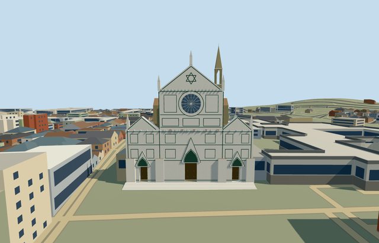

# N0770 — Basilica of Santa Croce

Reviewed 2026-10-23. **Completed medium-fi church/campanile exterior; qualified approximate native fit.**

## Built

The church has its long raised nave, repeated lower aisle gables, transept, rear chapels and polygonal apse under separate tiled roofs. The pale marble front has three gables and recessed wooden portals, layered pointed hoods, a rose proxy with nearby tracery, green/pink geometric inlay and five pinnacles. Both clerestory rows follow the actual tapering nave edges. The separate mapped campanile has an open belfry with pointed spandrels, a clock abstraction and slender spire. Broad supported entrance treads retain their closed bases.

Seven roles share six existing 256px graphs: weathered limestone, marble (trim/pink), basalt, ceramic tile, storefront and plain wood. Six textured draws/one skyline; metric UVs, linear tints, separate vertex streams and equal CPU/GPU geometry bytes. No embedded images, private atlas or new graph.

| LOD | Triangles | Bytes | Draws |
| --- | ---: | ---: | ---: |
| skyline | 996 | 83,044 | 1 |
| district | 1,536 | 135,652 | 6 |
| street | 2,008 | 176,876 | 6 |
| closeup | 2,556 | 225,600 | 6 |

Initial skyline + district geometry: **218,696 bytes**. Skyline retains the complete church/campanile envelope and five front pinnacles, with three coarser front treads.

## Placement and limits

Q51177 and the named basilica POI identify [parent way777563049](https://www.openstreetmap.org/way/777563049), its 32 integral roof/facade parts and [campanile way662908308](https://www.openstreetmap.org/way/662908308). All **34 full native records** enter the ownership union, including small map-part overhangs. The actual 36-vertex parent and roof subdivisions control scale. Anchor [11.262246966362,43.76864171752301]; baked east/up/south axes, heading 0. Internal X runs south-southwest across the front; Z points west-northwest toward the piazza. Controls: [map-frame.json](map-frame.json).

The separately mapped convent/cloisters, Pazzi Chapel, refectory and city buildings remain independent. **2,314 resident / 2,733 wider independent buildings**, original 201×201 / 6m terrain and roads, and **182,931.513 m² water** remain intact. Failure retains all 2,348 resident originals. Every LOD/failure/unload restores ground/water and releases geometry; each used texture graph reads once.

The outside datum is 57.339917263194465m. Boundary grades +0.031..+4.453m, raised entrance floor +0.9m and foundation −0.35m give supported contact. Coarse rear ground buries up to about 3.55m of lower wall; some outer treads are partly buried on the higher side. Exact historical floor/grade, thresholds, accessibility, roof junctions/heights, hidden windows and ornamental details are approximate. Native unchanged ground supplies the fit; no bespoke terrain or flattening.

Retained adjacent procedural buildings partly hide lower aisle walls and the campanile base. Default synthetic street/block/transition views and some shared details crop the long church or spire tip. Custom complete-LOD views, source turntables and native whole views cover the envelope. Flat planes can bury grade-specific foundations/treads or reveal small cutout patches. No copied sculpture, frescoes, inscriptions, Dante monument, tombs or furnished interiors. Physical phone/laptop and dense-city measurements remain pending.

## Checks and references

**Six GLBs: zero Khronos errors/warnings; 309 actual mesh/contact probes; 52 current inspected frames; 45 PMTiles13/14/15 cases, including all 34 detailed owned records.** Selected generation/import/placement, strict medium-fi, scene/sim30 and two-recipe lint pass. Sim30 sha256:5031c64e6fc2e437cae51f51eeac128b42c2ba48b2f3fe90df6251adbab1002e. Current hash-bound evidence: [qa.json](qa.json).

- [Ordinary aerial](https://www.tickets-florence.it/basilica-of-santa-croce/): Headout published picture; photographer/date unestablished. Actually inspected 1600×1000 image.
- [Front photograph](https://commons.wikimedia.org/wiki/File:Basilica_of_Santa_Croce_-_0972.jpg): Wikimedia published picture; individual credit/license not established. Actually inspected 2973×2133 image fitted to viewport. Viewed only; no pixels redistributed.
- Standard Protomaps20261020/Mapzen extract retained from N0764; ©OpenStreetMap contributors, ODbL-1.0. No additional terrain download or bespoke source research.

Ordinary pictures and standard map data guided one continuous author/inspect/fix pass. Current review corrected front material projections, portal inlay clearance and both clerestory rows before approval.
