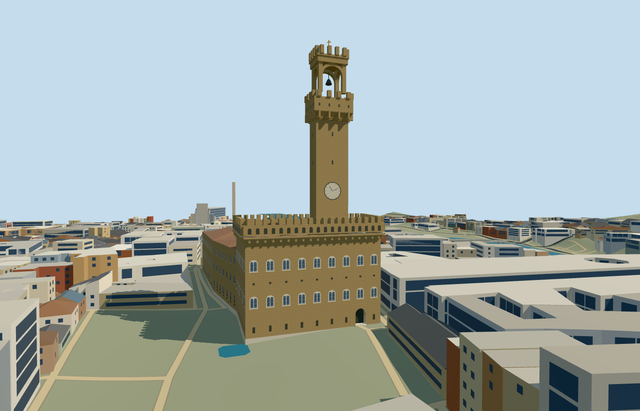

# palazzo_vecchio — Palazzo Vecchio

Reviewed2026-10-22. **Completed medium-fi connected palace exterior; qualified approximate native fit.**

## Built and inspected

Connected Palazzo Vecchio exterior: buff rusticated fortress block and red ceramic roof ranges, four open courts, paired arched window rhythm, projecting machicolated gallery/crenels and actual recessed entrance/threshold/treads. Torre di Arnolfo uses its mapped shaft footprint, separate static clock face/hands, projecting corbelled terrace, genuine open arched belfry with schematic hanging bell, V-notched tower merlons and original gold vane. Corrected the ownership mask for the slightly projecting tower, refined the tower merlons and framed the whole tower in the same author/inspect/fix pass. Windows, lower gallery arches and clock are exterior proxies; belfry and entrance have actual openings/recesses.

## Shared materials and LODs

Six roles use five existing 256px shared graphs: stone_sandstone, stone_limestone_raw, tile_ceramic, storefront and metal_painted. Sandstone repeats at 1.80 x 1.50m. Painted metal supplies dark accents and gold vane. No embedded image, private atlas or new graph. One skyline draw, five textured draws; separate POSITION/NORMAL streams and equal CPU/GPU geometry bytes. Each used graph reads once per native run; unload disposes geometry.

| Level | Triangles | Bytes | Draws |
| --- | ---: | ---: | ---: |
| skyline | 824 | 77300 | 1 |
| district | 1739 | 166316 | 5 |
| street | 5434 | 498732 | 5 |
| closeup | 8110 | 772164 | 5 |

Four authored LODs 824 / 1739 / 5434 / 8110 triangles; initial skyline+district geometry 243616 bytes, closeup 772164 bytes. Six GLBs zero Khronos errors/warnings; 135 actual mesh/contact probes and 12 actual PMTiles 13/14/15 cases with five owned detailed records. Inspected 52 current portable/shared/medium-fi/native frames. Every LOD/failure/unload preserves 2698 resident / 3351 wider independent buildings, original 201x201/6m terrain/roads/243798.838m² water and four court/Piazza/approach ground openings. Failure keeps all 2703 original buildings; unload restores ground/water and zero live geometry.

## Geographic fit

Q271928 and relation1461712/native52776559594960 identify Palazzo Vecchio. Three integral mapped sections and tower way361442653/native35184733531485 give five owned records. Current parent supplies exact occupied plan and four court holes; part heights/roof subdivisions remain approximate. Origin is the mapped tower footing center. Internal +X south-southwest along the Piazza facade, +Z west-northwest into Piazza della Signoria. Native east/up/south axes are baked, heading 0. Only the five owned records are replaced; independent buildings remain. Qualified approximate native exterior fit on original Protomaps20261020/Mapzen 201x201/6m terrain. Uncovered Piazza datum 64.24965730435895m, working floor +0.2m and foundation -1.837m. Boundary grades -1.687..0.502m expose downhill foundation and leave minor uphill base burial. Main portal reveal/threshold remain exposed; some low exterior treads meet the original path/ground. Exact Piazza paving, thresholds, stairs and accessibility are unverified. All four courtyard holes, Piazza, original heights/roads and 243798.838m² water remain. Five owned records are replaced, preserving 2698 resident / 3351 wider independent buildings. No bespoke terrain or flattening.

## Fidelity and limits

Picture-led medium-fi exterior. Source tower height 94m and parent 17m are unqualified map controls, not survey. Working west block eave 30m, gallery to 34m/crenels to 36m, rear ranges 23m and high connecting range 28m with pitched tile roofs. Mapped tower shaft rises from the palace to 67m; projecting terrace 67..76m, open arched belfry 76..87m, crown/merlons to 92m and schematic vane to 94m. Subdivisions, roof junctions, inventories and unseen elevations are reconstructed. Main portal has a 1.4m recess, curved soffit, 0.35m threshold and short treads. Clock face/hands are static proxies; no copied numerals or coats of arms. No furnished interiors or adjacent monuments. Tower merlons have V notches at district/street/closeup; skyline reduces them to simple crenels. Crown merlons reach 90.25m; vane remains 94m. Gallery arches/windows and static clock are exterior proxies; belfry arches are genuine open geometry. Native exterior fit remains a qualified approximation: coarse ground exposes downhill foundation and leaves minor uphill burial; some low entrance treads meet the original path/ground while the portal reveal/threshold remain exposed. Four native courtyard holes are preserved through all LODs. Heights, roof junctions, inventories, unseen elevations, historic paving/stairs and accessibility remain reconstructed or unverified. No copied sculptures, shields, numerals or inscriptions, flags, furnished rooms or adjacent Loggia/Uffizi models. Physical laptop/phone and dense-city timings remain pending.

## Targeted checks

Selected generation/import/placement, strict medium-fi, scene/sim30 and recipe lint pass. Sim30 sha256:82a127e6b9f571014627612f3ef31f58cacef9648f76d7ea2c1ab238d1ecb073. Current pins: [qa.json](qa.json); [source controls](map-frame.json).

## Viewed references

- https://commons.wikimedia.org/wiki/File:Palazzo_vecchio_Florence.jpg — Jebulon; 2011-06-02; CC0-1.0. Viewed only; no copied pixels.

- https://www.firenzeyesplease.com/en/post/simone-olivari — Simone Olivari / Firenze Yes Please; Not specified; No reuse license established; viewed only, no pixels copied or shipped. Viewed only; no copied pixels.

- https://www.openstreetmap.org/relation/1461712 — palace identity and integral parts; ©OpenStreetMap contributors, ODbL-1.0. Standard PMTiles/Mapzen only.

## Completion checklist

- [x] Rebuildable master/import, four authored LODs and shared materials.
- [x] Current actual architecture/context/native renders and geometry checked.
- [x] Explicit identity/orientation, exact ownership union and qualified native exterior fit.
- [x] Four courts/Piazza/approaches open; independent buildings/roads/terrain/water retained; failed loading/unload restoration checked.
