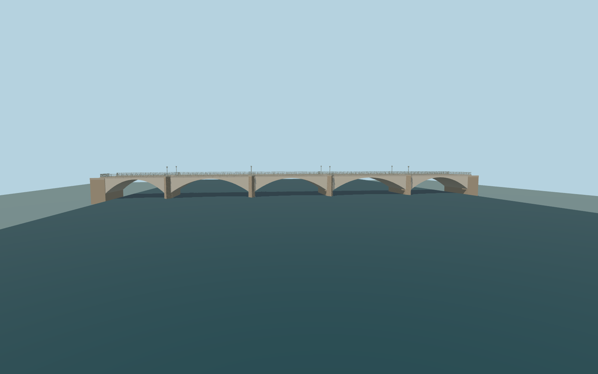

# Ponte alle Grazie

Current five shallow pale concrete arches across the Arno,with four unequal map-derived warm stone cutwaters,projecting pedestrian overlooks,stone pavements and open metal guardrails.

Original source:models/grazie-model.mjs and retained map/standard-terrain controls. Rebuild with `node packages/worldgen/scripts/generate-grazie-bridge.mjs`;append `--check` for exact bytes. Import/LOD commands select `--ids=ponte_alle_grazie`. GLBs are ignored outputs.

Five existing shared256px graphs,palette traffic paint,no private or embedded images. Detailed master and four browser tiers remain separate. Four mapped cutwater stations establish five unequal openings. Native terrain is unmodified;coarse urban bank returns do not certify raised quay crests or external road grades. Water rectangle is a separate review fixture. See model-brief.json and qa.json for exact scope/acceptance.

Original geometry uses the repository license. Maps:© OpenStreetMap contributors,ODbL-1.0;Protomaps. Raw terrain hashes/attribution:terrain-grid.json. Linked reference pictures are not redistributed or used as textures.
