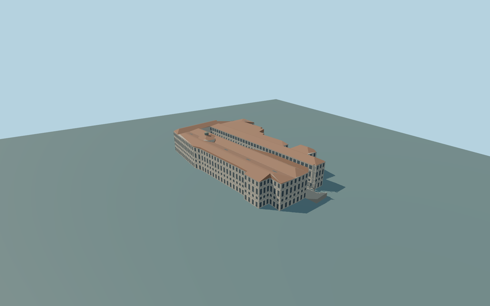

# Uffizi Gallery

Complete individual Uffizi principal galleries and irregular attached ranges, long open piazzale and real flat-lintel ground colonnades with closed rear walls, three open Arno arches, middle pedimented windows, upper glazed gallery, terracotta roofs/skylights and octagonal Tribune lantern. Independent PalazzoVecchio,LoggiadeiLanzi,the river andremote VasariCorridor remain context; no interiors or copied statues.

Rebuild: `node packages/worldgen/scripts/generate-uffizi-gallery.mjs`;append `--check` for exact source bytes. Select import/LOD/placement with `--ids=uffizi_gallery`. Detailed source and four browser tiers are separate ignored GLB outputs.

Complete individual Uffizi principal galleries and irregular attached ranges, long open piazzale and real flat-lintel ground colonnades with closed rear walls, three open Arno arches, middle pedimented windows, upper glazed gallery, terracotta roofs/skylights and octagonal Tribune lantern. Independent PalazzoVecchio,LoggiadeiLanzi,the river andremote VasariCorridor remain context; no interiors or copied statues.

Original picture-guided relative elevations on an approximate63m standard global Terrarium reference, not a surveyed floor datum. Uniform principal floor60.6m; a bounded original north transition meets both unchanged coarse-field outer corners. Deep occupied foundations seat the Arno facade above the urban/river slope. Exact historic riverbank and threshold heights remain uncertain; no invented staircase across the Arno road, bespoke survey or wider landscape flattening.

Window/roof/ornament inventories, concealed roofs, niches without copied statues, historic floor/riverbank grades and contact transitions are original approximations. Shared256px material graphs andfour browser tiers; physical-device timings and numerical LOD errors remain unmeasured.

Seven existing256px plaster,limestone,granite,ceramic tile,painted metal,window grid andpainted wood graphs,metric UVs andlinear colors. Skyline keeps thewhole principal geometry,open colonnade strips,three real river passages andTribune lantern. District adds sparse glazing;street adds facade frames;close-up adds pediments,pier panels andbalusters;source preserves fine column/trim profiles. LOD error estimates3/1.5/.7/.25m andphysical timings areunmeasured.

Original geometry:repository license. Map:© OpenStreetMap contributors,ODbL-1.0;Protomaps. Standard terrain:terrain-grid.json. Ordinary pictures stay local and are not redistributed or used as textures. Current acceptance:qa.json.
