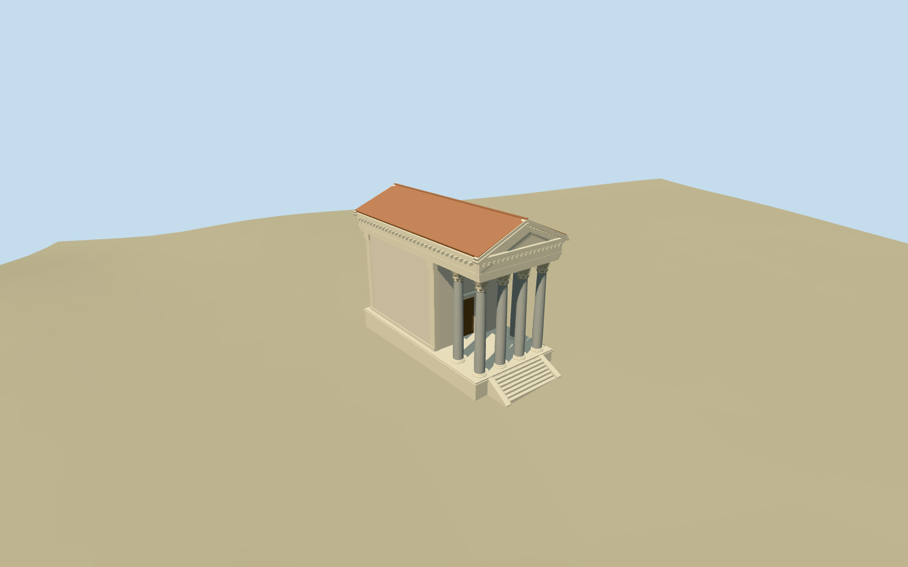

# N0536 — Temple of Augustus (Pula)

Reviewed2026-10-19 in one continuous author/build/inspect/fix round.

## Appearance

Inspected 48 final current source/shared/medium-fi/native-site/fallback views in one continuous brief/build/inspect/fix round. Six smooth grey Corinthian shafts, leafy capitals/concave abaci, real open front/side portico bays, recessed timber cella door, raised stone podium with centered stairs/solid cheeks, rubble-stone cella and engaged antae, layered entablature and plain triangular pediment with projecting dentil/modillion cornices, terracotta gable roof and simplified timber portico ceiling. Same-round rendering replaced an overly noisy trim texture with quieter shared raw limestone and moved the whole/side review cameras around the preserved City Hall. No copied readable inscription or narrative sculpture.

## Shared materials and browser levels

Five existing shared 256-square graphs: stone_drywall for stylized rubble walls, stone_limestone_raw for podium/capitals/entablature/pediment, stone_granite for the smooth grey shafts, tile_ceramic for the pitched roof and wood_plain for recessed door/ceiling. Metric UVs and linear muted tints; each graph read once by the production resolver. Four authored levels meet triangle/draw/download caps; initial geometry 347,308 bytes. Zero embedded images or unique atlas, separate GPU streams and matching CPU/GPU byte accounting. Eviction releases all model geometry.

| Level | Triangles | Bytes | Draws |
| --- | ---: | ---: | ---: |
| skyline | 844 | 89224 | 1 |
| district | 2584 | 258084 | 5 |
| street | 8908 | 889428 | 5 |
| closeup | 10732 | 1064252 | 5 |

Inspected noon/late, economy/high, whole silhouette, six-column portico/pediment, capital/cornice and cella/roof details, all four levels and transitions. Skyline keeps six smooth shafts/cap masses, open column gaps, cella, podium/stairs and gable/pediment silhouette with simpler entablature. District restores moulding/dentil bands; street/close add original simplified leaf/volute geometry and timber panel/ceiling detail. Flat shared stages can expose terrain-relative foundations; native/source terrain carries contact judgment. Green native fixture terrain and neighboring procedural facades remain host context, not a reconstruction of the paved Forum or City Hall architecture.

## Approximate map fit

Exact-QID Q770030/way119102927 and named standard building/POI35184491191759 fix the 19.804x9.354m temple envelope beside the distinct City Hall35184491191751. Anchor 13.84185,44.8702; heading 0, internal local+x angle -0.441743326094rad, local+z follows the long axis toward the southeast Forum; body origin [-1.17138,0.92686]m relative to anchor. Replace only the temple shell with 2cm numeric tolerance. All 360 independent in-tile building inputs, including City Hall, remain byte-equivalent; original 6m native terrain/water remain unchanged. Small local level podium has grade-buried bottom edges and short descending central stairs. No broad Forum slab, flattening or ground/water cutout. Loaded levels retain 360 native records; failure retains all 361 originals; unloading releases model geometry. Preserved neighboring shells can obscure some natural views; review cameras use the open side.

## Limits

Accepted medium-fi standing exterior from two inspected ordinary front/side pictures and standard PMTiles/Mapzen. Smooth monolithic shafts are deliberately authored instead of reusing the common helper flutes; the existing original Corinthian base/capital vocabulary is reused at scaled proportions. Column height about 8.2m, entablature/pediment/roof heights, cella split, six column/anta/door stations, exact stone/cornice inventory, hidden rear treatment and ceiling construction remain picture/map-led approximations. Shared rubble texture is a stylized material approximation, not a copied photograph or exact coursing survey. No copied readable inscription, narrative sculpture, complete museum interior or surveyed Forum/doorway levels. Coarse urban DEM does not resolve paved thresholds; local pedestal height is approximate. No bespoke survey/archive research. Physical-device/dense-city timings remain pending.

## Selected checks

Six Khronos files: zero errors/warnings.162 actual geometry/contact probes; 48 current inspected views. Scene validation/sim30 and strict selected medium-fi audit pass. Source and runtime hashes/material bindings/LOD caps verified.

Rebuild: node packages/worldgen/scripts/generate-additional-landmarks.mjs --ids=N0536; node packages/worldgen/scripts/import-next-1000-models.mjs --ids=N0536; node packages/tooling/scripts/generate-landmark-lods.mjs --ids=N0536 --force.

Source: sha256:ddd7f377f5723b6d55138b16418d254e6580606eec661f0edc7730fce0b599b2

Runtime: sha256:65d01409b0ba65667911c520676cd72bd24b8bbebc00a756f4b022f0d5ff1af7

Input: sha256:24abc1b2ffe4bded76d557daa05a72a131d67e6b8b39ac7727b7ce5d05b5c1e4

## Viewed ordinary pictures

https://commons.wikimedia.org/wiki/File:Augustus_temple_Pula.jpg — Orlovic (assumed by Commons); Public domain (PD-self). Viewed only; no pixels copied.

https://commons.wikimedia.org/wiki/File:Side_Wall,_Temple_of_Roma_and_Augustus_(Pula).jpg — MumblerJamie; CC BY-SA2.0. Viewed only; no pixels copied.

## Source binding maintenance — 550 checkpoint

Exact prior input reconstructed using prior recipe list and preserved helper text. Seven helper edits change only the first comment line, making existing source recipes explicit. All six approved model files are unchanged. Existing visual acceptance is retained through byte-equivalent rebuilding; this is not a new visual review.

Previous input: sha256:24abc1b2ffe4bded76d557daa05a72a131d67e6b8b39ac7727b7ce5d05b5c1e4

Current input: sha256:e0bbae6195a16f3e2eef2ee019f56c20ba69546c2745bf9146673098e27524f3
