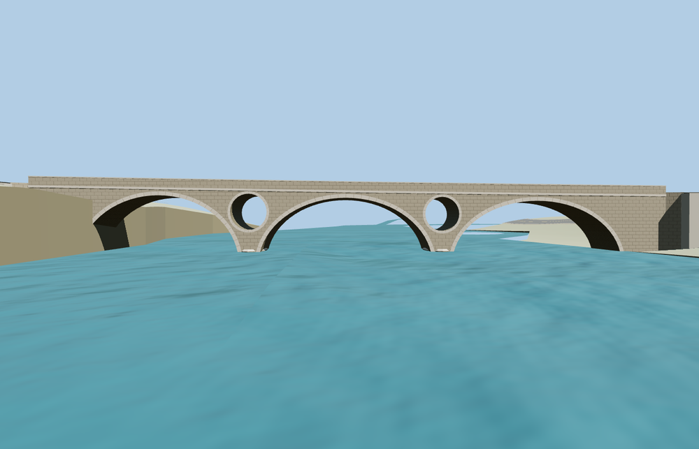

# Kosinj Bridge

Lika River masonry bridge with three clear stone vaults, two round through-oculi, dressed voussoirs, low rounded pier plinths, plain coping and a narrow paved deck.

The source master has 3,808 triangles. The skyline, district, street, and close-up tiers have 986, 1,610, 2,234, 3,294 triangles. The first two tiers total 179,208 bytes. The close-up tier is 218,320 bytes. Six GLBs passed validation and 34 current views were inspected.

All four tiers pass six road joins and eight bank approach samples within 0.15 m. Ten rays through the round openings and nine rays through the vaults remain unobstructed. Three probes along the mapped Lika centerline show at least 5.556 m of rendered headroom. The viewer retains all four neighboring buildings and the native terrain, water and independent routes. Model unload and failed-load fallback both passed.

The mapped 73.029 m outline and the attributed road set the signed frame. Vault spans and stone details follow ordinary photographs. The plinth caps in the three nearest tiers sit approximately 0.235 m above the native water at the sampled tips. The skyline tier simplifies the plinth profile. The standard terrain places the south approach below the deck and produces a steep support face. Heights and river clearance are visualization measurements. Physical-device timings remain unmeasured.

Rebuild with `node packages/worldgen/scripts/generate-kosinj-bridge.mjs`. Append `--check` to compare exact output bytes. Use `--ids=kosinj_bridge` for targeted import, LOD, placement, and readiness. The generator is registered in asset-build.json.
