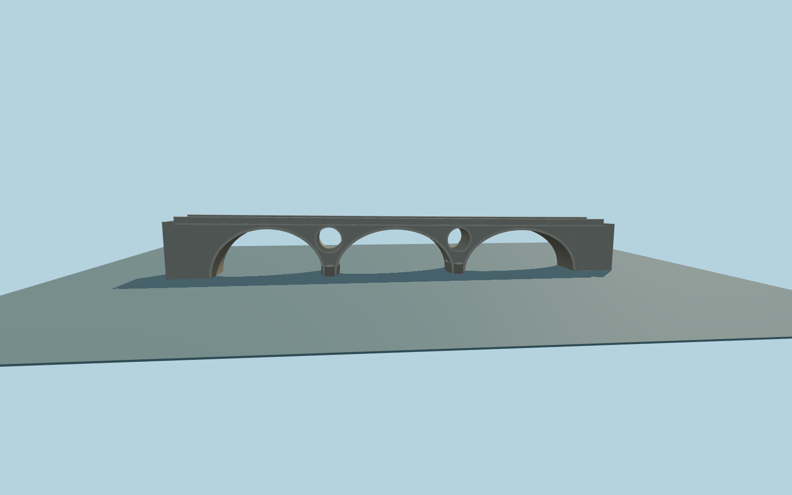

# Kosinj Bridge

Lika River masonry bridge with three clear stone vaults, two round through-oculi, dressed voussoirs, low rounded pier plinths, plain coping and a narrow paved deck.

Run `node packages/worldgen/scripts/generate-kosinj-bridge.mjs` to rebuild the source master. Append `--check` to compare the exact bytes. Use `--ids=kosinj_bridge` for targeted import, LOD generation and placement.

The retained outline and attributed route establish the signed axis and bank contacts. Vault proportions, oculi and coping follow ordinary side photographs.

The deck grade and approach support fit the standard terrain. The south approach terrain is lower than the deck in the source DEM.

Original geometry:repository license. Map:© OpenStreetMap contributors,ODbL-1.0;Protomaps. Standard terrain:terrain-grid.json. Ordinary pictures stay local and are not redistributed or used as textures. Current acceptance:qa.json.
