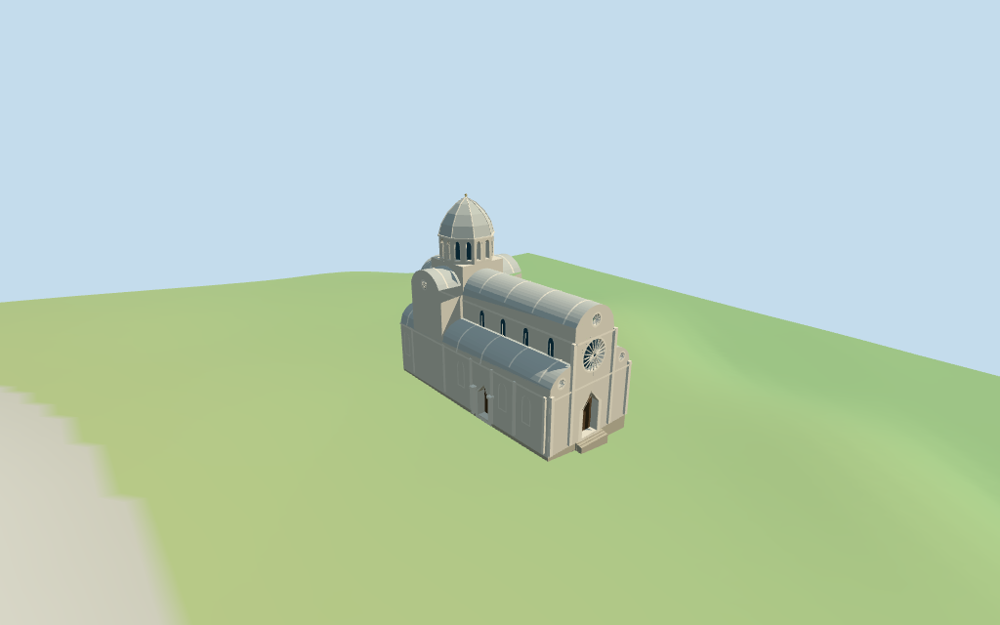

# N0339 — Šibenik Cathedral review

Reviewed 2026-10-14 against current source/runtime bytes. Accepted for this medium-fi exterior and approximate geographic scope.

## Built result

Inspected all 11 final portable/source-terrain frames. Individual Šibenik exterior preserves the pale curved nave/aisle/transept stone roofs, selected roof ribs, octagonal windowed drum/pointed dome, western curved crown/large and small rosettes, recessed west/north portals with closed doors, selected side bays/pilasters and three mapped eastern apses. Corrected the floating crossing plinth with a full support block and restored the small transept roses. Exact sculpture and Lion Portal figures are excluded.

Individual medium-fi exterior from two useful west/north pictures and standard PMTiles/DEM. Current map values are20.16m nave,32m dome,12.56m aisles,20.5m transept,14.9m central apse and8.84m flanking apses. Eave/drum roles, curved profiles, windows, small landing and thresholds are picture-led interpretations rather than independently surveyed heights. Exact sculptures/head frieze, full tracery, interiors and adjacent palace/town/plaza are excluded. Physical phone/laptop timing remains pending.

## Shared materials and placement

Inspected all 11 final shared/geographic frames. Four existing 256-square graphs provide sandstone walls, raw limestone trim/roof, weathered limestone foundations and plain wood. Shared graph bindings use metric UVs and linear tints; glass is flat blue-gray. Each graph reads once; unloading releases all model geometry and restores ground. Deep drum reveals can hide glazing from oblique angles. Flat placement views check the signed outline; source heightmap views complement approximate slope contact. Diagnostic ground colors are not local landcover.

Retained exact-QID way162544749 plus one current parent/eight parts preserve the approximately41x18m envelope. Western rose/portal versus mapped eastern triple apses resolves heading−0.901146475495rad; north portal faces native−Z toward the uphill square. All nine raw transforms match. Current part union differs from the688.291m² parent by0.297m² in two narrow approximately7cm edge slivers, consistent with tile quantization; the full parent supplies the lower body/foundation. StandardDEM datum8.650114m and estimated1.4m floor clear sampled footprint peak1.091m. Plaza/stair thresholds and coarse terrain joins remain approximate; no road replacement or certified walking surfaces.

Inspected all 27 final Earth-lighting frames: Economy/High, noon/late, three distances, silhouette, six details, four matched levels and four transitions. Skyline keeps curved stone roofs, octagonal dome and triple apses with coarse facets/mean tints. District adds shared textures, recessed closed portals, main rose aperture and selected windows; street restores drum apertures, small round cuts, roof ribs/pilasters; closeup refines vault/dome facets, frames and rosette spokes. Detail/profile changes remain visible; English-terrace neighbors are synthetic context.

## Browser budgets

| Level | Triangles | Bytes | Draws |
| --- | ---: | ---: | ---: |
| skyline | 431 | 45244 | 1 |
| district | 1669 | 160420 | 6 |
| street | 6923 | 614936 | 6 |
| closeup | 10441 | 933272 | 6 |

Skyline plus district: **205664 bytes** of geometry. Source master: **1304980 bytes /10843 triangles**. No embedded images. Four shared graphs are cached separately; initial geometry excludes graph definitions/texture generation. Separate POSITION/NORMAL streams report equal CPU/GPU buffer totals. Physical phone/laptop timings remain pending.

## Verification

- Exact targeted source reproduction with --ids=N0339 --check; current source/import/derivative and review hashes match.
- Six GLBs pass Khronos with zero errors, warnings or embedded images. Four authored levels meet triangle, draw and initial download limits.
- Nine raw map transforms, retained outline, current parent/part correspondence and standard DEM match; the 0.297m² quantized difference is recorded above.
- 92 imported geometry probes pass. Nave/apse roofs and crossing support are checked at all levels; portal recesses/closed doors, main rose and exposed clerestory panes in district/street/closeup; small upper round aperture and drum recess/glass in street/closeup. Frame-center mullions are intentionally solid. Declared 32m crown agrees across outputs and follows a map value, not an independent measurement.
- Four graphs read once; unload leaves zero live model geometries and restores ground.
- Source inventory/schema and source-frame/medium-fi readiness bindings pass.
- Scene validation and 30-tick simulation pass: sha256:574ad986f256fa0d61d419876e22d6b5388643639402b05507f48014f0fcb9c8.
- Inspected 49 final frames: 11 portable, 11 shared/placement, 27 medium-fi. Reports retain hashes,paths and cameras; bulk images stay local/ignored.

Source hash: sha256:23d68f28f1e9d8d741c75770c62c5a45a7b48c593e8507f3ab5f8dee5fff51dc. Runtime hash: sha256:9d29e2b86bc057d44c47734a3b6b592bd7d75bf2ca0b7cfbe0b3afbe7a6320f1. Input hash: sha256:536646c28312e83a441029e3ee835800a40a864fa6de4d4ff5fd92c23b3b6f2f.

Commands: targeted generate/import/LOD scripts; capture-next-1000-models.mjs --ids=N0339 --reflections --antialias --fit-shadows; capture-landmark-library.mjs --ids=N0339 --reflections --adaptive-clipping --bounded-placement; capture-medium-fi.mjs --ids=n0339_sibenik_cathedral --reflections; molen validate; molen sim run --ticks 30 --hash.

## Limits

- Current PMTiles provides20.16m nave,32m dome,12.56m aisle,20.5m transept,14.9m central apse and8.84m flanking-apse height values. Their roof/drum/eave roles are interpreted with two exterior pictures; dome top follows the32m map value, not a surveyed measurement. Eaves,window/drum stages,curved profiles,statue omissions and all thresholds remain approximate. Retained facts contain no published height/width/length values.
- Standard viewerDEM datum8.650114m; estimated level floor1.4m clears sampled footprint peak1.091m/perimeter-0.89..1.09m. Foundations descend to retained coarse terrain. Native−Z is uphill square/northern portal; exact plaza/stair/apse thresholds remain approximate, with no bespoke surveyed or certified walking claim.
- Current PMTiles controls are approximate and do not certify measured real heights. Selected rosette spokes,portal hoods,side bays,ribs,apse profiles and landing are approximations. Exact sculpture/lion figures,head frieze,full tracery,full interiors,neighboring palace/town/plaza and certified walking surfaces excluded. Physical phone/laptop timings pending.
- Skyline uses closed portals,coarse curved roofs/dome and mean tints. District adds shared textures,main rose aperture/recessed closed portals and selected windows. Street adds actual drum openings,small round facade cuts,roof ribs,pilasters and portal trim; closeup refines vault facets,dome ribs/windows and rosette spokes. Detail/profile changes remain visible.

Readiness records acceptance for this exterior scope. The 1,000-candidate goal remains incomplete.
