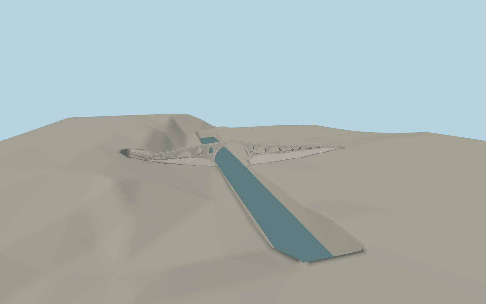

# Mes Bridge

Thirteen unequal stone arches with a21.5m main vault, raised pointed flood openings, the distinctive bent western approach, humped cobbled walkway, paired radial arch bands, low rough-stone parapets and edge-set step courses.

## Evidence

- [Primary reference](https://akt.gov.al/atraksionet/ura-e-mesit/)
- [Primary reference](https://drtkshkoder.com/fileadmin/user_upload/Ura_e_mesit_prokurim/Pasaporta_e_pasurise_kulturore_Ura_e_Mesit.pdf)
- [Primary reference](https://ahnp.ub.uni-heidelberg.de/journals/heritage/article/viewFile/21004/14776)
- [Primary reference](https://commons.wikimedia.org/wiki/File:Mesi_Bridge_2025.jpg)
- [Primary reference](https://commons.wikimedia.org/wiki/File:Mes_Bridge_Shkodra_02.jpg)
- [Primary reference](https://commons.wikimedia.org/wiki/File:Mes_Bridge_Shkodra_06.jpg)
- [Primary reference](https://commons.wikimedia.org/wiki/File:Mesi_bridge_detail.jpg)
- [Primary reference](https://www.openstreetmap.org/way/86888378)

Published dimensions and reconstruction assumptions are separated in spec.json. Source photos were consulted; no photos or third-party geometry are embedded. Map plan attribution: © OpenStreetMap contributors, ODbL-1.0.

## Source

334264 triangles; 30043348 bytes; 2 material groups. SHA256: sha256:48e9c29ae3338def6507e8e4f5691732b20cbabfbfd9f1e4a9c7d0d74936550d.

Shared surfaces (stone_drywall, stone_granite) are loaded through the central library; any transparent materials use local PBR parameters. Axis and provisional vertical datum are in spec.json.

Regenerate with node packages/worldgen/scripts/generate-researched-bridges.mjs --ids=N0011; append --check to verify. Import and capture through the standard next-1000 scripts. Geometry validation does not substitute for current-frame visual review.

## Reconstruction limits

- Original detailed exterior reconstruction; no survey-quality minor arch ordinates or hidden foundations are claimed.
- OSM maps124.721m walkway including bank approaches; the heritage authority108m historic body is kept separately. Published3.4m width provides a reconstructed transverse outline.
- Photographs and printed plan were inspected for shape; no external meshes, image textures or copyrighted sign artwork are embedded.
- Current rock/support tops use the original photo-scaled profile. Outer ramp controls and shoulder contacts use simplified ASIG terrain; neither the2m resampled grid nor the triangle mesh establishes2m survey accuracy.
- The public ASIG tileset does not state its vertical datum or redistribution license. Raw terrain tiles remain private research; sampled observations carry ASIG attribution. Relative host terrain contact avoids an assumed absolute vertical datum.
- The finite source terrain/water fixture is research context. Its bridge corridor uses the runtime opening plus a two-metre raster guard. A separate rectangular riverbed carve is reconstructed for this finite fixture; the raw terrain observations remain unchanged. Kir water level and bathymetry are reconstructed, not seasonal measurements.
- The original334084triangle/30021728byte master remains reproducible from the retained recipe, hashf0ac311a7395e85cddfa1ab2cc2e472ca53c734260d5e1387bcc2ab2883a896c. Current detailed source adds bank contact repairs; browser levels replace individual microstones/cobbles with shared256-square surfaces.
- Fine inscriptions, exact rock shapes, nearby modern concrete bridge, houses, vegetation and walkable navigation certification are excluded. Physical-device timings remain pending.
