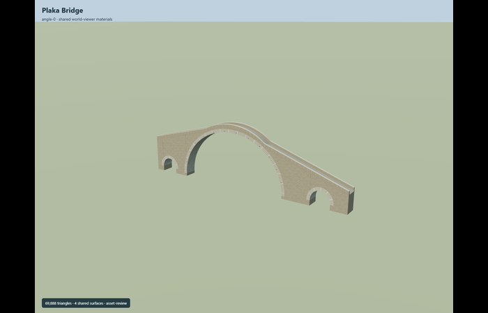
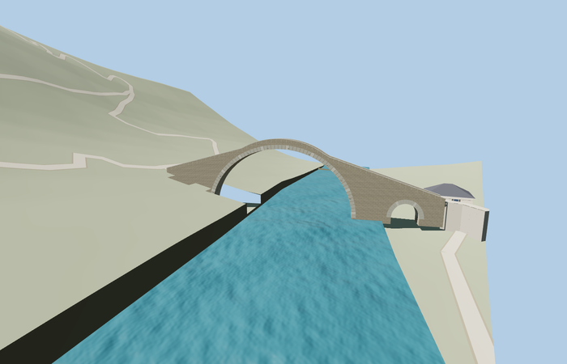

# Plaka Bridge

Reviewed2026-10-29. **Complete medium-fi static exterior and approximate native placement.**

Inspected64 current frames:10 portable,9 shared-material stage,26 medium-fi/context/LOD and19 native PMTiles views. Complete present-day reconstructed humpback bridge model with a tall offset main vault,two actual smaller bank relief vaults,double radial voussoir rings,exposed soffits,solid parapets and coping,a continuous sloping walking deck,masonry joints and small iron tie plates. Actual GLB rays verify all three open vaults,solid separating piers,complete walking surface,parapets and projecting rings. Distance tiers aggregate courses and arch segments while retaining the whole three-opening silhouette. Local native portal views are clear; coarse west-bank terrain still obscures the western relief in distant geographic views,as recorded below.

Four existing shared256px graphs: stone_limestone for pale masonry,stone_limestone_raw for voussoir bands/coping,stone_granite for the walking surface and metal_painted for iron tie plates. Metric UV repeats and linear vertex tints,with a local mortar tint. No private or embedded images. Skyline is one merged palette; district uses three shared graphs; detailed levels use four. Regularized coursing and repeating stone textures approximate the irregular pale masonry in the pictures. Graphs load once per used material and model/support geometry disposes.

| Level | Triangles | Bytes | Draws |
| --- | ---: | ---: | ---: |
| skyline | 496 | 35748 | 1 |
| district | 1012 | 71368 | 3 |
| street | 2852 | 222316 | 5 |
| closeup | 11136 | 860340 | 5 |

Detailed source 69888 triangles,8389844bytes. Browser triangles 496 / 1012 / 2852 / 11136,bytes 35748 / 71368 / 222316 / 860340,draws 1 / 3 / 5 / 5. Initial skyline+district 107116bytes. All four meet1000/4000/16000/64000triangles and at most6draws,with separate GPU position/normal streams. Detailed master retains128 main-arch segments,40 per relief,individual coursing,barrel strip joints,coping seams and walking bands. Browser close-up uses64/20 arch segments and coarser masonry; the source master remains intact. No physical laptop/phone timing claim.

Exact-QID way758796818 supplies a76.881m by4.285m plan. Current PMTiles footway35185052559676,west steps35184485842300 and east path35184485842310 establish alignment. Anchor[21.03004965,39.4605618],heading0.369628459904: +X northeast/eastern bank,-X southwest/western bank,+Z southeast,-Z northwest. Three ordinary views establish the present reconstructed bridge,the main crown offset toward the shorter western bank and both relief openings. The tested normal Mercator detail tile is17/73192/49876,236.05657005461086m wide,using public semantic overzoom and retained standard Mapzen samples. Native viewer water datum257.3589782714844m and end heights11.44/5.8m above it are map/photo approximations,not surveyed elevations.

All five loaded tiers preserve the one independent building,six independent transportation records,all11 raw road inputs,rawDEM and water. The mapped bridge replacement reduces11to10 nonempty rendered road records. Six transverse end samples stay within0.015000m of the authored end datum. End aprons extend0.3m into mapped approaches; the trails turn,so straight bank-extension probes are diagnostic rather than a false requirement that trails continue straight. Three bounded rendered-ground masks cap high coarse bank terrain at0.75m model-local height. Horizontal rays through all three local portals clear the model and rendered ground,with outside-ground probes unchanged. The western relief remains obscured by coarse bank terrain in distant views; hard bank terraces,water/tile boundary steps and generated path-support walls remain visible. Nearby rock faces,customs house,vegetation and trails are outside this bridge model. This is scoped approximate placement at detail tile17; coarser water datums are unverified. Failed loading retains all11 road records and native ground/water; unloading restores ground and disposes model/support geometry.

## Reconstruction limits

- Original present-day medium-fi reconstruction from three ordinary exterior pictures and current standard PMTiles. The mapped envelope is76.881m by4.285m. The main vault,bank relief dimensions and member sections are photo/map approximations,not engineering measurements. The modeled walking seams extend0.3m beyond each mapped bridge end.
- One tall main vault with crown offset toward the western bank,two smaller true bank relief openings,exposed barrel soffits,two radial voussoir bands,solid sloping stone parapets and coping,continuous humpback walking deck,masonry joints and small iron tie plates are modeled. Temporary scaffolding,festival flags,people and debris from past collapse/restoration are excluded.
- Detailed master retains128 main-arch segments,40 per relief,dense individual coursing,barrel strip joints,coping seams and walking bands. Browser close-up uses64/20 arch segments and coarser courses; street/district aggregate masonry. Skyline retains all three open vaults,solid parapets and the full humpback profile.
- Four existing shared256px graphs: stone_limestone,stone_limestone_raw,stone_granite and metal_painted,with metric UV repeats and linear vertex tints. Local mortar tint; no private or embedded images. Repeated courses and shared stone textures approximate the irregular pale masonry seen in pictures.
- Native verification uses actual detail tile17/73192/49876 clipped with the public normal semantic overzoom path. Its viewer water datum is257.3589782714844m from the retained standard PMTiles/Mapzen samples,not surveyed sea level. West/end heights11.44m and5.8m above that datum approximate the coarse mapped approach fit. Water datums at coarser levels differ and are not verified here.
- Three bounded arch corridors clear only rendered ground above0.75m model-local height,preserving rawDEM,water,paving and outside ground. All three local portal lines clear rendered ground. The coarse west-bank slope can obscure the small western relief from distant views; hard terrace edges and generated path-support sidewalls remain visible. Exact rock faces,river banks,customs house,vegetation and surrounding trails are outside this bridge asset. No accessibility or physical-device performance claim.
- Current hash-bound acceptance is in qa.json and placement-report.json. Native-fit.json and integration-review.json preserve source-promotion controls; their pending text is historical. This is a static exterior and scoped approximate map fit, not engineering dimensions, traffic legality or accessibility verification. Native bulk captures remain local.
