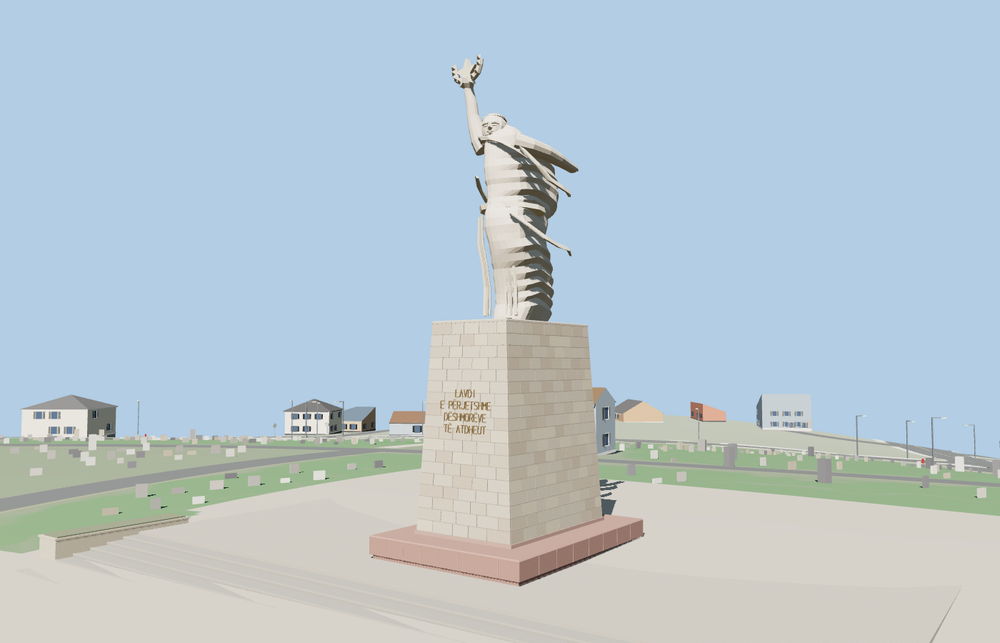

# Mother Albania

The statue holds the star and wreath over a swept cape. The north-facing pedestal carries the four-line bronze dedication above the pink plinth and the six broad steps. The figure and pedestal follow the published 12 m and 10 m scale. [Monument history and measurements](https://books.punctumbooks.com/10.21983/P3.0094.1.00.pdf)

The named PMTiles point locates the pedestal. The mapped terrace edge sets the signed axis, and standard Terrarium terrain supplies the 203 m datum. The closest stairs and planters use dimensions estimated from photographs.

The native viewer retained all 59 mapped road features and 25 nearby building features in the review area. The four LODs passed the stair, plinth and sculpture probes. Eviction freed the model geometry. The failure case preserved the surrounding scene.

The 13,916-triangle source master is reproducible from the geometry recipe. Skyline and district total 283,512 bytes. Six GLBs passed validation. The portable and site reviews covered 38 views.
