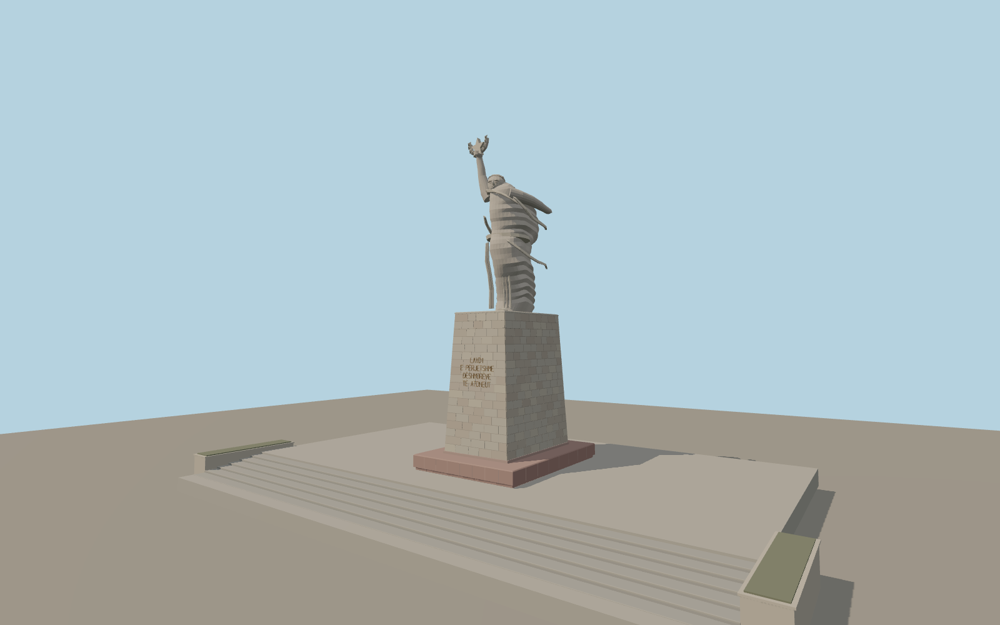

# Mother Albania

Mother Albania lifts a five-pointed star in a leafy wreath above her head. The wind sweeps the long cape behind her in broad angular folds. The pale ashlar pedestal carries a bronze dedication above a pink stone plinth and broad cemetery stairs.

Run `node packages/worldgen/scripts/generate-mother-albania.mjs` to rebuild the source master. Append `--check` to compare the exact bytes. Use `--ids=mother_albania` for targeted import, LOD generation and placement.

The model uses a published 12 m figure and 10 m pedestal. The taper, sculpted folds, lettering, plinth and stair dimensions are fitted to photographs.

The named monument point and the signed back edge of the mapped pedestrian terrace fix position and orientation. Standard terrain resolves the surrounding hillside. Exact stair treads and landscaping within the plaza are photograph-based estimates.

The modeled site covers the pedestal and the nearest stairs and planters. Surrounding cemetery paths, graves and terrain come from the map context.

Original geometry follows the repository license. Map data is © OpenStreetMap contributors under ODbL-1.0 via Protomaps. Terrain samples are described in terrain-grid.json. Ordinary pictures stay local and are not redistributed or used as textures. Current acceptance is recorded in qa.json.
