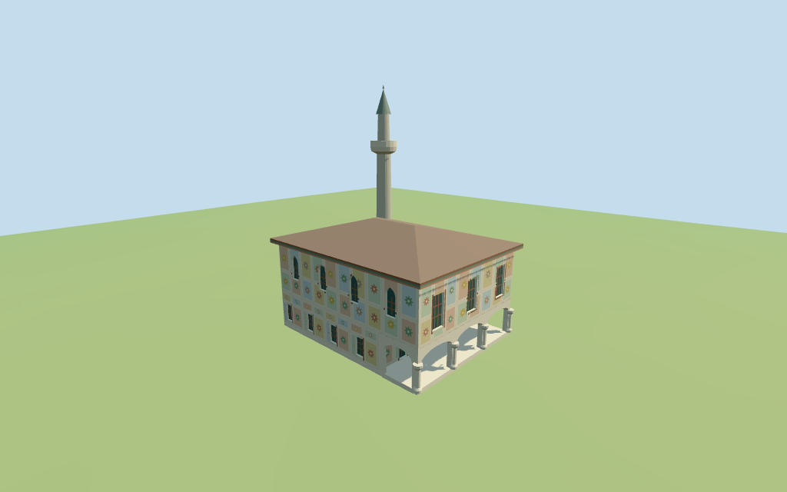

# sarena_mosque — Šarena Mosque

Reviewed2026-10-18 for the declared medium-fi exterior and approximate map fit. Retained exact map identity/outline and current named rectangle are controls;porch facing,tower attachment,painted detail and all heights remain estimates.

## Exterior and shared materials

Inspected11 current portable views including the retained1024×640 summary. The retained rectangle supports a columned lower porch and enclosed upper gallery beneath a low brown tiled hip roof. Four rows of framed cream/green/ochre/rust fields and coarse original geometric rosettes suggest the painted facade rhythm. Near windows carry simple wood grille bars. Broad red/green eave bands and one pale stone minaret are modeled. Fine historic floral imagery,calligraphy,exact lattice patterns,interiors,courtyard wall,tomb,fountain and planting are omitted.

Inspected11 current shared-material/geographic-flat views including the placement overlay. Six existing256² lime plaster,coursed/raw limestone,ceramic tile,plain wood and painted metal graphs serve seven merged roles including local opaque glazing. All painted panels and rosettes use linear vertex tints over shared plaster;no unique facade atlas,embedded image or copied photo pixels. Each graph is read once;eviction disposes geometry and restores host ground.10 neighboring buildings remain host content. Flat placement verifies pose/replacement behavior;exact grade and street joins remain unverified.

## Browser levels

| Level | Triangles | Bytes | Draws |
| --- | ---: | ---: | ---: |
| skyline | 365 | 34872 | 1 |
| district | 3231 | 281872 | 7 |
| street | 6428 | 551544 | 7 |
| closeup | 8511 | 727528 | 7 |

**316,744 bytes for initial skyline plus district**,plus six existing shared256² graphs. Seven merged roles;zero embedded images.

Inspected27 current medium-fi views: Economy/High,noon/late light,street/block/skyline,silhouette,six details,four matched levels and four transitions. Hip roof,columned porch,upper gallery and stone minaret persist at distance. Skyline collapses individual painted cells into broad tinted bands;district restores colored cells and simple rosette centers;street adds panel borders;closeup adds star-shaped centers and coarse grille bars. Historic painting is intentionally abstracted. Physical laptop,phone/tablet and full-city timing remain pending.

## Placement and limitations

Retained Q1009896 /way241085465 anchor,axis and six-vertex rectangle remain unchanged. Current named mosque/main polygon supplies four quantized corners. The front porch/upper gallery is assigned to negative X and the stone minaret is estimated inside the positive-X/positive-Z corner. No independent height tags or separate tower/tomb polygon are resolved. All partitions,facing,heights and painted-panel geometry remain picture-guided visualization estimates. The current named mosque and main polygon share id35184613174297. The separate tomb,courtyard enclosures,fountain and neighboring buildings are excluded. Ordinary viewer Protomaps20261014 and Mapzen/USGS extractN0472;datum 470.5791049422154 m. 154 footprint samples span -0.06710494221545105 to 0.014665425620819406 m. Floor 0.24128936509498544 m equals the median of 40 outer samples plus0.25 m. Foundations sample edges at<=2 m. Replacement and preview seating use only the retained mosque outline. Park,street,courtyard objects and nearby buildings remain host content. Exact thresholds,steps and grade are unverified. Independently reproduced the retained six-vertex outline/tags,current four-corner plan and named mosque point. All66 footprint checks across six GLBs pass: the current mosque is covered;10 other buildings remain separate. All562 FrontSide probes pass for porch clearances and roofed bays,opaque window/grille/door fields,hip-roof coverage,minaret27.5 m total and seated foundations.154 footprint terrain samples,40 outer samples and99 seated preview points reproduce the required16-bit fixture. Three surrounding points remain outside the cutout mask.

Individual Šarena Mosque exterior: retained rectangular plan,a columned open porch below an enclosed painted upper gallery,a low brown tiled hip roof with broad colored eaves,four rows of framed cream/green/ochre/rust painted fields and one pale stone minaret. Coarse original geometric rosettes suggest the painted façade rhythm;no historic floral art,calligraphy or photo pixels are copied. No furnished interior,detached tomb,fountain,planting or courtyard wall is included. Retained dimensional facts and current height tags are empty. Horizontal scale follows the retained20.624×15.9 m plan and current four-corner check. All vertical dimensions are estimates: lower porch gallery4.1 m,painted wall10.1 m,hip ridge12.5 m,minaret27.5 m including its tip. The tower attachment,porch depth,painted grid and window sizes are not surveyed. Two inspected exterior pictures establish the facade grid,porch/upper gallery,eaves and pale minaret vocabulary. Current PMTiles supplies only the rectangle and named point. The front assignment,tower attachment,porch partition and all heights remain estimates. Original coarse geometric motifs suggest the paint rhythm without reproducing historic artwork. Current finish,precise vertical datum,roof construction,engineering,interiors,ground joins and detached courtyard objects are unverified.

## Verification

49 current views inspected,562 FrontSide probes,66 footprint checks and six zero-error/zero-warning Khronos validations. Current model/input/material/render/report/placement hashes agree. Raw controls and16-bit terrain fixture reproduce. Source/placement --check,scene validate/sim30,selected LOD layout and Biome pass. Bulk captures remain ignored.

Source: sha256:9ea8bf6e026e1ecc5f3ea1c1ae0d68d9856dddd57fbaec020168619947798b10

Runtime: sha256:7a153809cf1546be656d2134bf1b93b352d69e24277c818429271ce4e1d268d2

Input: sha256:07f490b37ea00e76614d1a66b9aeb01fbf0365fb6372ff6bcceb0abee0c3b72d

Commands: targeted generate-additional-landmarks/import-structure-models/generate-landmark-lods/register-landmark-previews --ids=sarena_mosque;source/placement --check;capture-structure-models --reflections --antialias --fit-shadows;capture-landmark-library --reflections --adaptive-clipping --bounded-placement;capture-medium-fi --ids=sarena_mosque --reflections;scene validate/sim30;selected LOD layout;Biome. No full source/engine rebuild or dependency audit this round.

## Inspected picture references

[Not established;North Macedonia Timeless tourism page — Not established](https://macedonia-timeless.com/mac/aktivnosti/setila/dopir/kulturaistorija/dzamija/sarenadzamija/). Copyrighted reference;viewed only,no pixels copied or redistributed. Low angle porch corner: white columns and shallow bracketed/arched lintels support an enclosed upper gallery with rectangular dark wood window grilles. Cream wall panels carry green,rust and ochre painted motifs. Broad dark red/green eaves beneath a tiled roof. A pale stone minaret has a projecting pale balcony and pointed cap. Fine floral painting and calligraphy are not copied.

[Not established;Museum With No Frontiers image — Not established](https://sharinghistory.museumwnf.org/database_item.php?id=monument%3BAWE%3Bmc%3B10%3Ben). Copyrighted reference;viewed only,no pixels copied or redistributed. Painted side wall with four stacked rows of framed cream panels;green,ochre and rust rosette/star centers. Lower rectangular grilled windows and an upper row of narrow arched patterned fields. Low brown tiled hip roof with a broad eave;stone minaret shaft and lower balcony visible,tip cropped in this picture. The two pictures together guide the tower/roof vocabulary;neither establishes precise dimensions.
