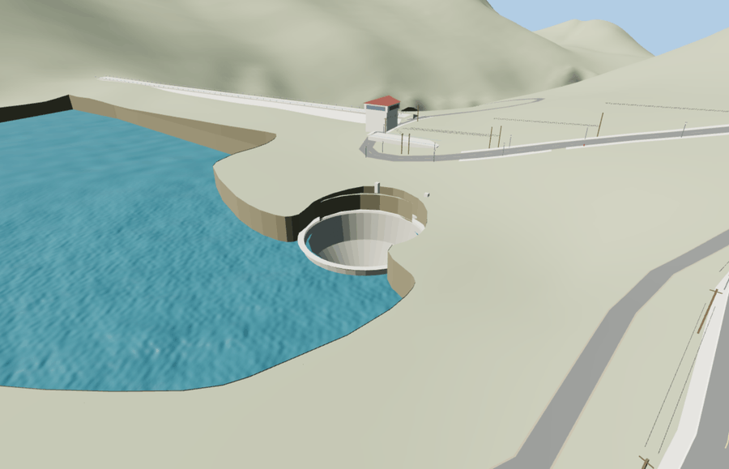

# Kozjak Hydro Power Plant

The individual exterior includes a pale rockfill slope, continuous crest road and rails, open circular overflow, thick weir rim, bank retaining wall and service landing. A white tower with a red roof accompanies the gallery and slanted intake rails. The lower ochre powerhouse has a broad red gabled roof, two auxiliary buildings, outfall walls, transformers and a simplified switchyard.

The native viewer separates the 459 m reservoir from the 361.58 m lower Treska pool. The circular overflow remains open inside its raised rim. The lower ground opening follows the powerhouse hall, and two small grades blend the switchyard and outfall landing into the canyon. The crest road and 12 other mapped road records remain.

Failed loading preserves the native layers. Eviction restores the ground and releases model geometry.

| Detail level | Triangles | Download bytes | Draws |
| --- | ---: | ---: | ---: |
| skyline | 692 | 65,884 | 8 |
| district | 1,366 | 122,392 | 8 |
| street | 2,572 | 218,360 | 8 |
| closeup | 3,538 | 296,816 | 8 |

Skyline and district total 188,276 bytes. Six GLBs pass Khronos validation and contain zero embedded images. Eight shared material graphs bind in the viewer. The review covers 64 renders and 135 geographic samples.

The grades and static pool elevations represent the appearance in the retained photographs and terrain tiles. The coarse terrain approximates the banks and hillside contact around the switchyard.

The source describes the exterior and visible overflow. Buried conduits and operating discharge are outside its scope.

[Mapped site frame](map-frame.json) · [Terrain and water fit](site-fit.json) · [QA evidence](qa.json)
