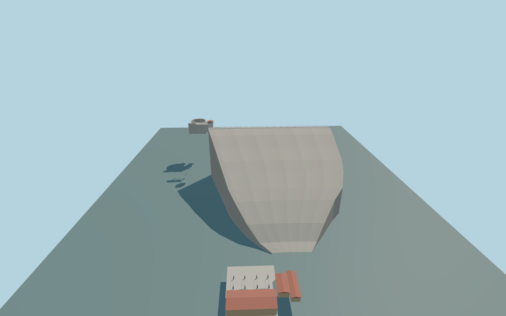

# Kozjak Hydro Power Plant

Kozjak’s pale rockfill dam with its 302.80 m mapped crest road, circular overflow, white red-roof tower, intake rails and lower two-unit generating complex with ochre walls, red gabled roofs and outdoor electrical equipment.

Rebuild: `node packages/worldgen/scripts/generate-kozjak-hydro-power-plant.mjs`;append `--check` for exact source bytes. Select import/LOD/placement with `--ids=kozjak_hydro_power_plant`. Detailed source and four browser tiers are separate ignored GLB outputs.

Signed datum 468 m. The exterior uses an approximate 474.4 m crest and 348.3 m foundation for the stated 126.1 m dam height. The operator gives 459 m maximum operating pool and 432 m minimum. The standard viewer samples 468.65 m headwater and 361.58 m in the lower pool.

The standard sampled reservoir is 9.65 m above the operator’s maximum pool, submerging the overflow rim. Reference and standard fixtures document this difference; native fit remains pending.

The main crest is mapped. Powerhouse footprint, switchyard, gallery, intake-rail position and local equipment sizes are approximate exterior layouts from ordinary photos and the native outfall point.

Rockfill cross-sections, buried foundations and cliff interfaces are approximated against standard terrain. Water, gates and exterior electrical equipment are static. The machinery interior and buried conduits are outside the model.

Original geometry:repository license. Map:© OpenStreetMap contributors,ODbL-1.0;Protomaps. Standard terrain:terrain-grid.json. Ordinary pictures stay local and are not redistributed or used as textures. Current acceptance:qa.json.
