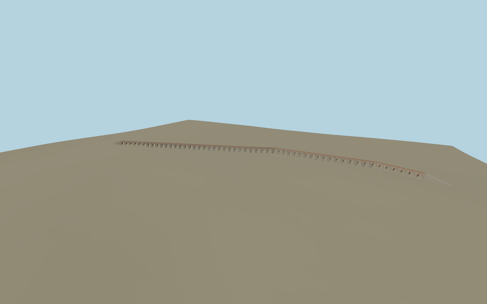

# Skopje Aqueduct

Medium-fi Skopje arcade:54main openings along both mapped bends,53interior piers,42upper relief openings, radial brick arch ribbons, open water trough and two reconstructed end ramps. Original detailed masonry master remains separately reproducible.

## Evidence

- [Primary reference](https://repository.ukim.mk/bitstream/20.500.12188/28646/1/5%20Sidnej%20-%2020ICSMGE%20-%20Akvadukt.pdf)
- [Primary reference](https://repository.ukim.mk/bitstream/20.500.12188/28652/1/MASE20%20-%20akvadukt.pdf)
- [Primary reference](https://karpos.gov.mk/wp-content/uploads/2017/08/turisticki-lokaliteti-Karpos.pdf)
- [Primary reference](https://commons.wikimedia.org/wiki/File:Skopje_Aqueduct_9.jpg)
- [Primary reference](https://commons.wikimedia.org/wiki/File:Skopje_Aqueduct_3.jpg)
- [Primary reference](https://commons.wikimedia.org/wiki/File:Skopje_Aqueduct_8.jpg)
- [Primary reference](https://www.openstreetmap.org/way/180360206)
- [Primary reference](https://pub-a8a09a2ee9454482a412c12c7e4f463e.r2.dev/Godisna%20programa%202026.pdf)

Published dimensions and reconstruction assumptions are separated in spec.json. Source photos were consulted; no photos or third-party geometry are embedded. Map plan attribution: © OpenStreetMap contributors, ODbL-1.0.

## Source

17040 triangles; 2046808 bytes; 2 material groups. SHA256: sha256:53a9d143d2f3baffe6b47aa28b0c3f335767a0e18ab08e38a352ad91d709bd7b.

Shared surfaces (stone_limestone_raw, clay_fired) are loaded through the central library; any transparent materials use local PBR parameters. Axis and provisional vertical datum are in spec.json.

Regenerate with node packages/worldgen/scripts/generate-researched-bridges.mjs --ids=N0018; append --check to verify. Import and capture through the standard next-1000 scripts. Geometry validation does not substitute for current-frame visual review.

## Reconstruction limits

- Picture and standard viewer PMTiles approximate exterior/placement scope; no bespoke surveys, conservation-plan research or local-data campaigns.
- Detailed original master is preserved by its unchanged recipe/map inputs and exact reproduced hash. Compact medium-fi source replaces individual rubble/brick geometry with the shared raw limestone and fired-clay graphs.
- Skyline retains all54 main openings with angular vaults, merges reliefs and channel rims; closer models restore42 upper openings, rounded vaults, arch ribbons and open trough. Exact broken cap courses, stone/brick patchwork, graffiti and repairs are simplified.
- Mapped350.7703m channel and385.8m overall reconstruction remain distinct; ramp lengths and relief stations are retained assumptions. PMTiles field/contact blending and narrow ground opening are approximate, not per-pier survey. Footprint replacement off; physical-device timing remains pending.
