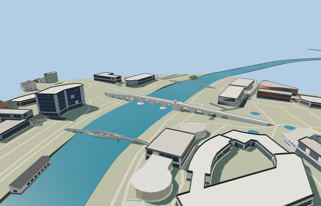

# Stone Bridge in Skopje — completed current medium-fi pass

Reviewed 2026-10-25. **Complete scoped bridge exterior and approximate native placement. Detailed source master preserved.**

## Geometry and surfaces

Inspected 55 current frames in one author/inspect/fix pass: 11 portable, 11 shared, 23 medium-fi and 10 native. The 11 unequal exposed/reconstructed vaults, sloped deck, complete parapets, different mapped pier projections, recessed prayer niche and supported opposite balcony remain complete. Replaced the old 64.52 m-error skyline and authored a closed district shell. Actual mesh rays caught the shallow automatic street niche; near levels now come from the original structural recipe and retain the full recess and carving. Removed collapsed paving side faces from runtime levels. Canonical viewer shadow-focus logic removed capture self-shadow striping. The 466,084-triangle source and canonical runtime masters remain byte-exact.

Three existing 256px shared graphs: stone_travertine, clay_fired and metal_painted. Each textured LOD uses three draws; skyline uses baked vertex colors and one draw. Metric UVs, original restrained stone/brick tints, no embedded images/private atlas/copied photo pixels. Dense wall and paving face relief is reserved for the master; runtime stone stays clean and low frequency. Material graphs read once each, separate GPU attribute streams and complete model/support disposal pass.

| Level | Triangles | Bytes | Draws |
| --- | ---: | ---: | ---: |
| skyline | 910 | 66568 | 1 |
| district | 3584 | 238656 | 3 |
| street | 6904 | 467896 | 3 |
| closeup | 14528 | 996692 | 3 |

Four complete authored LODs: 910/3584/6904/14528 triangles; initial skyline + district 305224 bytes. Closeup is 996692 bytes. Economy/high, noon/late, near/far, silhouette and transitions inspected under the shared Earth rig. Near structural surfaces replace noisy automatic decimation while keeping radial arch blocks, complete piers, carved niche and balcony corbels. Geometry budgets pass; physical laptop/phone timings remain pending.

## Native placement

Approximate native fit approved at [21.433244271,41.9971125], heading 0.7410149177885357: +X northeast and +Z southeast/downstream. The exact-identity outline retains the asymmetric projections. Native Y=0 uses the retained 241.5 m historical channel-bottom reference, not current water stage; source deck endpoints are 249.2 m ASL. Both immediate mapped road joins meet deck within 0.1 m. At 1.54 m beyond either end, the supported native grade has begun its terrain blend. Standard DEM is about 2.6–5.1 m below the end deck at those samples. This inferred approach grading and seasonal river exposure are visualization, not surveyed historic banks or a current engineering datum.

All 54 resident / 208 wider original mapped buildings remain; no building footprint is replaced. Only the overlapping longitudinal bridge path and its directly connected end fragment are clipped. Nearby transverse riverbank paths, other bridges and unrelated road plans stay independent. Original source roads, every DEM sample, native water/shoreline behavior remain. Two connected path records receive deck/approach hints and supported ground faces. Failed load retains the original full crossing without inferred supports. Unload restores native content and releases all model/support geometry. Native captures use the actual client shadow-focus helper; fixture and engine hashes are pinned.

## Checks

Targeted generator --check, strict medium-fi, scene validation and 30-tick simulation pass. Six GLBs have zero Khronos errors/warnings; 540 geometry probes pass. All 55 current frames were inspected and bound to current source/runtime/LOD, fixture and engine hashes. Bulk captures stay local; only two small summary previews remain with source. No global source rebuild, full engine suite or dependency audit was run for this model.

## Reference and limits

Ordinary [2013 photograph by Andrzej Wójtowicz](https://commons.wikimedia.org/wiki/File:Skopje_-_Kamen_Most_(9454032526).jpg), CC BY-SA 2.0, viewed only. Existing nominal dimensions and historical datum were retained without bespoke re-research. Standard 2026-10-20 Protomaps/Mapzen inputs remain unchanged. The 11 exposed/reconstructed vaults do not claim a surveyed inventory of buried historic openings. Nearby statues, urban architecture and interiors are outside this bridge. Physical device timings remain pending.
