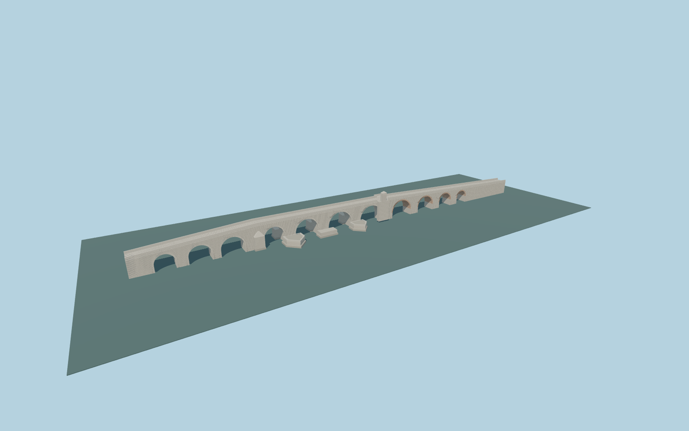

# Stone Bridge in Skopje

Detailed travertine crossing with four unequal river vaults, separately jointed brick approach vaults, mapped asymmetric cutwaters, stepped foundations, dressed parapets, rosettes, prayer niche with muqarnas and opposite corbelled balcony.

## Evidence

- [Primary reference](https://macedonia-timeless.com/eng/about/about/did-you-know/stone-bridge)
- [Primary reference](https://dergipark.org.tr/en/download/article-file/288477)
- [Primary reference](https://dergipark.org.tr/tr/download/article-file/3321195)
- [Primary reference](https://haemus.org.mk/stone-bridge/)
- [Primary reference](https://ceipa.pmf.ukim.mk/en/node/126)
- [Primary reference](https://commons.wikimedia.org/wiki/File:Skopje_-_Kamen_Most_(9454032526).jpg)
- [Primary reference](https://openjicareport.jica.go.jp/pdf/11945227_01.pdf)
- [Primary reference](https://www.openstreetmap.org/way/734159692)

Published dimensions and reconstruction assumptions are separated in spec.json. Source photos were consulted; no photos or third-party geometry are embedded. Map plan attribution: © OpenStreetMap contributors, ODbL-1.0.

## Source

466084 triangles; 39115588 bytes; 3 material groups. SHA256: sha256:97b89aa20fe8483a18f2df8bb276ac65a904fcc9c5c11bf9333c712d99b8f27a.

Shared surfaces (stone_travertine, clay_fired, metal_painted) are loaded through the central library; any transparent materials use local PBR parameters. Axis and provisional vertical datum are in spec.json.

Regenerate with node packages/worldgen/scripts/generate-researched-bridges.mjs --ids=stone_bridge_in_skopje; append --check to verify. Import and capture through the standard structure-catalog scripts. Geometry validation does not substitute for current-frame visual review.

## Reconstruction limits

- The 466,084-triangle detailed source master remains exact. Four separate runtime representations prioritize the full vaults, complete deck/parapets, mapped asymmetric cutwaters, recessed prayer niche and supported opposite balcony.
- Runtime surfaces use shared low-frequency graphs. Dense individual wall/paving side faces are omitted to avoid automatic-decimation noise; closeup retains radial masonry, carved niche and rosette detail.
- Eleven exposed/reconstructed openings are represented; historical total counts, buried ends, precise vault dimensions, channel-bottom datum and seasonal river stage are not a current engineering survey.
- Native nearby statues, town buildings, shore landscaping and interiors remain outside the bridge asset. Physical device timings remain pending.
