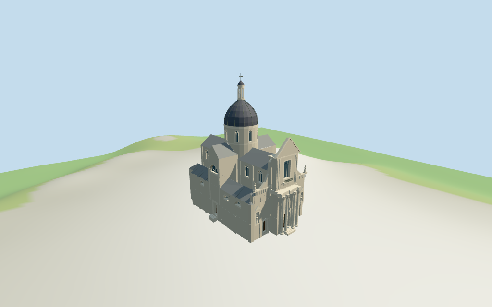

# N0380 — Dubrovnik Cathedral review

Reviewed2026-10-15 against current source/runtime bytes. Accepted for medium-fi exterior and approximate geographic/terrain scope. All vertical architecture and internal partitions remain explicit picture estimates.

## Built result

Inspected all11 current portable/source-terrain frames. Individual Dubrovnik Cathedral has a pale Baroque front with four free-standing columns, recessed central wood portal, two side doors and real outer figure niches with simplified stone figures. The upper rectangular window, shallow open balcony, thick volute shoulders, shoulder balustrades/statues and triangular crown join the long nave and lower aisles. Gray metal nave/aisle/transept roofs and side upper arched windows/lower semicircular lunettes lead to the central pale windowed drum, dark gray ribbed dome, slender pale lantern and estimated45m cross. Corrected crown/volute edge winding and canopy underside orientation. Fine carving and hidden rear detail remain approximate.

Medium-fi exterior from two actually inspected Commons2011 front and2016 elevated-side pictures plus standard viewer PMTiles/DEM. No bespoke plans/surveys researched or reference pictures redistributed. Pale colonnaded front/volutes/crown, gray metal roof family, dark dome/pale lantern, side upper windows/lunettes and recessed doors are individually authored. All vertical architecture and internal divisions are estimates; no survey accuracy claimed. Fine Corinthian carving/statue identity, inscriptions/ironwork, full interiors and exact hidden rear/current finishes/thresholds remain approximate or excluded. Nearby bell tower/other church are separate buildings. Physical phone/laptop measurements pending.

## Shared materials and placement

Inspected all11 current shared/geographic frames. Four existing cached256-square coursed limestone, continuous limestone, standing-seam metal and plain-wood graphs serve six merged groups. Columns/trim use continuous stone rather than coursed blocks. Linear pale-stone/gray/wood tints, metric UVs and flat architectural normals; glass/metal accents use geometric PBR colors. No embedded images, unique facade maps or baked shadows. Each graph reads once; unloading disposes geometry and leaves zero live model geometries. Close views show roof seams, dome ribs, the colonnade/recessed entry, figure niches, upper window/balcony and side lunettes. Top placement retains the mapped whole and its western projection. Flat diagnostic ground does not establish surveyed old-town paving.

Retained exact-QID OSM way737699509/Q584428 matches current main35185109788341. Anchor[18.110420769,42.639904088], heading0.11135625687rad signs the native-X western projecting front and+X long nave/rear. All77 raw vertices/tags reproduce by rigid rotation without rescale; original multilingual identity and exact old map control remain intact. No map height/min_height, measured height fact or independent component control is supplied. An unrelated31-vertex northern building_part is excluded. All modeled heights/internal Boolean partitions and dome location/radius are explicit picture estimates: nave19/22.5m, aisles11/13.5m, transept20.5/24m, drum19..29.5m, dark dome37m, pale lantern41.5m/hat43m/cross45m; lower front13.4m, upper23.2m/crown28.2m. Inset entry wall x-19m and columns x-20.3m preserve actual air under the overhang. All36 viewer footprint checks cover the whole and retain four neighboring buildings/parts plus the front plaza across six outputs. Standard DEM datum13.547986m, floor0.6m, perimeter-0.98..0.29m; footings extend below coarse terrain and local steps approach a threshold0.3m above floor. Exact paving/door joins, absolute altitude and walking remain unverified. No global flattening or road replacement.

Inspected all27 current Earth-lighting frames: Economy/High, noon/late, three distances, texture-free silhouette, six details, four matched whole LODs and four transitions. Skyline preserves mapped massing, pale columns/front/crown, gray roof family, dome/lantern/cross at911triangles. District adds shared textures and flat glazing/portal fields at1572triangles. Street introduces actual recessed wall/drum/lantern glazing, doors/niches, ribbed dome, simple pilasters, open balcony/balustrades and figures; closeup/master refine frames/capitals. Whole LODs include the full envelope/tip. Small windows, balustrades and ribs change intentionally by tier. Detail crops exclude other parts intentionally. Synthetic cottages and coarse source terrain are fixtures; physical motion/device timings pending.

## Browser budgets

| Level | Triangles | Bytes | Draws |
| --- | ---: | ---: | ---: |
| skyline | 911 | 90496 | 1 |
| district | 1572 | 133280 | 6 |
| street | 12120 | 1064180 | 6 |
| closeup | 17137 | 1563128 | 6 |

Initial skyline plus district: **223776 bytes** of geometry. Master: **2060112 bytes / 17137 triangles**. Four cached shared256-square graphs; zero embedded images. Bytes exclude graph definitions/texture generation. Split POSITION/NORMAL views have equal CPU/GPU totals. Physical device timing pending.

## Verification

- Targeted byte reproduction and current source/import/LOD/input/report bindings; source/recipe inventory/schema match.
- Six Khronos validations: zero errors/warnings/images. Four browser budgets pass.
- All77 raw map vertices/tags, exact identity/retained multilingual metadata, explicit estimates and standard DEM match.
- **784 actual geometry probes** and **36 current viewer footprint checks** pass.
- Shared graph read-once/unload and hash-bound geographic/medium-fi reviews pass.
- Scene validation and30-tick simulation: sha256:18109546aac0152f145dcf2345226a7f3ead53b1cc7001ead4bc5c9d851ea19d.
- Inspected **49 current frames**:11 portable,11 shared/placement,27 medium-fi. Cameras/paths/hashes retained; bulk images ignored.

Source hash: sha256:0d950157262e6a122a998a0c5278ab51f7b2d2b1563ec3c019b0aec27942e3b2. Runtime hash: sha256:d9c3ff5fd295d129e84d1589f92697e58901e4b311eba5dbb568ceab1652ef58. Input hash: sha256:1b25fbf722945849b650302b8d45b8ed2b23de509aea8fdcfc347d9d7b93d5c3.

Commands: targeted generate/import/LOD/register-landmark-previews --ids=N0380; generate-additional-landmarks.mjs --ids=N0380 --check; capture-next-1000-models.mjs --ids=N0380 --reflections --antialias --fit-shadows; capture-landmark-library.mjs --ids=N0380 --reflections --adaptive-clipping --bounded-placement; capture-medium-fi.mjs --ids=n0380_dubrovnik_cathedral --reflections; molen validate; molen sim run --ticks30 --hash. Next routine full source checkpoint N0380–N0399.

## Limits

- Retained exact-QID OSM way737699509/Q584428 matches current main35185109788341. All77 current raw vertices/tags reproduce by rigid rotation without rescale. No map height/min_height, measured height facts or independent cathedral component controls are supplied. An unrelated31-vertex building_part north of the church is excluded. Western central projection (-X) and broad long roof toward+X sign the facing. Original multilingual identity and earlier control remain verbatim. Internal Boolean roof/ground/entry partitions, dome center[1.5,-0.8]m/radius5.5m and all heights are picture estimates: main walls19m/gray metal roof22.5m, aisles11m/roofs13.5m, transept20.5m/roof24m, dome shaft19..29.5m (exposed above roof), ribbed gray dome37m, pale lantern41.5m/hat43m/cross45m. Front lower13.4m with four free-standing columns and canopy, upper23.2m/triangular crown28.2m; wood portal behind the columns at x-19m, column plane-20.3m. Side doors, outer figure niches, shoulder balustrades/statues, central window/balcony/volutes and side lunette/window rhythm are approximate. Full original footprint stays retained; ground wall omits the projection air space and inserts the inset entry plan. No survey/engineering accuracy claimed.
- Standard viewer DEM datum 13.547986m; display floor0.6m, raw whole perimeter -0.98..0.29m. Footings extend below coarse terrain; short local stairs approach a threshold0.3m above model floor. Exact old-town paving/door joins, absolute altitude and walking remain unverified. No global flattening or road replacement.
- Medium-fi exterior from two inspected2011 front/2016 elevated-side pictures and standard viewer PMTiles/DEM only. All heights and internal partitions are picture estimates. Fine Corinthian carving/statue identity, ironwork, inscriptions, full interiors, exact hidden rear/current finishes and surveyed paving/thresholds remain approximate or excluded. The nearby bell tower and other church are separate buildings. Physical phone/laptop timings pending.
- Skyline retains pale front/columns/crown, gray roofs and dome/lantern/cross; small windows and balustrades omitted. District adds shared surfaces and flat fields. Street adds actual recessed glazing/wood portals/figure niches, dome ribs, pilasters, balcony/open balustrades and simplified statues; closeup/master refine frames/capitals. Synthetic cottages are fixtures.

Readiness accepts this exterior scope. The full1000-candidate goal remains incomplete.
