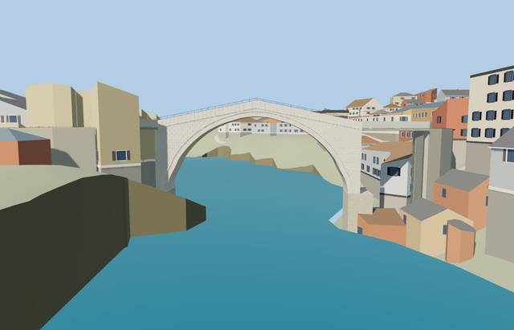

# Stari Most — complete scoped bridge and supported approaches

Reviewed 2026-10-25. **The bridge exterior and approximate native placement pass are complete. Historical quay geometry and nearby towers remain outside this asset.**

## Changes and inspection

Inspected 51 current frames in one author/inspect/fix pass: 10 portable, 10 shared, 22 medium-fi and 9 native. The humpback crossing, clear arch, closed intrados, stone cornices, parapets, iron guard and traction strips remain recognizable. Replaced the over-decimated skyline with a complete 64-segment arch. Actual ray tests found the old district crown deck missing down to the extrados; the authored district now closes the deck and preserves both cornices. Detailed source/runtime masters and street/closeup bytes are unchanged.

Three existing shared graphs: stone_granite, metal_painted, stone_drywall. District uses the two stone graphs; skyline uses baked vertex color and one draw. No embedded images, private atlas or copied photo pixels. Metric UVs and restrained pale stone match the earlier master. Runtime LODs keep position/normal streams separate. Shared graphs are read once each; the model library releases its geometry on unload.

| Level | Triangles | Bytes | Draws |
| --- | ---: | ---: | ---: |
| skyline | 864 | 59160 | 1 |
| district | 2448 | 160964 | 2 |
| street | 15873 | 1172524 | 3 |
| closeup | 56312 | 4689216 | 3 |

Four LODs: 864/2448/15873/56312 triangles; initial skyline + district 220,124 bytes. Skyline/district omit sub-pixel iron guard geometry, retaining stone parapets. District adds the two projecting cornices and shared surfaces. Synthetic lighting, distances and transitions inspected. Physical phone/laptop timings remain pending.

## Native placement

Actual native Molen placement, four LODs and failed-load fallback checked. Only the overlapping longitudinal bridge corridor is suppressed while resident. Short outside bridge tails retain connected deck heights; the two directly connected streets receive local elevation hints with retaining side/end faces down to unchanged native ground. All 290 resident buildings and the horizontal geometry of 296 other road features remain; only the two connected street profiles intentionally change. Original source road inputs, every DEM sample, native river and native shoreline behavior remain. Model vertices retain the 40.05 m absolute datum. Failure retains the original full mapped crossing without inferred approach hints/supports. Unload restores native content and releases both model and support geometry.

Approved for approximate photo/map visualization at the confirmed crossing [17.8150293,43.3372672], heading -0.004339929494839471. The historical low-water datum is 40.05 m ASL, with deck crown 60.39 m. Short retained bridge tails carry the respective deck-edge heights through one short west gateway to the connected streets. Six sampled bank/street joins meet the corresponding deck level within 0.1 m in every LOD. The original standard DEM remains 11–18 m too low at the immediate banks: supported approach grading and tall retaining faces are inferred visualization, not surveyed historic quays. Current native views show continuous supported connections. Adjacent towers and town buildings remain independent generic context outside this bridge asset.

## Checks

Targeted generator --check, strict medium-fi, scene validation and 30-tick simulation passed. Six GLBs have zero Khronos errors/warnings; 84 mesh probes pass. All 51 current frames were inspected. Hashes and native-load/fallback/unload results are in [qa.json](qa.json). Native capture fixtures and bulk images remain local. The approach runtime fix additionally passes 118 focused tests, both affected package typechecks and the five-file formatter check. No dependency audit or full repository suite was run.

## References

Existing restoration dimensions remain in spec.json. This pass used ordinary [approach photographs](https://www.maravillas-del-mundo.com/Puente-de-Mostar/Descripcion-del-puente-de-Mostar.php) and a [river-side photograph](https://spagosmail.blogspot.com/2016/12/mostar-ocima-stranih-putopisaca-karin.html), viewed only. Map fit uses the standard 2026-10-20 Protomaps extract and unmodified Mapzen Terrarium samples. URLs, input hashes and limits are retained in reference-metadata.json/native-fit.json. No copied pixels or bespoke terrain survey.
