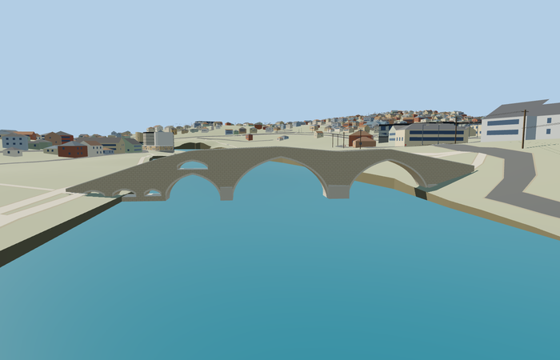

# Arslanagić Bridge — completed current pass

Reviewed 2026-10-25. **Scoped medium-fi bridge exterior and approximate native placement complete.**

## Shape and shared materials

Inspected all 54 current frames: 9 portable, 9 shared, 25 medium-fi and 11 native. Original 85.14m asymmetric stone crossing with two dominant pointed arches, a lower south water arch and separate relief arch above it, three small south approach openings and a small north opening. Genuine through-openings, vault soffits, voussoir rims, broad projecting pier faces, coping, raised parapets and double-crested narrow walk remain across the complete browser levels. All source and opposite-side turntables, arch and paving details, lighting/context views, all native levels, both banks and failure view were inspected in the same authoring pass.

Three existing 256px shared graphs: stone_limestone, stone_limestone_raw and stone_drywall. Limestone walls/rims and irregular stone paving use metric UVs and component tints. No glazing, private or embedded images, downloaded meshes or copied photo pixels. Each graph is read once per resident fixture; skyline is one mean-color draw, other levels three draws. Separate position/normal GPU streams and complete disposal pass.

| Level | Triangles | Bytes | Draws |
| --- | ---: | ---: | ---: |
| skyline | 952 | 71352 | 1 |
| district | 2016 | 149696 | 3 |
| street | 3852 | 283836 | 3 |
| closeup | 7324 | 528236 | 3 |

The preserved detailed source is 13,364 triangles / 1,606,148 bytes; canonical import 1,605,788 bytes. Skyline/district/street/closeup: 952/2016/3852/7324 triangles and 71352/149696/283836/528236 bytes. Initial skyline plus district: 221048 bytes, below both phone and laptop initial-download limits. Physical ordinary-laptop and phone/tablet timings remain pending.

## Placement and preservation

Exact mapped bridge way/550141423; anchor [18.354008321,42.714653005], heading 1.34679398019 rad. +X north-northeast to the higher bank; -X south-southwest to the longer low approach; +Z east-southeast. Native model origin 269.88m and viewer water 271.078674m put water at sourceY1.198674m. Native footway joins 3cm beyond each outline endpoint meet authored deck elevations 272.88/276.88m within 0.035m. The shared approach grading fix retains the rising bank profile, with eight actual approach probes 1/2/4/8m from the connections above native terrain by at least 0.169m. No model ground/water cutouts or support walls. Coarse banks partly occlude lower foundations; this is approximate visualization placement, not surveyed construction. Retained historical80m versus mapped85.14m extents and an undatumed6m photo-caption height remain unresolved.

All 1902 resident / 2672 wider native buildings and 886 independent road records remain. Two connected footways retain their exact routes. Original road inputs, raw heightfield, rendered ground and water remain; outside-ground probes differ from raw sampling by less than0.005m. Load failure preserves the original map bridge and approaches. Unload releases every model geometry and leaves native ground/water intact. The common approach grading fix is covered by all384 unique terrain tests (two sandbox HTTP cases passed on retry), package build and typecheck; broader engine CI is pending separately.

## Checks

Selected source reconstruction, strict medium-fi audit, scene validation and30-tick simulation pass. Six clean GLBs and192 mesh probes bind the actual geometry. All54 retained image hashes were inspected. A metadata-only correction removed generic mentions of granite, glazing and cables; regeneration preserved all six GLB bytes and placement/fixture pins, so unchanged renders were reused with explicit provenance. Bulk captures stay local; two small summary previews remain with source.

## Evidence and limits

Three ordinary Diego Delso Commons photographs from2014, the exact-QID OSM bridge outline and standard Protomaps20261020/Mapzen Terrarium guide this pass. See reference-metadata.json, map-frame.json and native-fit.json. Photographs were consulted and are not redistributed. Arch radii, opening rises, individual stonework, pier sections, opposite-side details and concealed foundations are inferred. Historical/mapped length and caption-height differences are retained explicitly. Current furniture, nearby houses, hidden structure and surveyed foundation/river elevations are outside this asset.
