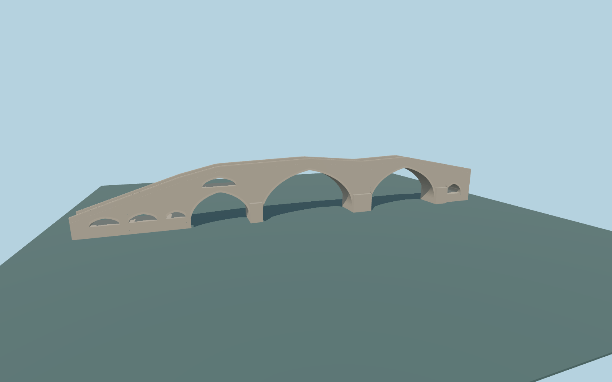

# Arslanagić Bridge

The asymmetric pale-stone Trebišnjica crossing: two dominant pointed arches, a lower south water arch with a relief opening above it, three small south approach openings, a small north opening, raised stone parapets and a narrow double-crested cobbled walk.

## Evidence

- [Primary reference](https://commons.wikimedia.org/wiki/File:Puente_Arslanagi%C4%87,_Trebinje,_Bosnia_y_Herzegovina,_2014-04-14,_DD_28.jpg)
- [Primary reference](https://commons.wikimedia.org/wiki/File:Puente_Arslanagi%C4%87,_Trebinje,_Bosnia_y_Herzegovina,_2014-04-14,_DD_29.jpg)
- [Primary reference](https://commons.wikimedia.org/wiki/File:Puente_Arslanagi%C4%87,_Trebinje,_Bosnia_y_Herzegovina,_2014-04-14,_DD_30.jpg)
- [Primary reference](https://www.openstreetmap.org/way/550141423)

Published dimensions and reconstruction assumptions are separated in spec.json. Source photos were consulted; no photos or third-party geometry are embedded. Map plan attribution: © OpenStreetMap contributors, ODbL-1.0.

## Source

13364 triangles; 1606148 bytes; 3 material groups. SHA256: sha256:991aa987226a463e0d1e9d9900eb4fa574a3e3b0a390d24da41845987eef85a9.

Shared surfaces (stone_limestone, stone_limestone_raw, stone_drywall) are loaded through the central library; any transparent materials use local PBR parameters. Axis and provisional vertical datum are in spec.json.

Regenerate with node packages/worldgen/scripts/generate-researched-bridges.mjs --ids=arslanagic_bridge; append --check to verify. Import and capture through the standard structure-catalog scripts. Geometry validation does not substitute for current-frame visual review.

## Reconstruction limits

- Exact arch radii/rises, pier sections, parapet height, individual stones and pavement repairs are approximate ordinary-photo interpretations.
- The historical80m length and current85.14m mapped extent differ; original foundations and a6m caption height have unresolved scope/datum.
- Only ordinary photos and the standard PMTiles/Mapzen pipeline guide this pass. Native river stage and banks are approximate; current shared-material/native review uses the retained provisional river level and approximate banks.
- Opposite-face details, concealed foundations, temporary signs/furniture, bankside buildings and utilities outside the bridge are excluded.
- Physical ordinary-laptop and phone/tablet timing measurements remain pending.
