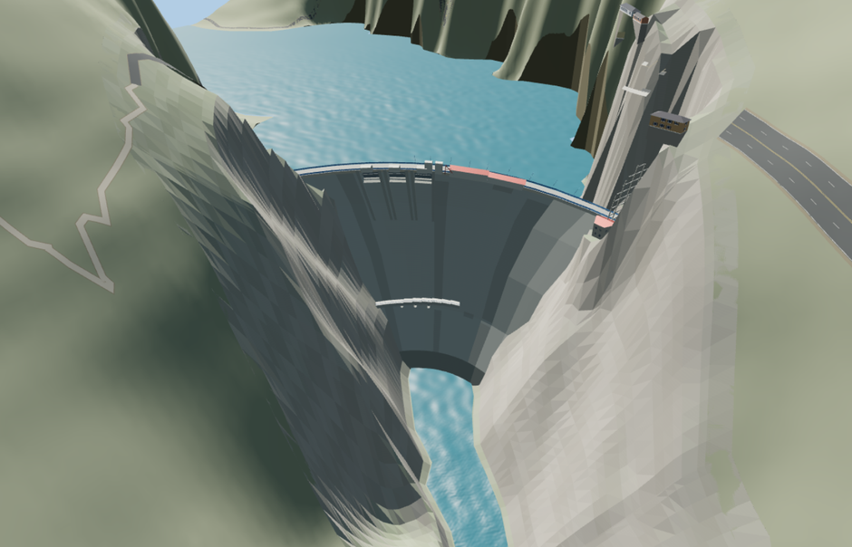

# Mratinje Dam

The 220 m double-curvature arch retains the curved roadway, three crest spillways, five outlet mouths in the nearer tiers, inspection gallery and tunnel approaches. The fitted gorge includes the west road bench, retaining lattice and mapped service house.

The fitted west approach connects to the rendered M-3 pavement within 9 mm at the sampled points. The dry rock rim meets the retained terrain within 26 mm at 15 sampled rim controls. The road bench covers the remaining western control. Piva Lake and tailwater stay at their representative 651.65 m and 534.18 m stages.

The local fixture keeps 12 neighboring buildings, 42 transportation records and all water inputs. The authored asset replaces the matching crest road, the fitted portion of the M-3 approach and one mapped service house. The other 37 transportation records keep their mapped coordinates. The renderer caps uphill approach supports below the road surface, including on steep crossfall. A failed load restores the full native map.

| Detail level | Triangles | Download bytes | Draws |
| --- | ---: | ---: | ---: |
| skyline | 988 | 89,516 | 6 |
| district | 3,150 | 273,608 | 7 |
| street | 8,414 | 738,044 | 7 |
| closeup | 12,358 | 1,149,080 | 7 |

The first two levels total 363,124 bytes. Six GLBs validated with zero errors or warnings. Four focused tests and 376 placement probes passed. 76 renders were inspected.

The gorge edge, roadway grades, portal recesses and service-house details are original visualization estimates from ordinary photographs and the standard native map. The outer M-3 road remains in the surrounding native terrain.

The water elevations are representative sampled stages. Underground machinery, tunnel interiors and operating discharge are outside the exterior scope.

[Gorge controls](models/gorge-fit.json) · [QA evidence](qa.json) · [Crest photograph](https://commons.wikimedia.org/wiki/File:MratinjeDam.JPG)
