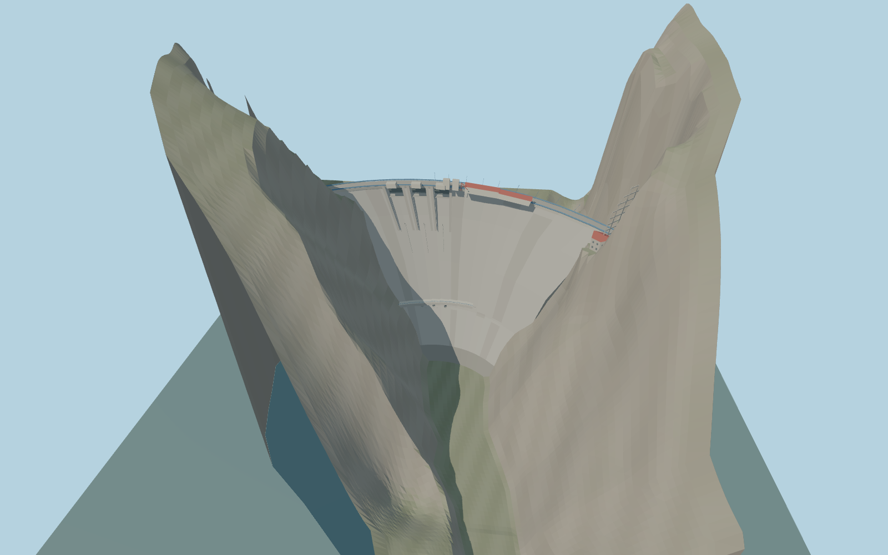

# Mratinje Dam

Mratinje Dam's 220 m double-curvature arch, three crest spillways, five recessed hydraulic outlets, crown road, stepped gallery, two tunnel portals, photographed retaining grid and mapped service house on the fitted Piva gorge.

Rebuild: `node packages/worldgen/scripts/generate-mratinje-dam.mjs`;append `--check` for exact source bytes. Select import/LOD/placement with `--ids=mratinje_dam`. Detailed source and four browser tiers are separate ignored GLB outputs.

The modeled gorge profiles follow the mapped shorelines and ordinary photographs, with approximate cliff angles, abutment contact and tunnel recesses.

The two water surfaces use representative stages sampled from the retained Terrarium field. The gates depict a static dry configuration, with the lowest two outlet mouths below the representative tailwater stage.

The service-house roof, lattice spacing and gallery details are visual reconstructions. Underground machinery, tunnel interiors and operating flows are outside the asset scope.

The mapped path and sampled rock set the bounded west approach. The road heights and cliff bench are visualization estimates. The roadway beyond the join remains in the surrounding native terrain.

Original geometry:repository license. Map:© OpenStreetMap contributors,ODbL-1.0;Protomaps. Standard terrain:terrain-grid.json. Ordinary pictures stay local and are not redistributed or used as textures. Current acceptance:qa.json.
