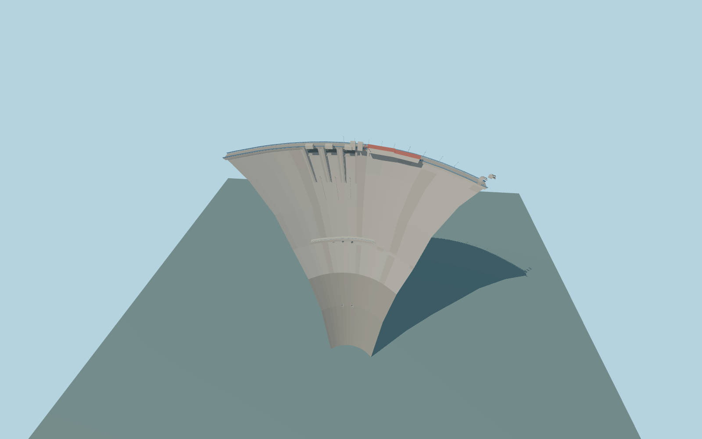

# Mratinje Dam

Mratinje Dam’s 220 m double-curvature arch, three crest spillways, five recessed outlet mouths, crown road, blue rails, red-roof service buildings, inspection gallery and two approach portals.

Rebuild: `node packages/worldgen/scripts/generate-mratinje-dam.mjs`;append `--check` for exact source bytes. Select import/LOD/placement with `--ids=mratinje_dam`. Detailed source and four browser tiers are separate ignored GLB outputs.

The signed vertical origin is 651 m. The crest is fixed at 678 m and the foundation at 458 m. The design fixture uses 675.25 m normal reservoir level and an illustrative 530 m downstream surface.

The open crest road follows its 246.83 m native map line. The arch extends beyond that road segment into its modeled abutments. Section widths, the inspection gallery and portal surrounds are exterior approximations.

The standard Terrarium field places portions of the gorge above the crest and masks much of the native rock fit. The representative stage is 651.65 m upstream and 534.18 m downstream. Full site review is pending.

The recessed gates depict a static dry configuration. Buried waterways, power station interiors and actual flows are outside the exterior model.

Original geometry:repository license. Map:© OpenStreetMap contributors,ODbL-1.0;Protomaps. Standard terrain:terrain-grid.json. Ordinary pictures stay local and are not redistributed or used as textures. Current acceptance:qa.json.
