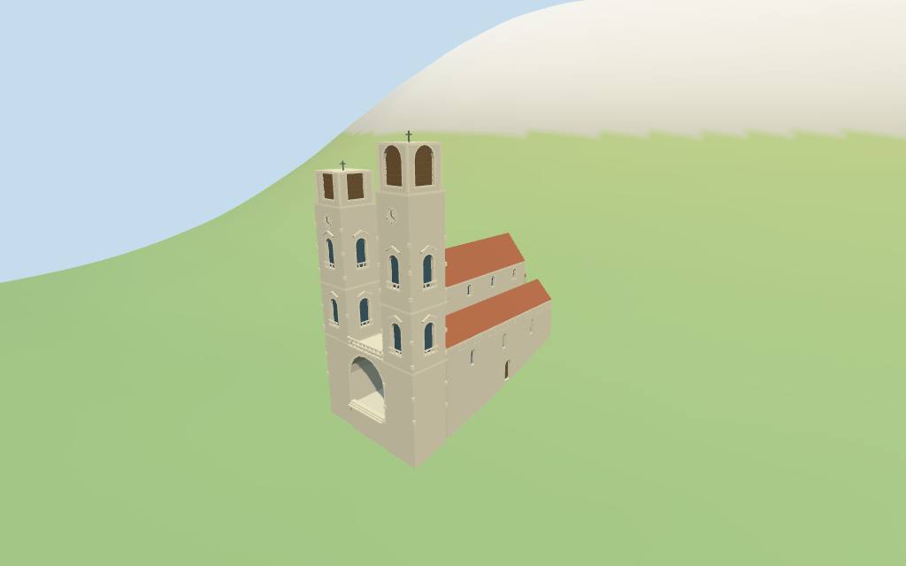

# Kotor Cathedral

Individual medium-fi Kotor Cathedral: unequal square pale limestone west towers, simpler flat north crown and ornate arched south belfry, cornice stages, clocks/window balconies/pediments, central rose and real open vaulted porch beneath balustraded terrace; red-tile-roofed nave/lower aisles and three unequal rounded east apses with blind cornice arcades and recessed lights. Five shared graphs, six material groups and four browser LODs. Adjacent buildings/cafes excluded; detailed profiles and heights above map blocks estimated.

## Evidence and reconstruction

Published dimensions and reconstructed details are separated in spec.json. Primary references:

- [Reference](https://commons.wikimedia.org/wiki/File:Kotor_Cathedral_church.jpg)
- [Reference](https://commons.wikimedia.org/wiki/File:Cattaro,_san_trifone,_ext,_abside_del_xii_sec._01.JPG)
- [Reference](https://commons.wikimedia.org/wiki/File:Cattaro,_san_trifone,_ext,_abside_del_xii_sec._04.JPG)
- [Reference](https://commons.wikimedia.org/wiki/File:Cattaro,_san_trifone,_ext_05.JPG)

Five existing shared 256-square ashlar, raw limestone, ceramic tile, painted metal and plain wood graphs serve six groups including local blue-grey glass. Linear tints, metric UVs and flat normals; no embedded images, unique facade photographs, bespoke textures or baked lighting.

## Model and axes

10,960 triangles; 32,880 vertices; 6 material groups; 1,318,964 bytes. Native bounds: -17.400, -4.039, -9.295 to 16.892, 35.100, 9.288. Source hash: `sha256:4315d2214083c6430a4526a4ee218cb64e7bba441ac2dcd3cbf04fae217a4855`.

{"x":"east toward apses","y":"up","z":"south toward street"}

Standard viewer DEM datum 16.356409 m; selected perimeter -3.69 to 5.16 m. Floor0.5 m; adaptive footings cross Y=0 and extend below retained samples. No ground cutout or flattening. Exact square/street slopes, threshold/step/base contact, east/north adjoining walls, absolute altitude and walking remain unverified.

## Reproduce

Run `node packages/worldgen/scripts/generate-additional-landmarks.mjs --ids=N0405` (or add `--check`). The generator preserves manually edited masters by checking their baseline hashes. Import through the standard authored-model workflow with optimization disabled; then capture all QA cameras, including shared-surface views.

## Pending work

- Exact retained way/165389709 and Q966429 identify Kotor Cathedral / St. Tryphon. Current standard viewer whole 35184537478541 and tower parts 35184579975938 / 35184579975941 supply 20 raw points and properties. Earlier whole/tags retained. Anchor [18.771557132,42.42416531] and heading -0.258079235423 rad unchanged, with no horizontal rescale. Native +X east apses, -X west square/twin towers, +Z south street. Adjacent north/east ranges, east building, square cafes/canopies, surrounding houses and city walls remain host content. Nave/aisle/apse and upper tower profiles are picture estimates constrained by these map controls. The north aisle steps inward at X=5.3 to preserve the separate adjoining range 35184579975960; its roof connection is estimated.
- Current whole height=8 m and both tower-part height=14 m are retained as lower mapped volumes; they are not independent surveys of roof/crown height. Earlier two-level tag retained; no independent dimension/height facts. All extensions above those blocks and detailed profiles are picture estimates above floor 0.5 m: nave eaves14.8/ridge18.9 m, aisles9.5/ridge12.3 m, porch balcony8.3 m, north tower main25.8/top31.1 m and south main28.3/top34.6 m including small crosses. Central apse wall11.8/cap13.1 m and flank apses8.3/cap9.7 m. All openings, cornices, clocks, rose, balcony and steps are estimated or simplified.
- Standard viewer DEM datum 16.356409 m; selected perimeter -3.69 to 5.16 m. Floor0.5 m; adaptive footings cross Y=0 and extend below retained samples. No ground cutout or flattening. Exact square/street slopes, threshold/step/base contact, east/north adjoining walls, absolute altitude and walking remain unverified.
- Individual medium-fi exterior from four inspected exterior/detail pictures and standard viewer PMTiles/DEM. Tower crown/roof heights and detailed partitions are estimates beyond retained map8/14m blocks. Porch is actual open air; windows are recessed blue-grey panes and belfry fields are louver-backed. Balusters, rose spokes, clocks, pediments, blind cornice arcades and stone relief are abstractions. Fine sculpture, faithful carved ornament, interiors/bells, hidden adjoining walls, current finish, engineering, exact lane/square/threshold/base joins and physical phone/laptop timing remain simplified, excluded or unverified. Adjacent buildings, cafes/canopies and town walls remain host content. Mediterranean neighbors are synthetic fixtures.
- Skyline retains unequal square towers, simpler north and arched south crowns, open porch, red basilica roofs and unequal rounded apses. District adds shared surfaces, rose/window rhythm, clocks and balcony. Street adds aisle/clerestory recesses, balusters/pediments/quoins and apse bifora/arcades. Close-up/master add finer curved sampling.

This bundle follows the medium-fi standard. Medium-fi appearance and geographic fit are reviewed separately. Hash-bound visual acceptance is recorded separately after capture inspection.

## Additional geographic data

©OpenStreetMap contributors; Protomaps; Mapzen/USGS terrain tiles.
