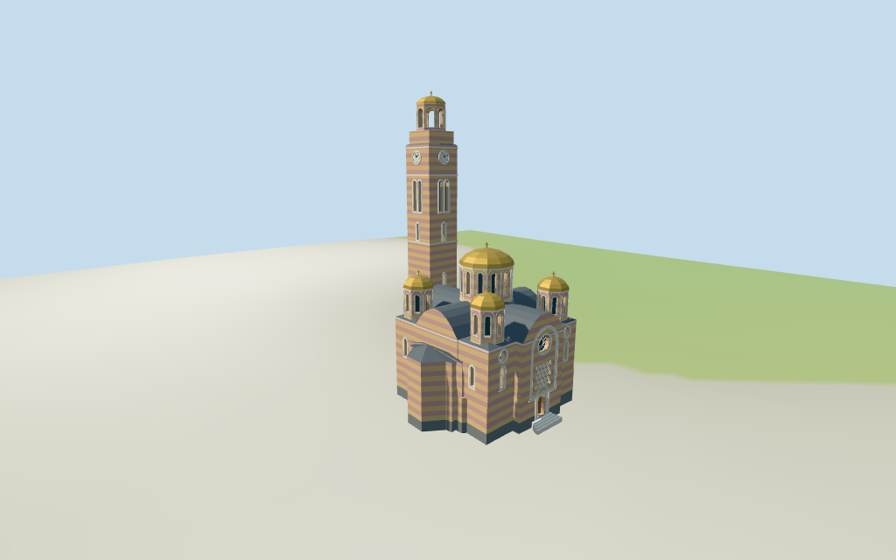

# cathedral_of_christ_the_saviour — Cathedral of Christ the Saviour, Banja Luka

Reviewed 2026-10-15 against current source/runtime bytes. Accepted for medium-fi exterior and approximate horizontal placement. Exact host terrain contact remains unverified.

## Built result

Inspected 11 current portable/source-terrain frames. The individual Banja Luka cathedral has a stepped cross-plan body, four small corner domed drums and a wider central gilded dome. Pink and ochre masonry bands share one graph. Curved side gables carry real recessed wooden portals and rose windows, with sparse white star/diamond relief. A low northwest porch has three recessed doors, a raised curved central roof and shallow steps; a low wing joins the separate tall clock tower. The striped shaft has paired dark louvers, four simple clocks, stepped cornices and a genuinely open upper crown with a small cap/cross. Corrected crown support and filled the raised porch gable after inspecting the first renders. Fine iconography, interlace, exact carved profiles and hidden bays remain simplified estimates.

Medium-fi exterior based on four actually inspected 2018/2019 Commons exterior/detail pictures and standard viewer PMTiles/DEM. No bespoke plans/surveys researched or reference photos redistributed. Authored identity features are the five gilded domes, alternating stone colors, curved side gable/rose/portal relief, low northwest porch/link and separate tall clock tower with paired louvers, clocks and open upper crown. Fine icons are not copied as facade textures. Hidden southwest/rear fenestration, current finish, exact proportions, band/stone pitch, mosaic/interlace/lettering, bells, engineering and full interiors are simplified or excluded. Main/tower height datums and crown openness are picture interpretations. Temporary awning/signage and independent city buildings remain excluded. Ground joins and physical-device measurements remain pending.

## Shared surfaces, placement and levels

Inspected 11 current shared/geographic frames. Five existing cached 256-square ashlar, marble, standing-seam metal, cast bronze and plain wood graphs serve seven merged groups; skyline is one draw. Ochre/pink bands reuse the same masonry texture maps and draw. Neutral bronze is tinted gold; glazing, clock hands and small accents use geometric PBR colors. Metric UVs, linear tints and flat architectural normals; no embedded images, unique facade maps, photographic icons or baked lighting. Actual texture presence, one read per graph and geometry unload pass, leaving zero live model geometries. Close details show stone courses, metal seams, dome facets, portal/rose recesses, geometric tracery, louvers and the open crown. Native and signed geographic top views agree with both map controls. Flat placement ground does not establish actual host terrain contact.

Retained exact-QID way/1287023880, Q135271 and multilingual identity match current whole 35185659112712. Its 32 current vertices plus four vertices of associated tower 35185837450814 retain all 36 raw vertices/tags, without rescale; earlier 48 distinct whole vertices and empty dimension facts remain intact. Main height22.37m and tower height44.95m are retained verbatim, interpreted as highest respective crosses above an estimated 0.8m floor; their original height datum is unverified. Anchor[17.191717162,44.772231084], heading0.921711846857rad: +X northeast ornate side, +Z southeast apse, -Z northwest entrance, tower at[-16.72,-8.59]. Tower association is positional/visual, not another exact-QID claim. Internal nave/cross/corner partitions, dome centers and stage profiles are picture estimates. Low porch hip roof5.4m has a raised central curved gable6.05m; main roofs14.6m, central drum14..19.4m/cap21.65m/cross22.37m, satellites18.35m tips, tower44.95m tip. Forty-two actual viewer-footprint checks cover both controls while retaining three neighbors and east/west courts across six outputs. DEM datum166.450042m, raw perimeter-0.23..0.19m. Footings crossY=0 and extend below samples. Exact plaza/street/door joins, base clipping, absolute altitude and walking remain unverified. No flattening, host DEM change or road replacement.

Inspected 27 current Earth-lighting frames: Economy/High, noon/late, three distances, texture-free silhouette, six details, four matched whole LODs and four transitions. Skyline preserves five domes, curved massing, separate tall clock tower and an open four-post crown at 792 triangles. District adds shared materials, average masonry color, flat window/rose fields and real door recesses at 3931 triangles. Street adds actual window/rose/louver recesses, sparse tracery/diamond motifs and 1.36m masonry band spacing at 15837 triangles. Closeup/master refine 0.68m bands, nested trim, tracery and volumetric louvers at 37632 triangles. Different band pitch and averaged distant color are intentional LOD simplifications; transitions were inspected. The matched whole views contain the complete 45.75m local tower tip above an estimated 0.8m floor. Generic detail views deliberately crop other sections. Synthetic cottages/coarse terrain are review fixtures; physical phone/laptop timings remain pending.

## Browser budgets

| Level | Triangles | Bytes | Draws |
| --- | ---: | ---: | ---: |
| skyline | 792 | 82460 | 1 |
| district | 3931 | 347564 | 7 |
| street | 15837 | 1343344 | 7 |
| closeup | 37632 | 3236020 | 7 |

Initial skyline plus district: **430024 bytes** of geometry. Master: **4519980 bytes / 37632 triangles**. Five shared 256-square graphs; zero embedded images. Bytes exclude graph definitions/texture generation. Split POSITION/NORMAL streams, equal CPU/GPU totals. Physical-device timing pending.

## Verification

- Targeted byte reproduction and current source/import/LOD/input/report bindings; source/recipe inventory/schema.
- Six Khronos validations: zero errors/warnings/images; all four LOD budgets pass.
- Exact-QID whole, 36 current raw vertices, original tags/heights/facts and standard DEM match.
- **1419 actual geometry probes** and **42 actual viewer-footprint checks** pass.
- Shared texture read-once/unload and hash-bound geographic/medium-fi checks pass.
- Scene validation and 30-tick simulation: sha256:e311db1440eeafcb2b5343ec0bdb0216cac3a89174cc4534642341e1fbeb58ca.
- Inspected **49 current frames** after crown/porch corrections:11portable,11shared/geographic,27medium-fi. Bulk captures remain ignored.

Source hash: sha256:6f967a329c598d2e26fa2fa2fb8ba57ccd7417fa1825589f3a1ff3a4e44c8df8. Runtime hash: sha256:5fb56d9f40c42bdd620d06c1a8d5375d49a4c78d6ba5f39b722232438a12d98e. Input hash: sha256:86f05661131faa26900658f70a37e0bbb2b850197cd5613e096f5c72fc11e487.

Commands: targeted generate/import/LOD/register-landmark-previews --ids=cathedral_of_christ_the_saviour; generate-additional-landmarks.mjs --ids=cathedral_of_christ_the_saviour --check; capture-structure-models.mjs --ids=cathedral_of_christ_the_saviour --reflections --antialias --fit-shadows; capture-landmark-library.mjs --ids=cathedral_of_christ_the_saviour --reflections --adaptive-clipping --bounded-placement; capture-medium-fi.mjs --ids=cathedral_of_christ_the_saviour --reflections; molen validate; molen sim run --ticks30 --hash. Next routine full source checkpoint: dubrovnik_cathedral–armenian_cathedral_of_the_holy_cross.

## Limits

- Retained exact-QID way/1287023880/Q135271 matches current whole35185659112712. Current32 whole vertices plus4 separate associated tower35185837450814 vertices retain all36 raw vertices/tags;earlier48 distinct whole vertices and multilingual identity remain intact. Main height22.37m and separate tower height44.95m retained verbatim;no Wikidata height/width/length facts. Retained heading0.921711846857rad:Native+Z southeast apse,-Z northwest low entrance,+X northeast ornate side,clock tower at[-16.72,-8.59] signs the frame. No rescale. Low link in main outline joins the separate tower;main control height interpreted as highest central cross22.37m,tower control as highest tower cross44.95m,above estimated0.8m floor (height datum is unverified). Main wall11.5m/curved cross roofs14.6m,central12-sided drum14..19.4m/cap21.65m/cross22.37m,four smaller drums11.0..16.0m/caps17.7m/cross18.35m,porch/link4.2..5.4m are picture estimates. Tower shaft stages9/20/31m,clocks34m,curved crown37.2m,estimated open octagonal upper stage38.4..42.7m/cap44.2m/cross44.95m. Hidden rear fenestration,exact dome/roof profiles,facade bays,bells and thresholds remain estimated.
- Standard viewer DEM datum166.450042m;estimated floor0.8m,raw whole/tower perimeter-0.23..0.19m. Footings crossY=0 and extend below raw samples;porch and side landings/steps approximate. No preview flattening,host DEM change or road replacement. Exact plaza/street/door contact,base clipping,absolute altitude and walking remain unverified. Other city buildings/roads/trees/street furniture remain host content.
- Medium-fi exterior from four actually inspected2018/2019 exterior/porch/carving/tower photographs and standard viewer PMTiles/DEM only. No bespoke plans/surveys. Exact current finish,hidden southwest/rear rhythm,icons/interlace/inscriptions/bells,full interiors and engineering sections simplified or excluded. Upper bell-crown openness and height datums are picture interpretations. Other city buildings and temporary awning/signage excluded. Physical laptop/phone timing pending.
- Skyline preserves five domes,curved cross massing,separate clock tower and open upper crown. District adds shared textures,mean masonry color,flat window/rose fields and genuine door recesses. Street adds real window/rose/louver recesses,sparse geometric tracery/diamond relief and broad masonry bands. Closeup/master refine band pitch,nested trim,tracery/louvers. Synthetic cottages are fixtures.

Readiness accepts this exterior/approximate horizontal scope. The 1,000-candidate goal remains incomplete.
