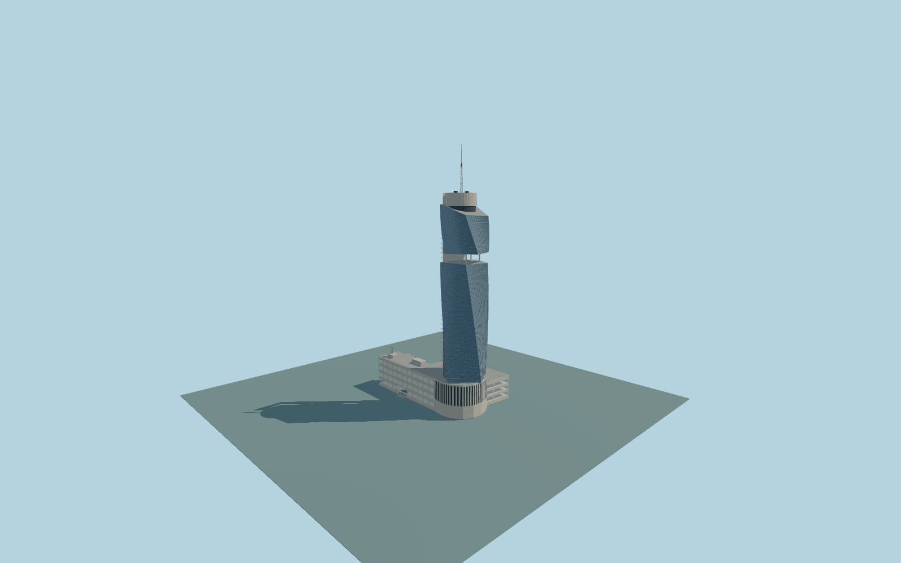

# Avaz Twist Tower

Complete original Avaz exterior:western142m straightpale recessedcore beside two twisted/facetedblueglass lobes,physical99–105m column-supported gap,roundedroofcrown andseparate172m antenna. Whole23m lowparent andoriginal18m attachedgarage preserveactualopenparking slots,roofdeck/plant andapproximateforecourtcanopy/recess.

Rebuild originalsource with `node packages/worldgen/scripts/generate-avaz-twist.mjs`;append `--check` for exactbytes. Import/LOD select `--ids=avaz_twist_tower`. GLBs areignoredoutputs. Detailedmaster plusfour shared-material browsertiers. RetainedQ790278 wholelowparent andactualwestern142m towerpart establishplacement;separate172m antenna. Wholeparent isnot a142m extrusion.

Three ordinaryphotographs guidetwistedglass/straightcore/open-gap/garage reconstruction. Native545m datum,original18m attachedparkingextensionheight andallcurb/entry/floor/accessibility levels areapproximate,not surveyed;attachedparking ownership/fineinventory isphoto-context reconstruction. No new/private/embeddedtextures orbranding/photoshadows/reflections. Fullscope/limits:model-brief.json andqa.json.

Originalgeometry usesrepositorylicense. Map:© OpenStreetMap contributors,ODbL-1.0;Protomaps. Terrain attribution/hashes:terrain-grid.json. Linkedmanufacturerphotographs arereferenceonly,not redistributed orusedastextures.
