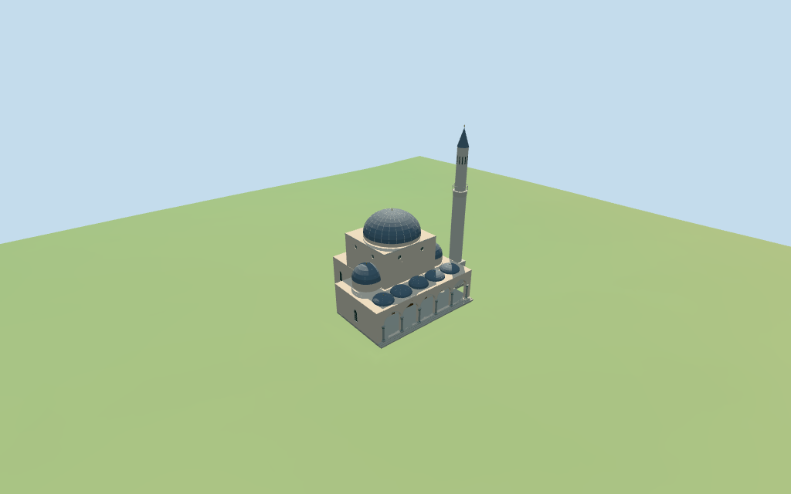

# gazi_husrev_beg_mosque — Gazi Husrev-beg Mosque

Reviewed 2026-10-18 for its declared medium-fi exterior and approximate geographic fit. Mapped part heights are retained with an unspecified datum; facing, roof transitions, portal and treads remain estimates.

## Exterior and shared materials

Inspected 11 current portable views, including the retained 1024×640 summary, and one supplemental ground-level porch view. The retained stepped cream envelope supports a tall central dome, two side domes and a partly occluded rear dome. Five small domes sit above the open pointed porch with gray stone columns, green collars, timber backing fields and an original coarse blue-gray portal surround with three canopy tiers. Three shallow treads meet the gallery. A slender minaret has an open balcony and gray conical cap. The gallery floor can read as a band in oblique views; full-depth low probes reach its backing doors without an intervening wall. The porch ceiling is a flat underside abstraction, not a reconstruction of decorated vaults. Historic artwork, inscriptions, furnished interiors, adjacent fountain/tombs and engineering are omitted.

Inspected 11 current shared-material/geographic views including the placement overlay. Six existing 256² graphs supply lime plaster, coursed limestone, weathered paving, standing-seam metal, bronze and plain wood; seven merged roles include local opaque glazing and colored column/portal accents. Metric UVs and linear tints; no embedded images or unique atlas. Each shared graph is read once and eviction disposes the model geometry. Precise building subtraction follows the union of the named compound and 17 associated parts, including small roof-edge slivers. All 200 independent nearby building records remain, including separate tombs; the fountain POI is excluded. Two ground masks cover the retained envelope and estimated tread apron. The flat overlay establishes approximate pose/replacement, not surveyed terrain contact.

## Browser levels

| Level | Triangles | Bytes | Draws |
| --- | ---: | ---: | ---: |
| skyline | 826 | 77384 | 1 |
| district | 2080 | 194468 | 7 |
| street | 5720 | 552512 | 7 |
| closeup | 7118 | 694028 | 7 |

**271,852 bytes for initial skyline plus district**, plus six existing shared 256² graphs. Seven merged roles; no embedded images.

Inspected 27 current medium-fi views: Economy/High, noon/late light, street/block/skyline, silhouette, six details, four matched LODs and four transitions. All levels retain the domed stepped mass, five-bay porch and slender minaret. Skyline has coarse dome facets and simple porch openings; district adds columns, portal bands and window fields; street/closeup refine ribs, grids, canopy and curves. Whole-model cameras retain the complete minaret; detail views intentionally crop other sections. Synthetic apartments and terrain are illustrative. Physical laptop/phone/tablet and full-city performance remain unmeasured.

## Placement and limits

Retained Q1255835 way/609903435 preserves anchor,undirected heading,16 exterior vertices,original tags and empty dimensional facts. Current ordinary PMTiles has a named12-vertex compound plus17 height-tagged parts for hall,porch/side/rear roofs and minaret stages. Their raw geometry and tags are retained. The five mapped porch cupolas establish the northern porch rhythm;the western projection and mapped tower stages establish the minaret base. Signed facade bearing and roof transitions are reviewed approximations from pictures and ordinary map parts. Standard Protomaps20261014 and Mapzen/USGS viewer extractN0484;datum 550.3027496728663 m. 403 occupied samples range -0.30135438233412515 to 0.3688173920952522 m;floor 0.36622681375433785 m is the median of 112 compound/tread edge samples plus0.25 m. Footings follow sampled grade;the review fixture seats the compound and estimated1.5 m front tread apron with a3 m margin. Adjacent fountain,tombs and other buildings remain separate. Finished ground levels,stairs,thresholds,drainage and structural foundations are not surveyed. Independently reproduced all 16 retained outline vertices and 186 current control vertices, one named compound point, original tags and empty dimensional facts. All 17 current part heights and balcony min_height are retained; their datum remains unspecified. All 1,308 placement/host-area checks and 777 FrontSide probes pass for opaque fields/doors, open porch passages and continuous gallery, ceilings/floors, visible main/side/porch shells and finials, rear visible shell, open minaret balcony/floor/tip and envelope/tower/tread foundations. The rear dome finial is obscured by the taller hall and is not claimed as visibly tested. Standard DEM reproduces 403 occupied samples, 112 edge samples, 239 seated fixture points and the 16-bit heightmap. Finished grades and foundations remain approximate.

Individual Gazi Husrev-beg Mosque exterior: retained stepped plaster/stone envelope,tall domed central hall,rear and two side domes,five-cupola open pointed porch with stone columns and green collars,opaque windows and timber doors,an original coarse blue-gray portal surround with stepped canopy,three shallow front treads,and a slender stone minaret with open balcony and gray conical cap. Adjacent fountain,tombs,clock tower,bazaar,trees,fences,people,furniture,inscriptions,historic decorative art,furnished interiors and engineering are excluded. Current parts retain heights8,9,9.5,10.5,11,15,17,19,26,29,31 and47 m;the balcony part also retains min_height28 m. The model applies these as approximate part tops above the local floor;the map gives no survey datum. Main hall19 m,main dome shell26 m,minaret finial47 m,side/rear shells15/17 m and porch shells10.5/11 m follow those tags. Inferred main/side/rear dome spring levels20/11.2/11.5 m,balcony floor29.5 m,cone spring41.3 m and small roof finial extensions are visual estimates. Porch arches,columns,portal pattern,small windows and three shallow treads are original coarse reconstructions;exact thresholds,dimensions and current condition are unverified. Retained exact identity/axis and current compound/part geometry support approximate visualization. Two porch/minaret pictures and one supplemental portal close-up guide architectural vocabulary. Signed facing, spring levels, dome profiles, columns, facade rhythm, portal proportions, coarse canopy, treads and complete current condition remain estimates. Fine historic artwork, inscriptions, navigable/furnished interiors, surveyed ground and engineering are unverified or omitted.

## Verification

49 current views inspected; 777 FrontSide probes; 1308 placement/host-area checks; six zero-error/zero-warning Khronos validations. Model/source/input/material/capture/placement hashes agree. Raw map compound/part controls and 16-bit terrain fixture reproduce. Source/placement checks, scene validate/sim30, selected LOD layout and Biome pass. Bulk captures stay ignored.

Source: sha256:bb7c4f7ed8ec06625e97afc5ac726e62ad75d593f2837c5d3654023a09287b09

Runtime: sha256:c6a2c31bf0b68c1321c885936b84d0e53cffaf1be86eabc1c21b50f867984f2f

Input: sha256:f6c1e9eeb5f4112ecb7d17c268fe0140d8b9d7ba13e5242d9e443bcb9ed9d7f7

Commands: targeted generate-additional-landmarks/import-structure-models/generate-landmark-lods/register-landmark-previews --ids=gazi_husrev_beg_mosque; source/placement --check; capture-structure-models --reflections --antialias --fit-shadows; capture-landmark-library --reflections --adaptive-clipping --bounded-placement; capture-medium-fi --ids=gazi_husrev_beg_mosque --reflections; scene validate/sim30; selected LOD layout; Biome. Existing builds reused.

## Inspected picture references

[CeeGee — 2015-09-19](https://commons.wikimedia.org/wiki/File:GaziHusrev-begMosqueSarajevo.JPG). CC-BY-SA-4.0. Inspected960×616 porch exterior:cream plaster,stone pointed arches,gray columns with molded bases/caps and green collars,lead-gray porch domes,tall opaque side glazing,and shallow front treads. Trees hide some roof/minaret portions.

[Yann Forget — 2017-10](https://commons.wikimedia.org/wiki/File:Mosqu%C3%A9e_Gazi_Husrev-beg_de_Sarajevo,_Bosnie.jpg). CC-BY-SA-3.0 (also offered under other CC-BY-SA versions). Inspected960×1449 portal detail. It shows dark timber double doors beneath a pale stone opening,blue-gray rectangular painted surround and a projecting stepped canopy. Used only for original coarse portal vocabulary;no inscriptions,arabesques or historic art are copied. It does not show the full exterior.

[Panassko — 2020-09-02](https://commons.wikimedia.org/wiki/File:Begova_d%C5%BEamija.jpg). CC-BY-SA-4.0. Inspected960×1280 wider porch view:five pointed bays,gray columns with green bands,cream wall backing and dark doors,front steps,and a slender coursed minaret with an open pale balcony and gray conical cap above the roof. A third image was needed because the preceding supposed wide view was a portal close-up. Trees and crop prevent a complete measured elevation;map parts control roof roles/heights.
