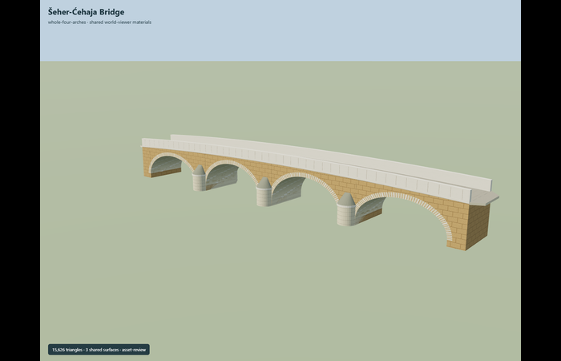
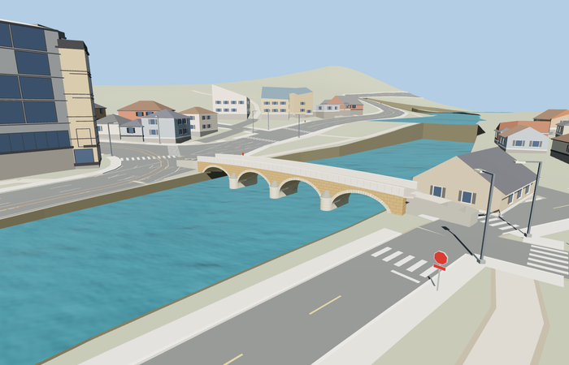

# Šeher-Ćehaja Bridge

Reviewed2026-10-29. **Complete medium-fi static exterior and approximate native placement.**

Inspected65 current frames:9 portable,8 shared-material local-stage,25 medium-fi context/LOD and23 native views. Four clear arch barrels, all three downstream rounded and upstream pointed cutwaters/caps, continuous warm spandrels, radial pale voussoirs, crowned paving and solid pale parapets are complete. Focused rays exposed and corrected missing upstream noses during this same authoring pass; dedicated upstream master/closeup views confirm the correction. Short tapering mouth wings close the narrower oblique path joins.

Three existing256px graphs: coursed stone_limestone on unmodeled wall courses, continuous stone_limestone_raw on modeled arch/pier/parapet details, stone_granite on paving. Metric UVs and linear sRGB-derived vertex colors; no private/embedded image. Each graph loads once per model library and all model/support geometries dispose. Local-source/shared/context stages useY0; the separate native fixture exercises actual absolute placement and water.

| Level | Triangles | Bytes | Draws |
| --- | ---: | ---: | ---: |
| skyline | 816 | 64604 | 1 |
| district | 2328 | 175656 | 3 |
| street | 5082 | 394580 | 3 |
| closeup | 9362 | 718936 | 3 |

Detailed source 15626 triangles,1877608 bytes. Browser triangles 816 / 2328 / 5082 / 9362, bytes 64604 / 175656 / 394580 / 718936, draws 1 / 3 / 3 / 3. Initial skyline+district 240260bytes. Levels meet1000/4000/16000/64000 targets and use separate GPU position/normal streams. Coarse curves and joints aggregate with distance; no physical device timing claim.

Exact-QID cached way189835884 and current named PMTiles crossing35184561924716 agree within0.09m. Retained anchor[18.43405085,43.85875635], heading-1.346660665598: +X south-southeast/Alifakovac, -X north-northwest/City Hall, +Z downstream/west-southwest.40.772m is the mapped centerline length. Width4.70m and vertical sections are photo reconstruction; geographic origin547.4136352539062m follows this standard native water plane, not a surveyed bridge datum.

At every loaded native tier, six mapped path-mouth samples meet actual bridge paving within 0.034212m; all six end-width samples retain model support. Original67 building records,89 independent road records, raw road inputs, DEM, displayed ground and water remain. Only the named bridge record is removed on successful load (92to91 roads); both directly connected paths are clipped/graded. Failed loading retains all92 roads. Unload releases all model/support geometries and retains ground/water. No ground/building cutouts or model distortion. Coarse bank grading, automatic retaining faces and reconstructed approach slopes remain visible approximations; surrounding City Hall and houses are generic map context.

## Reconstruction limits

- Original continuous exterior reconstruction from ordinary photos and PMTiles. The40.772m exact-QID cached crossing axis matches current named PMTiles line35184561924716 within0.09m across its endpoints; this establishes placement, not a surveyed structural length.
- Width4.70m, elliptical arch heights,1.70m piers, paving joints and cutwater sections are explicit photo-based reconstruction controls. Four visible arches and three projecting piers are complete; a historically buried fifth arch, interiors, separate river weir, retaining quays, buildings, graffiti and temporary boards are not modeled.
- The native water plane and coarse terrain come from the ordinary viewer PMTiles/Mapzen pipeline. Their vertical fit and automatically graded footpath connections are approximate visualization, not a surveyed channel datum or navigable accessibility grade. Short0.95m tapering paving wings join the narrower oblique path mouths.
- Skyline has six arch segments, coarse nose facets and continuous parapets; district has twelve and coarse parapet joints; street restores twenty-four and barrel/paving joints; closeup has forty. The detailed source has sixty-four segments and denser barrel joints. All levels retain complete four-span geometry, all three noses, pale parapets and continuous paving.
- Shared256px limestone/limestone-raw/granite graphs only; portable GLBs contain no embedded image. Physical laptop/phone timing is unmeasured.
- Upstream pointed-nose profile is a plausible reconstruction; inspected ordinary references establish the downstream rounded noses, not a survey of the opposite pier face. Native sidewalk/road grades, parapet/paving sections and low-frequency stone courses are approximate. Generic neighboring context is not approved as unique landmark geometry. Native-fit.json and integration-review.json retain pre-review generation controls; current acceptance and hash-bound captures are in qa.json and placement-report.json.
