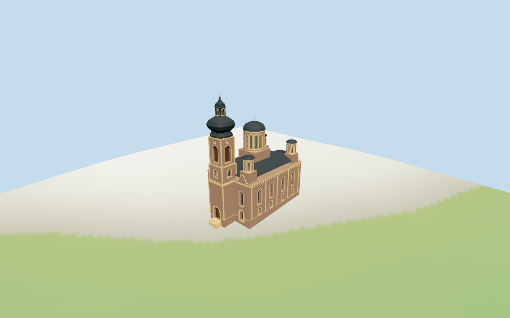

# serbian_orthodox_cathedral_in_sarajevo — Serbian Orthodox Cathedral in Sarajevo review

Reviewed2026-10-15 against current source/runtime bytes.Accepted for medium-fi exterior and approximate horizontal placement. **Exact runtime ground contact remains unverified.**

## Built result

Inspected11 current portable/source-terrain frames. Individual Sarajevo Orthodox Cathedral has a rose-brown articulated plaster body,cream pilasters/cornices and round-headed window/portal fields. A single projecting western square bell tower carries recessed dark louvers,circular clocks,pediments,a rounded-square swelling sheet-metal roof,dark small louvered lantern,upper onion and gold cross. The broader central windowed drum/dome and four smaller corner windowed drums/domes rise over a dark hip roof. Three eastern rounded apses have shallow dark caps. Curved shoulder gables face the front/rear,with approximate connected entry landing/stairs. Corrected an initially angular tower bulb,light-colored cap lantern and sideways shoulder gables. Hidden bays,fine iconography and exact roof profiles remain approximate.

Medium-fi exterior from four actually inspected Commons pictures:2006 front byChristian Bickel,2011 front/side byMilan Suvajac,2023 snowy front/side byNiegodzisie and2019 telephoto roof detail byBernard Gagnon,plus standard viewer PMTiles/DEM. No bespoke plans/surveys researched or photographs redistributed. Single Baroque bell tower,five dome/drum controls,round-headed plaster facade and lobed apse are individually authored. Raw height/min_height controls are preserved with explicitly estimated floor/profile interpretations. Hidden side/rear bay rhythm,precise drum/facade profiles,plaster tone,sculpture/ornament and threshold joins remain approximate. Interiors and fine iconography/inscriptions excluded;nearby gardens/trees/fences/buildings remain host content. Exact terrain contact and physical-device measurements remain pending.

## Shared materials and placement

Inspected11 current shared/geographic frames. Four existing cached256-square lime plaster,continuous limestone,standing-seam metal and plain-wood graphs serve six merged groups;skyline is one draw. Metric UVs,linear rose/cream/dark-metal tints and flat architectural normals. Glass,clock hands and gold crosses use local PBR colors;no embedded images,bespoke facade maps or baked shadows. Each graph reads once and unloading leaves zero live model geometries. Detail views show recessed round-headed fields,timber doors,louver rows,geometric grilles,clocks,roof ribs,pilasters and cornice brackets. Signed top placement agrees with mapped western bell projection/eastern lobed apse. Flat geographic ground does not verify retained DEM/threshold contact. Detail cameras intentionally crop other sections.

Retained exact-QID way/157329998,Q1271286,matches current whole35184529418830. Anchor[18.425198099,43.858218828],heading0.265486248946rad. Native-X west-southwest projecting square entrance/bell tower and+X east-northeast three-lobe apse sign the frame. Whole25 distinct vertices versus earlier25/closing-point control;whole/35 components reproduce247 current vertices,tags,heights and min_height values rigidly without rescaling. Whole height15.5m,tower tip45.62m,central dome34m/cross35.86m,four satellite domes25m/crosses25.95m and intermediate roof/stage controls are preserved verbatim. Overlapping mapped parts are not a vertical survey;floor and cap-stage interpretations remain approximate. Original multilingual identity and empty Wikidata height/width/length arrays retained.246 current viewer footprint checks cover36 controls while retaining four neighboring buildings/front garden across six outputs. Standard DEM datum552.646207m,estimated floor0.6m,raw whole perimeter-1.63..1.46m. Footings crossY=0 and extend below raw samples. Exact garden/street/door joins,base clipping,absolute altitude and walking remain unverified;no preview flattening,host terrain changes or road replacement.

Inspected27 current Earth-lighting frames:Economy/High,noon/late,three distances,texture-free silhouette,six details,four matched whole LODs and four transitions. Skyline preserves single tall bell tower,five domed drums,low hip roof and eastern apses at909 triangles. District adds shared surfaces,flat fields/clocks/cornices,curved shoulders and genuinely recessed doors at2427 triangles. Street adds actual recessed body/central-drum/louver fields,pilasters,pediments and roof ribs at15162 triangles;the smaller satellite windows remain flat at this distance to meet the16k ceiling. Closeup/master add actual satellite recesses,finer grilles/louvers and roof facets at41753 triangles. Whole matched LODs include the complete46.22m local tip above the0.6m estimated floor. Synthetic cottages/coarse terrain are fixtures;physical phone/laptop timing remains pending.

## Browser budgets

| Level | Triangles | Bytes | Draws |
| --- | ---: | ---: | ---: |
| skyline | 909 | 94552 | 1 |
| district | 2427 | 238348 | 6 |
| street | 15162 | 1452568 | 6 |
| closeup | 41753 | 3896604 | 6 |

Initial skyline plus district: **332900 bytes** of geometry.Master: **5014056 bytes / 41753 triangles**.Four existing shared256-square graphs,zero embedded images.Bytes exclude graph definitions/texture generation.Split POSITION/NORMAL streams have equal CPU/GPU totals.Physical-device timing pending.

## Verification

- Targeted byte reproduction and current source/import/LOD/input/report bindings;source/recipe inventory/schema match.
- Six Khronos validations:zero errors/warnings/images.Four browser budgets pass.
-247 whole/component vertices/tags,original exact identity/empty dimension arrays,height/min_height controls and standard DEM match.
- **1308 imported geometry probes** and **246 current viewer footprint checks** pass.
- Shared graph read-once/unload and hash-bound geographic/medium-fi reviews pass.
- Scene validation and30-tick simulation:sha256:33bf59bfdd0b8dfcb10fcbcf498335f1f44db25a88451645c07046175f1e2b55.
- Actually inspected **49 current frames**:11 portable/source-terrain,11 shared/placement,27 medium-fi.Cameras/paths/hashes retained;bulk captures ignored.

Source hash:sha256:b0c93d84f19eacc394219edf6fb05a9b046d37adf52af823235005219b1335d7.Runtime hash:sha256:82a11425a3d6d839337930fffa871cc398bf783299b734313773f44d26863c97.Input hash:sha256:5d23451ea3536a546410e7ae580f7d46737b27993fed76144de0d5fc3aacfec2.

Commands:targeted generate/import/LOD/register-landmark-previews --ids=serbian_orthodox_cathedral_in_sarajevo;generate-additional-landmarks.mjs --ids=serbian_orthodox_cathedral_in_sarajevo --check;capture-structure-models.mjs --ids=serbian_orthodox_cathedral_in_sarajevo --reflections --antialias --fit-shadows;capture-landmark-library.mjs --ids=serbian_orthodox_cathedral_in_sarajevo --reflections --adaptive-clipping --bounded-placement;capture-medium-fi.mjs --ids=serbian_orthodox_cathedral_in_sarajevo --reflections;molen validate;molen sim run --ticks30 --hash.Next routine full source checkpoint dubrovnik_cathedral–armenian_cathedral_of_the_holy_cross.

## Limits

- Retained exact-QID way/157329998/Q1271286 matches current whole35184529418830. Its25 distinct vertices match the earlier25-vertex/closing-point control approximately after tile quantization. Current whole and35 component controls retain all247 current vertices, heights and min_height tags rigidly with no rescale. Whole wall height15.5m; roof16.73/21.32m; tower base15.39m, middle21.64m, belfry30.86/32.11m, overlapping decorative/roof controls34.3..45.62m; central plinth22.94m/dome34m/cross35.86m; four satellites plinth19.25m/dome25m/cross25.95m; three apses16.3/17.79m all retained verbatim. Some overlapping mapped parts lack min_height; the mapping is not a vertical survey. The estimated stage/roof profiles interpret overall cap levels above a0.6m estimated floor; tower tip45.62m, central tip35.86m and satellite tips25.95m preserve highest controls. There are no retained Wikidata height/width/length facts. Native-X west-southwest projecting square entrance/bell tower and+X east-northeast three-lobe apse sign retained heading0.265486248946rad. Window rhythm, exact drum shapes, eaves, roof curves, portal depth and ornament are picture estimates, not surveyed architecture.
- Standard viewer DEM datum552.646207m; estimated floor0.6m, raw whole perimeter-1.63..1.46m. Retained coarse urban DEM is not a floor survey. Footings crossY=0 and extend below raw terrain; local front landing/stairs are approximate. No source preview flattening or host DEM change. Runtime foundation exposure/base clipping, exact garden/street/door contact, absolute altitude and walking remain unverified. No road replacement.
- Medium-fi exterior from four actually inspected2006/2011/2019/2023 exterior photographs and standard viewer PMTiles/DEM. Whole/component controls retained; hidden side/rear window rhythm,internal eaves/stages,curved roof profiles,plaster tone,small grille details and shoulders are approximate. No bespoke plans/surveys researched or photographs redistributed. Fine iconography,inscriptions,sculpture and interiors are simplified or excluded. Nearby buildings,garden fence/trees and actual street surfaces remain host content. Physical phone/laptop timing pending.
- Skyline preserves the projecting single tall bell tower and five domed drums with simplified profiles. District adds shared surfaces,flat framed fields,clocks/cornices and deep door recesses. Street adds actual recessed round-headed window/louver fields,pilasters,roof ribs and pediments. Closeup/master refine glazing grilles,roof facets and louver rows. Synthetic cottages are fixtures.

Readiness accepts the reviewed exterior/approximate horizontal-placement scope.Exact terrain contact and mapped height datum remain unverified.The full1000-candidate goal remains incomplete.
